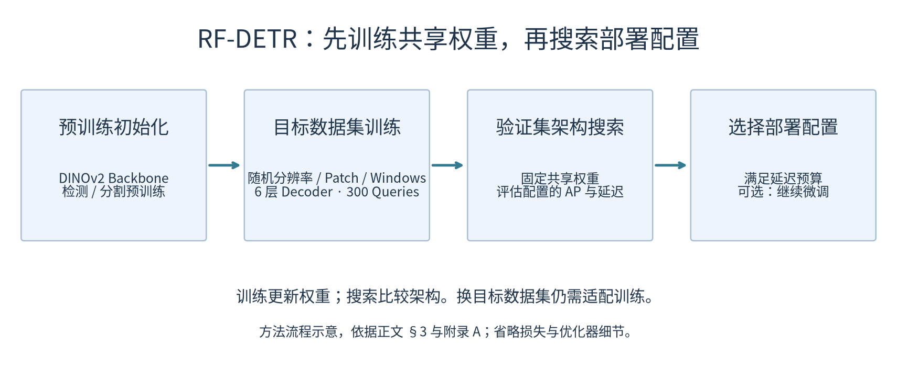
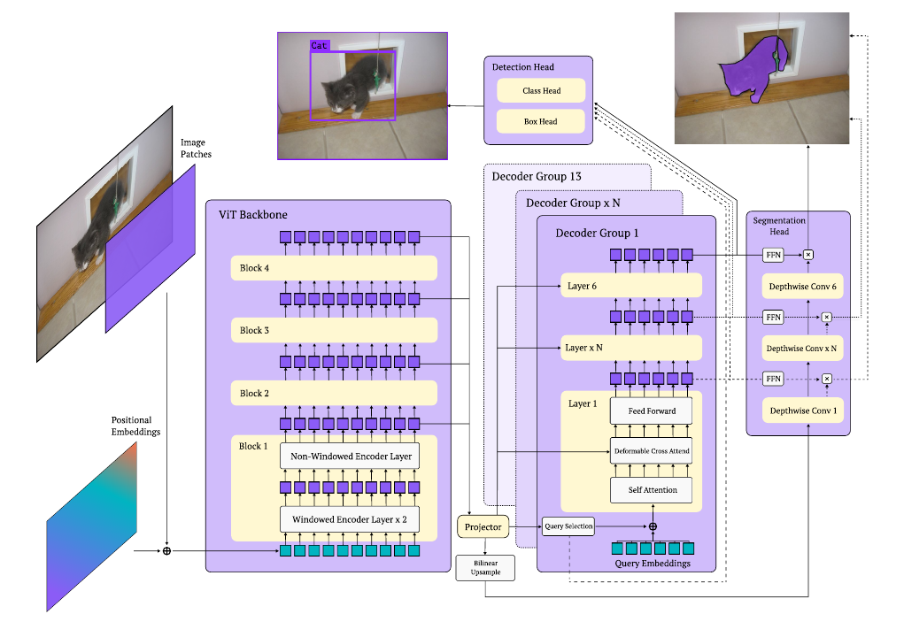
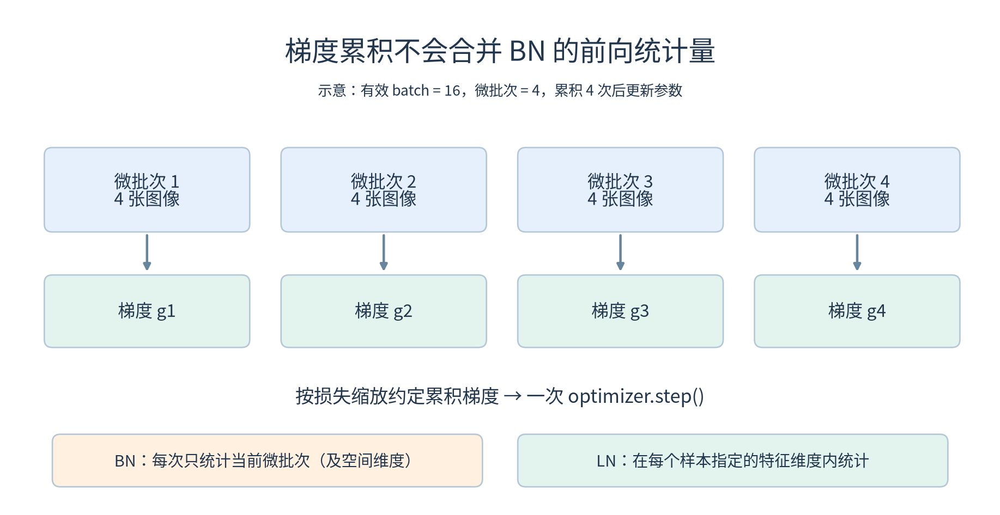
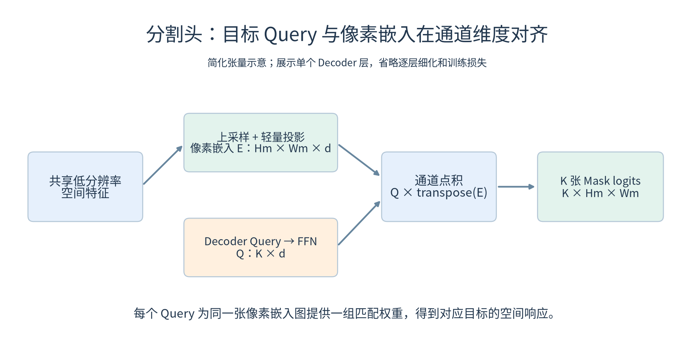
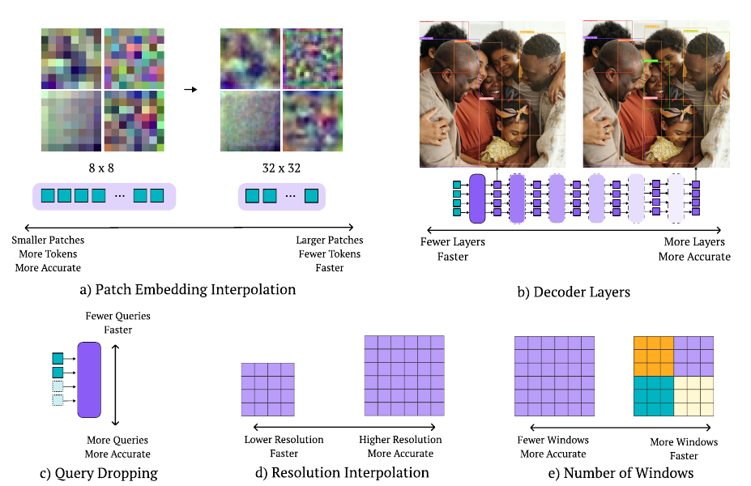
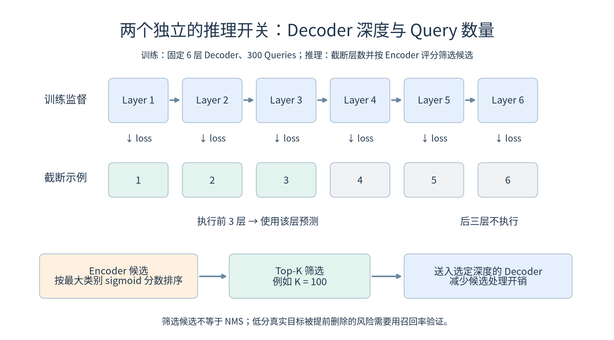
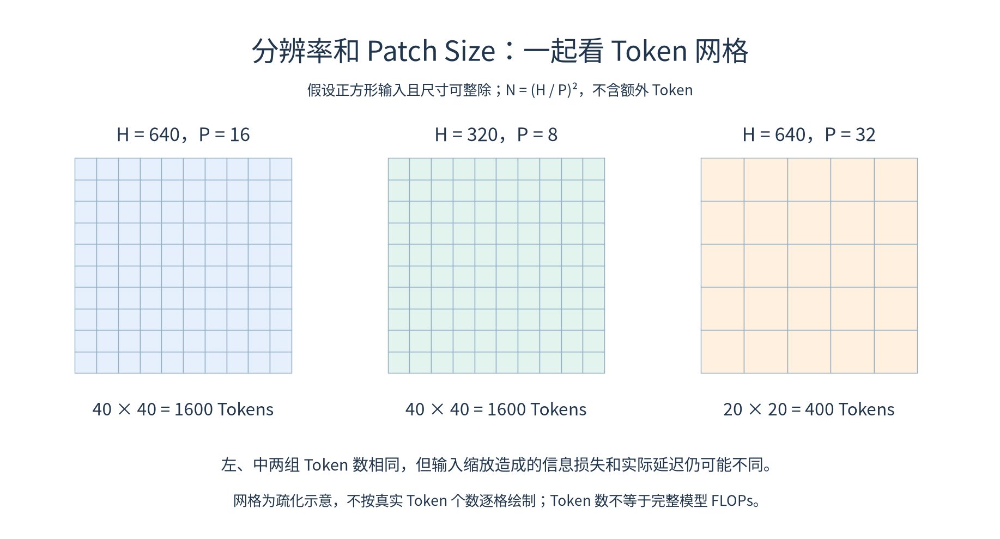
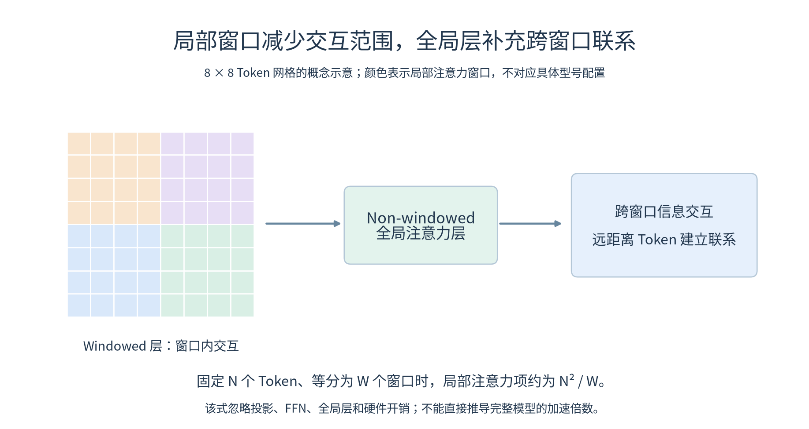
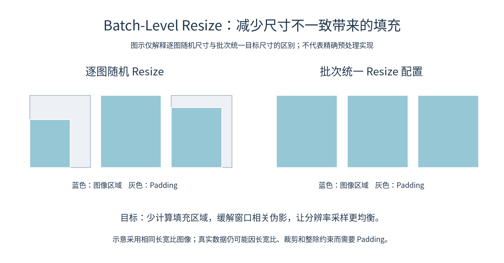
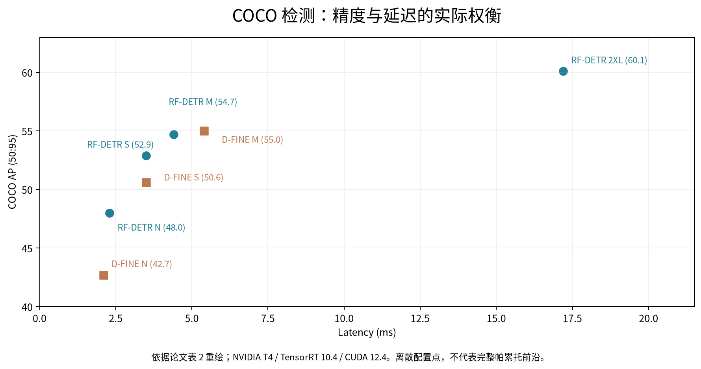

# RF-DETR: Neural Architecture Search for Real-Time Detection Transformers

> **阅读主线：** 预训练提供特征基础 → 架构增强训练共享权重 → 验证集搜索精度与延迟 → 选择部署配置。

**阅读索引：** [研究动机](#motivation) · [网络结构](#architecture) · [NAS 机制](#nas) · [实验与局限](#evidence) · [SAR 研究思考](#sar-reflections)

## 一、论文基本信息

- **论文名称：** RF-DETR: Neural Architecture Search for Real-Time Detection Transformers
- **中文名称：** RF-DETR：面向实时检测 Transformer 的神经架构搜索
- **发表会议：** ICLR 2026
- **作者：** Isaac Robinson, Peter Robicheaux, Matvei Popov, Deva Ramanan, Neehar Peri
- **研究领域：** 实时目标检测、DETR、神经架构搜索、迁移学习、实例分割
- **技术基础：** LW-DETR、DINOv2、Once-for-All、FlexiViT
- **笔记完成日期：** 2026-10-30
- **原文 / 代码：** [仓库 PDF](../originals/2026-10-30_RF-DETR.pdf) · [arXiv](https://arxiv.org/abs/2511.09554v2) · [官方代码](https://github.com/roboflow/rf-detr)
- **阅读版本：** arXiv:2511.09554v2，2026-02-03；下文页码按论文印刷页码。

### 论文核心思想

RF-DETR 以 LW-DETR 为基础，引入 DINOv2 预训练 Backbone，并采用权重共享神经架构搜索（Weight-Sharing NAS），使同一套模型参数能够适应多种网络配置。

模型在目标数据集上完成共享权重训练后，通过验证集搜索不同架构的精度与推理延迟，从而选择满足实际需求的网络结构，而不必为每个配置重新训练完整模型。

**核心认识：**

RF-DETR 的创新重点并不是设计新的检测损失或注意力机制，而是研究如何利用大规模预训练与权重共享 NAS，提高检测模型的架构适应性，并实现精度与推理效率之间的灵活权衡。

---

## 二、研究背景与动机（Introduction）

### 2.1 现有目标检测器可能过度针对 COCO 优化

作者认为，许多现有目标检测算法为了获得更高的 COCO AP，会针对 COCO 数据集的特点进行大量定向调整，例如：

- 网络架构（Model Architecture）
- 学习率调度策略（Learning Rate Scheduler）
- 数据增强及调度策略（Augmentation Scheduler）

这些设计在 COCO 上可能有效，但面对类别数量、目标密度、数据规模等不同的新数据集时，不一定仍然是最合适的配置。

**理解与辨析：**

这里需要区分“大规模预训练”和“针对 COCO 定向优化”。

大规模预训练可以让模型提前学习边缘、纹理、形状等视觉特征，有利于后续迁移学习。这与使用 YOLO 预训练权重训练自己的检测任务，本质上属于相同的迁移学习思想。

作者并不反对这种预训练方式，而是质疑研究人员是否为了追求 COCO 上的高 AP，过度针对 COCO 设计网络和训练策略。

因此：

**预训练解决的是模型从什么基础开始学习，而架构设计解决的是模型以什么结构完成当前任务。**

两者并不矛盾。

此外，模型在新数据集上表现不好，也不能全部归因于针对 COCO 的过度优化，还可能涉及成像差异、标注质量、训练数据规模等因素。

### 2.2 引入神经架构搜索（NAS）

NAS（Neural Architecture Search）指从预先定义的网络架构空间中，寻找满足特定性能要求的网络结构。

例如，DETR 可以有不同的 Decoder 层数、Query 数量、输入分辨率等配置。

需要注意，**NAS 主要搜索网络架构，而不是直接搜索模型的具体权重参数。**

传统独立训练方案可以采用逐个训练、逐个比较的方式，但候选架构很多时，计算成本会很高。

RF-DETR 因此采用 Weight-Sharing NAS（权重共享 NAS）。

不同的网络配置不需要各自维护一套完全独立的参数，而是共同使用一套共享权重中适用的部分。

**理解与辨析：**

权重共享可以部分理解为“一层包一层”的结构。

例如，一个包含 6 层 Decoder 的网络，可以通过保留前 2 层、前 4 层或全部 6 层，形成不同深度的推理配置。

这些配置共享相同的前几层权重。

但这种理解只适用于部分架构参数。对于 Patch Size 等参数，需要额外的权重适配机制，并不是简单地删除或增加网络层。

### 2.3 NAS 的训练与搜索阶段

*图 1｜方法流程示意。重点区分训练中的参数更新与训练后的配置评估。*

RF-DETR 将共享权重训练和架构搜索分成两个主要过程。

**第一阶段：共享权重训练**

训练过程中随机选择部分网络配置，进行前向传播、损失计算、反向传播和参数更新，让共享参数逐渐适应不同结构。

**第二阶段：架构搜索**

完成训练后，在目标验证集上评估不同配置的精度与推理延迟，寻找合适的架构。

这里的关键是：

训练阶段虽然会随机改变网络配置，但其目的主要是学习能够适应多种架构的共享权重，而不是在每次迭代中立即确定最优架构。

正式的架构选择发生在训练完成后。

**个人理解：**

RF-DETR 并没有消除架构搜索的计算开销，而是将原本需要多次完整训练的过程，转变成共享权重训练加上后续的架构评估。

因此，权重共享 NAS 节省的是重复训练成本，并不意味着整个训练和搜索过程没有额外开销。

另外，“一次训练”指的是一轮共享权重训练可以支持多种架构配置，并不意味着换到任何新数据集都不再需要训练。

### 2.4 帕累托最优（Pareto Optimality）

RF-DETR 同时关注检测精度和推理延迟，而不是单纯追求最高 AP。

例如：

- 模型 A：AP = 55，Latency = 10 ms
- 模型 B：AP = 53，Latency = 5 ms

模型 A 精度更高，但需要更多推理时间；模型 B 精度略低，但速度更快。

两者各有优势，需要根据实际应用选择。

如果某个模型同时具有更高精度和更低延迟，则可以认为它支配另一个模型。

**个人理解：**

帕累托最优强调的是不同性能指标之间的权衡。

因此，架构搜索并不一定只返回一个统一的最佳网络，而是可以得到一系列适合不同计算预算的网络配置。

### 2.5 推理延迟评估的标准化

不同研究中使用的 GPU、计算精度、后处理方式和硬件运行状态可能不同，导致推理延迟缺乏直接可比性。

作者尤其关注 GPU 的功耗限制和温度变化，因为它们可能导致模型的实际运行频率变化。

论文采用在连续推理之间加入 200 ms 间隔的方式，减少功耗限制对延迟测量的影响。

需要明确，这种方法是为了改善单次推理延迟测试的可复现性，并不是让模型实际推理更快，也不适用于直接评价持续吞吐量。

---

## 三、相关工作（Related Works）

### 3.1 Neural Architecture Search

NAS 相关研究经历了从单纯追求精度，到考虑硬件效率，再到降低重复训练成本的发展。

- 早期 NAS：重点搜索高精度架构，计算成本可能较高。
- Hardware-Aware NAS：将硬件延迟等实际运行指标纳入架构选择。
- Weight-Sharing NAS：允许不同子网络共享参数，减少重复训练。

RF-DETR 借鉴了 Once-for-All（OFA）的思想。

**创新定位：**

RF-DETR 没有首次提出权重共享 NAS，而是进一步将其应用于端到端目标检测和实例分割，并联合考虑多个网络组件的配置选择。

### 3.2 Real-Time Object Detectors

传统目标检测可以分为两阶段检测和单阶段检测。

两阶段检测器通常先生成候选区域，再进行进一步分类和定位；单阶段检测器则直接从图像特征中预测检测结果。

DETR 通过集合预测与匹配训练，实现通常不需要 NMS 的端到端检测。

早期 DETR 的推理效率存在一定限制，而 RT-DETR 和 LW-DETR 进一步探索了实时检测架构。

**个人理解：**

RF-DETR 选择 LW-DETR 作为基础，主要因为 LW-DETR 已经具有相对高效的实时检测结构。

作者希望在此基础上，通过预训练和 NAS 进一步提升检测性能与架构灵活性，而不是从原始 DETR 重新设计整个实时检测框架。

### 3.3 Vision-Language Models

大型视觉语言检测器利用图像与文本之间的语义关系，实现开放词汇目标检测。

但对于专业领域或与预训练数据差异较大的目标，仍然可能需要微调，而且大型视觉语言结构通常具有较高推理成本。

RF-DETR 因此选择专用检测器路线，利用大规模视觉预训练获得的特征表示能力，构建针对特定类别的高效检测模型。

---

## 四、RF-DETR 网络结构（Method）

*图 2｜论文原图 Figure 2（第 4 页）。左侧为 ViT 特征提取，中间为 Projector 与 Decoder，右侧为分割支路。图中的 Decoder Groups 属于训练结构细节，不能理解为部署时需要并行运行多套完整检测器。*

### 4.1 DINOv2 预训练 Backbone

RF-DETR 以 LW-DETR 为基础，将原来的 CAEv2 Backbone 替换为 DINOv2。

| Backbone | Encoder 层数 | 原生 Patch Size |
|---|---:|---:|
| CAEv2 | 10 | 16 |
| DINOv2 | 12 | 14 |

DINOv2 具有较强的预训练视觉表征能力，能够为下游目标检测提供良好的初始化。

但 DINOv2 的 Encoder 层数更多，因此也会增加部分计算开销。

作者希望利用后续 NAS 进行架构调整，在精度与效率之间取得更好的平衡。

**个人理解：**

这里使用 DINOv2 的思路，与使用 YOLO 预训练权重进行迁移学习并没有本质冲突。

区别是 RF-DETR 主要使用 DINOv2 的视觉 Backbone，并在此基础上建立完整检测网络，而不是直接使用一个已经具备相同检测头的预训练检测器。

### 4.2 LayerNorm 与 BatchNorm

*图 3｜梯度跨微批次累积，不会让 BN 的每次前向传播看到完整有效 Batch。*

作者将 Multi-scale Projector 中的 BatchNorm（BN）替换成 LayerNorm（LN），以便使用梯度累积进行训练。

假设有效 Batch Size 为 16，但显存每次只能容纳 4 张图像。

那么训练程序需要分 4 次处理，每次计算梯度，最后再统一更新参数。

**BN 的特点：**

在训练时，BN 利用当前微批次中多个样本的统计量进行归一化。对于 CNN 中常见的 BN，还会同时统计对应通道的空间位置。

因此，虽然通过梯度累积处理了 16 张图像，但 BN 每次前向传播仍然只能使用当前 4 张图像的统计量。

**LN 的特点：**

LN 在单个样本内部指定的特征维度上计算均值和方差，不依赖同批次其他图像的特征。

因此，其他图像的变化不会直接改变当前样本的 LN 统计量。

**理解过程中明确的关键区别：**

BN 和 LN 的区别并不是串行与并行。

两者都可以利用 GPU 并行计算，也都不负责将训练数据分成不同微批次。

真正的区别在于归一化的统计范围：

- 梯度累积：决定分几次计算梯度以及何时更新参数。
- BN：训练时依赖当前 Batch 的统计信息。
- LN：每个样本独立计算指定特征维度的统计信息。

因此，LN 更方便配合较小微批次和梯度累积使用。

### 4.3 RF-DETR 与 RF-DETR-Seg

*图 4｜点积沿通道维度进行，每个 Query 产生一张目标掩码响应图。*

RF-DETR 主要进行目标检测，输出类别和边界框。

RF-DETR-Seg 在检测架构基础上增加轻量级实例分割头，额外预测目标 Mask。

其处理过程可以概括为：

1. Backbone 提取图像特征。
2. 共享空间特征经过上采样和投影，生成 Pixel Embedding Map。
3. Decoder 输出的 Query 经过 FFN 投影。
4. 将 Query 特征与 Pixel Embedding Map 进行点积。
5. 得到每个目标对应的 Mask 预测。

若像素嵌入为 $E\in\mathbb{R}^{H_m\times W_m\times d}$，投影后的第 $i$ 个 Query 为 $q_i\in\mathbb{R}^{d}$，则点积可写为：

$$
M_i(u,v)=q_i^\top E(u,v),\qquad \hat m_i(u,v)=\sigma(M_i(u,v)).
$$

这里 $M_i$ 是掩码 logit，$\sigma$ 将其转为像素前景概率。这是帮助理解点积预测的简化表达，省略分割支路逐层细化细节。

**理解与纠正：**

上采样并不是为了获得 Query，而是为了生成更密集的空间特征图。

Query 来自检测解码器，主要表达对应目标的候选特征。

Mask 也不是预先输入的数值，而是 Query 特征与像素特征进行计算后得到的预测结果。

因此，RF-DETR-Seg 的核心是复用检测网络已有特征，以较小的额外开销增加实例分割能力，而不是重新搭建一套完整 Backbone。

---

## 五、Weight-Sharing NAS 核心机制

### 5.1 共享权重训练

RF-DETR 在训练过程中随机选择不同的网络配置，并持续更新共享权重。

例如：

第一次迭代使用 Patch Size = 8，第二次迭代使用 Patch Size = 16。

第二次不会重新初始化一个模型，而是继续使用前面更新过的共享参数，并通过相应的权重适配完成新的计算配置。

**个人理解：**

RF-DETR 让不同架构交替参与训练，使共享参数能够在多种结构下发挥作用。

但要注意，训练时并不是五个架构参数全部随机变化。

### 5.2 Architecture Augmentation（架构增强）

数据增强改变的是训练输入，而架构增强改变的是网络本身的运行配置。

RF-DETR 在训练中随机调整部分架构参数，使模型不能只依赖一种固定的网络结构。

这种机制的直接作用是提高共享权重对不同架构的适应能力。

作者同时认为，它可能产生正则化效果，改善模型的泛化能力。

**理解与辨析：**

架构增强首先解决的是模型对固定架构的依赖。

它可能间接改善面对不同数据时的表现，但不能直接理解成随机改变 Patch Size 就一定能够提高跨数据集泛化能力。

### 5.3 五个可调参数（Tunable Knobs）

*图 5｜论文原图 Figure 3（第 5 页）。图中速度与精度方向表示设计动机，不保证每一次单参数调整都单调改善指标，仍需实测。*

#### ① Patch Size

ViT 将输入图像划分为多个 Patch，并通过 Patch Embedding 转换为 Token。

对于宽高均为 H、Patch Size 为 P 的正方形图像，若可以整除：

$$
N=\left(\frac{H}{P}\right)^2
$$

Patch Size 越小，通常生成的 Token 越多，能够获得更细粒度的空间表示，但也会增加计算量。

**Patch Embedding Interpolation：**

DINOv2 原本具有固定的 Patch Embedding 权重。

例如，原始 Patch Size 为 14，RGB 图像中每个 Patch 包含：

$$
14\times14\times3=588
$$

个输入数值。

如果改成 Patch Size = 8，则每个 Patch 只有：

$$
8\times8\times3=192
$$

个数值。

原来的映射权重无法不加修改地直接用于新的输入维度。

RF-DETR 借鉴 FlexiViT 的思想，通过 Patch Embedding 权重变换和插值，使预训练权重适应新的空间尺寸。

**个人理解：**

本质上是输入 Patch 的维度发生变化，导致原来的权重矩阵无法直接完成对应的映射，因此需要对权重尺寸进行适配。

权重插值解决尺寸兼容问题，而共享权重训练让模型逐渐适应不同 Patch Size。

#### ② Number of Decoder Layers

*图 6｜上半部分解释分层监督如何支持截断，下半部分解释候选评分筛选；二者可共同调节。*

RF-DETR 训练时使用完整 Decoder，并对各层的预测施加监督。

因此，推理阶段可以选择只执行前几层 Decoder。

例如，完整模型有 6 层，推理时可以选择只执行前 3 层。

**个人理解：**

并不是后三层没有用，而是前三层已经接受检测监督，具备一定的独立预测能力。

后三层可以进一步更新 Query 特征、改善预测，但需要额外计算时间。

因此，Decoder 层数可以根据精度和速度需求调整。

#### ③ Number of Query Tokens

RF-DETR 训练时使用 300 个 Query。

推理时根据 Encoder 输出候选的最大类别 Sigmoid 分数进行排序，保留 Top-K Query，以减少 Decoder 的计算开销。

例如，可以从 300 个 Query 中选择分数较高的 100 个。

**个人理解：**

Query 数量限制了常规检测输出的最大候选数量。

假设图像中有 5 个真实目标，但最终只保留 3 个 Query，那么常规情况下最多产生 3 个独立检测结果，不可能把 5 个目标全部检测出来。

因此，Query 数量一般需要留有一定余量。

但 Query 也不是越多越好，较多 Query 可能带来额外计算开销。

需要特别区分：

- Query Dropping：根据候选评分筛选需要继续处理的 Query。
- NMS：根据检测框重叠程度及分数抑制重复预测。
- O2O/O2M：涉及训练阶段的预测与真实目标匹配关系。

三者不是相同机制。

#### ④ Image Resolution

*图 7｜640/16 与 320/8 都得到 40 × 40 Token 网格，但不保证图像信息或检测结果相同。*

输入分辨率越高，通常能够保留更多图像细节，但计算成本也会提高。

Resolution 和 Patch Size 共同决定图像 Token 数量。

例如：

$$
640/16=40
$$

$$
320/8=40
$$

两种配置均产生：

$$
40\times40=1600
$$

个 Patch Token。

**理解与辨析：**

两种配置虽然 Token 数量相同，但不意味着检测效果完全相同。

如果低分辨率图像由原始高分辨率图像缩小得到，那么它可能在缩放过程中丢失部分细节。

同时，两个配置中的 Patch 对原图的空间覆盖范围可能相近，因此不能简单认为后一种配置使用了更小 Patch，就一定保留了更细粒度的原始信息。

模型还需要通过位置嵌入插值适配不同分辨率产生的 Token 网格。

#### ⑤ Number of Windows

*图 8｜不同颜色表示局部窗口；全局注意力层负责更大范围的信息交互。*

Window Attention 将 Token 划分到局部窗口中，主要在窗口内部计算注意力，从而减少注意力计算成本。

较多窗口意味着单个窗口通常包含更少的 Token，有利于降低局部注意力计算量，但也会限制不同窗口之间的直接信息交互。

RF-DETR 在 Backbone 中结合 Windowed Attention 和 Non-Windowed Attention。

**个人理解：**

Windowed Attention 用于局部区域的信息交互。

Non-Windowed Attention 允许更大范围的特征交换。

因此，即使两个目标相距较远、位于不同窗口，它们的特征仍然可以通过 Non-Windowed Attention 建立联系。

这也解释了为什么 RF-DETR 不是单纯追求更多窗口，而是将窗口数量纳入架构搜索。

### 5.4 训练与推理配置的区别

| 参数 | 训练阶段 | 搜索与推理阶段 |
|---|---|---|
| Resolution | 320–960，步长 64 | 在候选分辨率中选择 |
| Patch Size | 8、10、12、16、20、24、32 | 训练候选值，另含 14 |
| Windows | 1、2、4 | 1、2、4 |
| Decoder Layers | 固定 6 层 | 0–6 层 |
| Queries | 固定 300 | 50、100、200、300 |

**关键认识：**

RF-DETR 训练时主要随机改变分辨率、Patch Size 和 Window 配置。

Decoder 层数与 Query 数量主要通过训练后的截断和筛选实现灵活调整。

因此，权重共享 NAS 并不是每次训练都随机改变五个参数。

**附录核查：** 附录 A 报告评估 6,468 个配置，对应乘式 11 × 7 × 7 × 3 × 4 = 6,468；但推理列表另含 Patch Size 14，若将 8 个 Patch 候选全部展开，则为 7,392 个组合。论文没有在这里明确解释额外候选与实际评估集合的对应关系，因此复现时应以实际配置列表和过滤规则为准。

---

## 六、训练策略改进

### 6.1 Scheduler-Free Training

作者认为，部分学习率调度策略依赖预先确定的训练总时长。

例如，使用以 100 Epoch 为周期的余弦学习率调度。

如果模型需要 200 Epoch 才能充分收敛，那么原来的调度可能在第 100 Epoch 时就已经把学习率降低到很小。

**个人理解：**

学习率调度器认为训练应该结束，但模型实际上可能还需要进一步优化。

如果最低学习率设置为 0，那么在预设周期结束时学习率可能下降到 0。

因此，RF-DETR 希望减少对固定训练周期的依赖。

需要注意，Scheduler-Free 并不意味着不存在任何调度机制。论文仍使用 EMA Scheduler。

### 6.2 Data Augmentation（数据增强）

作者认为，数据增强并不是越丰富越好。

某些增强方式可能使样本不符合实际场景中的视觉规律，从而影响模型学习。

例如，对自动驾驶行人检测使用垂直翻转，可能引入不符合实际场景的倒置行人样本。

RF-DETR 主要保留水平翻转和随机裁剪。

**个人理解：**

数据增强的目的是帮助模型学习真实任务中具有意义的特征，而不是单纯增加图像变化。

对于 SAR 图像，如果某些增强操作破坏了目标真实的散射结构，可能让模型学习到不符合成像规律的特征。

但这种风险需要通过具体实验判断，不能认为所有改变图像结构的增强都会降低精度。

### 6.3 Batch-Level Resize（批次级缩放）

*图 9｜蓝色是有效图像区域，灰色是填充区域；具体填充量仍受长宽比等因素影响。*

LW-DETR 采用逐图像随机缩放，不同图像可能具有不同尺寸。

为了组成统一的 Batch，需要将较小图像 Padding 到较大尺寸。

大量 Padding 可能带来两个问题：

1. 增加无效计算。
2. 对 Window Attention 产生不利影响，引入窗口相关伪影。

RF-DETR 改为在 Batch 级别选择缩放配置，从而减少由于批次内随机尺寸差异造成的填充开销。

此外，还可以让不同分辨率对应的位置嵌入得到更均衡的训练。

**个人理解：**

Batch-Level Resize 不只是为了适配窗口注意力。

它同时考虑了计算效率、Padding 对特征处理的影响，以及多分辨率架构训练的均衡性。

---

## 七、实验结果与证据边界

### 7.1 COCO 检测结果：收益体现在哪里？

*图 10｜按论文表 2 重绘的部分配置。精度越高越好，延迟越低越好；散点不连线，避免将离散结果误解为完整搜索前沿。*

| 配置 | COCO AP | 延迟（ms） | 参数量 |
|---|---:|---:|---:|
| D-FINE N | 42.7 | 2.1 | 3.8M |
| RF-DETR N | 48.0 | 2.3 | 30.5M |
| D-FINE S | 50.6 | 3.5 | 10.2M |
| RF-DETR S | 52.9 | 3.5 | 32.1M |
| D-FINE M | 55.0 | 5.4 | 19.2M |
| RF-DETR M | 54.7 | 4.4 | 33.7M |
| RF-DETR 2XL | 60.1 | 17.2 | 126.9M |

数据来自论文表 2（第 7 页），环境为 NVIDIA T4、TensorRT 10.4、CUDA 12.4，使用论文统一测量协议。RF-DETR N 以相近延迟获得比 D-FINE N 高 5.3 AP 的结果；M 配置则体现另一种权衡：AP 略低，延迟更小。模型大小分组以延迟为依据，不能将同一字母理解为相同参数量。

### 7.2 消融：不要把全部收益归因于 NAS

论文表 5（第 9 页）给出了逐步改动的结果：

| 累积改动 | AP | 延迟（ms） |
|---|---:|---:|
| LW-DETR M 基线 | 52.6 | 4.4 |
| 较温和的训练超参数 | 51.6 | 4.4 |
| 替换为 DINOv2 | 53.6 | 4.7 |
| 额外 Objects-365 预训练 | 54.3 | 4.7 |
| 加入权重共享 NAS | 54.6 | 4.7 |

这些是同一消融路径上的条件性结果。NAS 在这一基础配置上的增益为 0.3 AP；其更主要的价值还包括训练后调节架构、搜索不同延迟预算。这里不能将主表中不同方法的全部差距解释成 NAS 的独立贡献，也不能把消融表末行的 54.6 与主表 M 的 54.7 混作同一实验数值。

### 7.3 成本、微调与评估边界

- **训练和搜索有成本。** 附录 A 报告共享权重训练约为非 NAS 基线的 2–4 倍耗时，并估计全量搜索约需 10,000 GPU 小时。优势在于多配置复用训练，并非搜索成本很低；实际缩小候选空间后的成本需要另测。
- **搜索后微调是可选项。** 正文第 6 页指出，在 COCO 上进一步微调收益很小，在 RF100-VL 上有一定收益。无需重训每个候选，不等于后续微调永远无效。
- **跨域证据来自多个目标数据集的适配。** RF100-VL 的结果支持方法对不同领域的可迁移性，不等同于一个模型在所有新领域上零样本通用。
- **COCO 验证集兼用于选择与报告。** 作者在第 9 页也讨论了这种评估方式可能造成的过拟合风险。自己的实验应保留独立测试集。
- **延迟依赖部署环境。** 200 ms 缓冲协议服务于可复现的单次延迟测量，持续运行还应另测吞吐、功耗和温度。同参数量或同 FLOPs 不保证同延迟。

---

## 八、个人研究思考：与 SAR 目标检测的联系

以下是基于 RF-DETR 的技术机制提出的研究思考，并非论文已验证的 SAR 结论。

### 8.1 固定网络架构是否适合 SAR 数据？

RF-DETR 提醒我们，网络结构的最佳配置可能与目标数据特点有关。

因此，在 SAR 飞机目标检测中，可以进一步关注输入分辨率、特征粒度、Decoder 深度和 Query 数量是否适合当前任务，而不是直接沿用自然图像检测中的默认配置。

### 8.2 Query Dropping 与弱散射目标

Query Dropping 能够减少 Decoder 的计算量，但可能提前删除低分的真实目标候选。

对于 SAR 目标检测，弱散射目标不一定具有较高的初始分类分数。

因此，如果引入类似机制，需要谨慎考虑候选筛选是否造成漏检。

另外，RF-DETR 的 Query 与 DiffusionDet 中带噪边界框 Proposal 的机制并不相同，不能直接等同。

### 8.3 先验证单项设计，再研究配置选择

RF-DETR 的启发在于：不同层级、不同特征尺度可能需要不同的计算结构。

但在引入复杂 NAS 之前，应先验证单项设计是否具有稳定收益，再研究它在不同层级与计算预算下的适用性，避免多个改动混在一起后难以判断各自的作用。

---

## 九、文献阅读总结

RF-DETR 的核心研究思路可以概括为：

**以 LW-DETR 为实时检测基础，利用 DINOv2 提供大规模预训练特征，通过权重共享 NAS 训练能够适应多种配置的模型，再根据目标数据集和计算预算选择合适的架构。**

本次阅读形成了以下主要认识：

1. 大规模预训练与过度针对 COCO 优化不是同一个问题，前者可以帮助迁移学习，后者可能限制架构和训练策略的适用性。
2. NAS 主要寻找网络架构配置，权重共享则使不同架构能够复用部分模型参数，降低重复训练成本。
3. RF-DETR 的共享权重训练与最终架构搜索是两个阶段，训练时发生架构变化，不等于训练时已经完成最优架构选择。
4. 架构增强首先提高模型对不同网络配置的适应能力，并可能通过正则化改善泛化。
5. BN 和 LN 的本质区别是归一化统计量的计算范围，而不是数据分组或串并行方式。
6. RF-DETR-Seg 利用检测器已有的 Query 特征与共享空间特征，实现轻量级实例分割。
7. Patch Size、分辨率、Decoder 层数、Query 数量和窗口数量，分别控制网络不同位置的计算需求。
8. 模型架构选择需要考虑精度与速度之间的帕累托权衡，而不是始终追求最高 AP。
9. 数据增强、学习率调度和图像缩放方式都可能影响模型的跨数据集适用性，不能脱离实际数据特点进行设计。

**总体理解：**

RF-DETR 的研究价值不在于单独提出某个新的特征增强模块，而是将预训练特征、可变架构和高效检测组织成一套完整方法。

它强调的是：目标检测模型的架构不必始终固定，也不必针对每一种计算预算重新训练一套完全独立的参数。

这一思路对后续研究 SAR 目标检测中的特征粒度、候选数量、网络深度以及模块配置具有一定参考价值。

---

## 十、回看原文的位置

| 问题 | 原文位置 |
|---|---|
| 研究动机、贡献与跨域问题 | §1，第 1–2 页 |
| 检测和分割架构 | Figure 2、§3，第 4 页 |
| 五个搜索维度 | Figure 3、§3，第 5–6 页 |
| 延迟协议与 COCO 结果 | Tables 1–2，第 7 页 |
| NAS 消融与验证集选择风险 | Table 5 及相邻正文，第 9 页 |
| 实现细节、具体型号配置与搜索成本 | Appendix A，第 15–16 页 |

图 2、图 5 截取自所附论文；图 10 按论文表 2 数据重绘，其余图为方法或概念示意。示意图中的数值示例、网格和模块比例不代表额外实验结果。
