# MLDet｜去噪特征、辅助分割与旋转框融合

**论文名称：** Multitask Learning for SAR Ship Detection with Gaussian-Mask Joint Segmentation

**中文译名：** 基于高斯掩码联合分割的 SAR 舰船检测多任务学习方法

**作者：** Ming Zhao, Xin Zhang, André Kaup

**核心模型：** MLDet（Multitask Learning Detector）

**阅读范围：** 以 Introduction、Methodology 为主；仅为核查去噪监督来源补读实验设置，不展开实验结果。

**笔记完成日期：** 2026-10-31

**原文 / 代码：** [仓库 PDF](../originals/2026-10-31_MLDet.pdf) · [arXiv](https://arxiv.org/abs/2411.13847v1) · [官方代码](https://github.com/zx152/MLDet)

---

## 先看这一页：不要急着读公式

**这篇论文想回答：图像里有很多亮点，网络怎样更可靠地找到船，并把框放准？**

先想象一艘靠近港口的小船：它本身有亮点，岸边建筑也有亮点；如果直接平滑图像，杂波少了，小船也可能变弱。MLDet 因此保留原始特征，再加入去噪特征，让检测与分割共同学习，最后融合两套预测框。

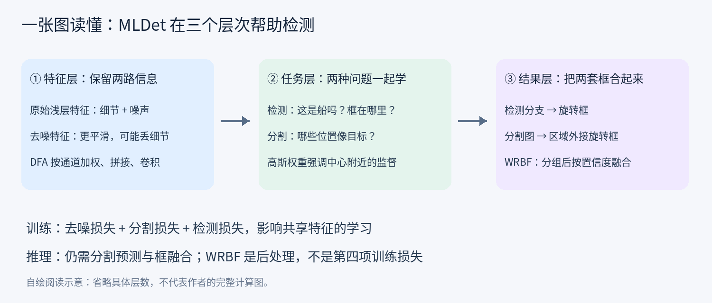

**读图顺序：** 先看左边“用什么特征”，再看中间“用什么监督”，最后看右边“怎样得到最终框”。三者分别对应 DFF/DFA、Gaussian-Mask、WRBF；ARW 则负责检测头中的角度误差。

| 你现在最困惑的问题 | 优先阅读 |
|---|---|
| 整个模型到底做了什么？ | 第二节，结合原文 Fig. 2 |
| 去噪为什么还要保留原图特征？ | 第四、五节 |
| 高斯图到底是标签、预测还是权重？ | 第六节，尤其 6.5 |
| 两个角度差 90°，为何损失很小？ | 第三节 |
| 分割为何还要转成框？ | 第七、九节 |
| 如何借鉴多任务设计思路？ | 第十一节，区分论文结论与方法启发 |

> **全文三个标记约定：** “原文”指作者给出的结构与公式；“推导/教学例”是为了理解而计算的例子；“个人分析”是局限或迁移设想，不代表实验结论。

---

## 一、论文概述

### 1.1 研究背景与目标

SAR 图像目标检测受到特殊成像机制的影响，主要面临以下问题：

- **散斑噪声和复杂背景干扰：** SAR 图像中的海浪、港口建筑、岛屿等可能产生较强散射响应，容易与舰船目标混淆，造成虚警。
- **目标尺度差异：** 不同成像分辨率和舰船尺寸导致目标尺度差异较大，尤其是小目标，在深层特征提取过程中容易丢失有效信息。
- **目标空间结构与定位问题：** 舰船通常呈细长形态，使用水平检测框容易包含大量背景区域；旋转框虽然能够更准确地描述目标，但又存在角度周期性问题。

作者认为，单纯依赖目标分类和边界框回归，并没有充分利用 SAR 图像去噪、目标区域分割与目标检测之间的联系。

因此提出 **MLDet 多任务学习检测框架**，以目标检测为主任务，引入去噪特征融合与目标分割两个辅助任务，通过特征共享、辅助监督和检测结果融合，提高 SAR 舰船检测的鲁棒性。

### 1.2 核心思路

整篇论文可以概括为：

**利用去噪任务改善图像特征表达，通过 Gaussian-Mask 分割任务增强目标区域学习，再结合角度损失与旋转框融合，完成 SAR 舰船检测。**

论文的主要技术组成包括：

| 技术模块 | 核心机制 | 解决问题 |
|---|---|---|
| Object Detection + ARW | 长宽比自适应的角度周期损失 | 旋转框角度回归不合理 |
| DFF + DFA | 去噪特征与原始特征的通道注意力融合 | 噪声干扰与小目标特征丢失 |
| Target Segmentation | 旋转 Gaussian-Mask 加权分割监督 | 目标区域与复杂背景混杂 |
| WRBF | 基于 IoU 分组和置信度加权的旋转框融合 | 多个候选框冗余及定位偏差 |

需要注意，**MLDet 是一种多任务辅助检测框架，而不是对 SAR 物理散射过程进行显式建模的框架。**

---

## 二、MLDet 整体网络架构

对应论文 Fig. 2。

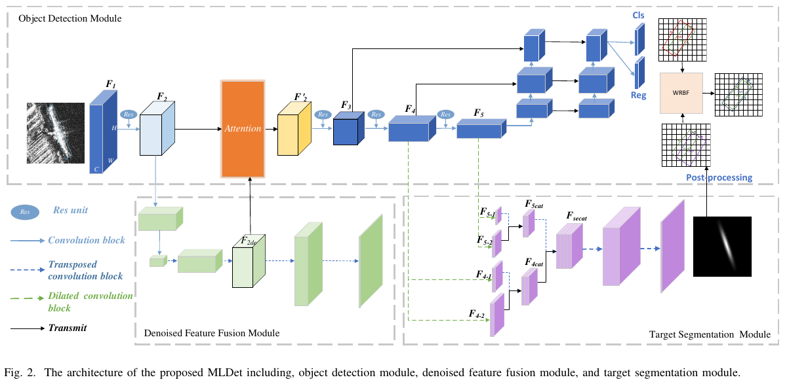

*来源：原论文第 4 页，Fig. 2。先沿最上方读检测主路，再看左下去噪路径回接 Attention，最后看右下分割路径进入 WRBF。*

**图中最容易读错的一点：** 接回检测骨干的是中间特征，不是最后生成的去噪图像。浅层侧重细节，深层侧重语义；辅助任务通过共享路径影响后续表示。

MLDet 以 CSPDarknet 为特征提取骨干，通过共享浅层特征，使目标检测、去噪和分割三个任务相互联系。

整体数据流可以概括为：

```text
SAR 原始图像
    ↓
CSPDarknet 共享浅层特征提取
    ↓
F2 浅层特征
    ├── 原始特征 F2 ─────────────┐
    │                           │
    └── DFF 去噪分支             │
             ↓                  │
           F2de                 │
             └──────┬───────────┘
                    ↓
            DFA 注意力融合
                    ↓
                   F2'
                    ↓
          后续深层特征提取
             F3、F4、F5
                    ↓
          ┌─────────┴─────────┐
          ↓                   ↓
       检测分支            分割分支
      Cls + Reg          Gaussian-Mask
        + ARW            辅助监督
          ↓                   ↓
      检测旋转框          分割区域
                              ↓
                         提取旋转框
          └─────────┬─────────┘
                    ↓
            WRBF 加权框融合
                    ↓
              最终检测结果
```

这里存在三个层次的协作：

**第一层：特征协作。** 原始特征与去噪特征融合，尽可能兼顾噪声抑制和细节保留。

**第二层：任务协作。** 检测与分割利用共享特征学习目标语义和空间信息。

**第三层：预测协作。** 检测分支和分割分支分别产生旋转框，通过 WRBF 进行后处理融合。

这种结构与简单串行的“图像去噪→目标检测”不同，辅助任务不只是对输入进行预处理，还参与特征学习。

---

## 三、Object Detection Module：旋转框检测与 ARW 损失

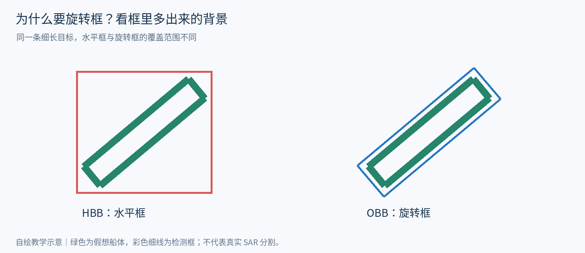

*读图：先比较绿色目标与外围框：旋转框减少了框内背景，但也引入角度表示问题。*

### 3.1 旋转框表示

作者采用 OBB（Oriented Bounding Box）表示舰船：

$$
B=(x,y,h,w,\theta)
$$

其中：

- `(x, y)` 为检测框中心。
- `h` 表示长边。
- `w` 表示短边。
- `θ` 表示长边与水平轴的夹角，范围为 `[-90°, 90°]`。

相比普通水平框，OBB 能够更加紧密地包围倾斜排列的舰船，减少框内背景，并适应密集目标场景。

但增加旋转角度后，网络还需要处理角度表示的周期性。

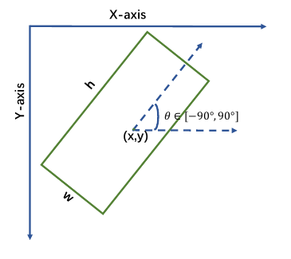

*来源：第 4 页 Fig. 3。记住 h 是长边、w 是短边；不要直接套用其他代码库的宽高和角度约定。*

### 3.2 角度周期性问题

对于矩形而言，旋转 180° 后覆盖区域保持不变。

例如真实角度为 `89°`，预测角度为 `-89°`，直接计算得到 178° 的误差，但两个矩形的长轴方向实际上非常接近。

因此，直接使用 Smooth L1 计算角度回归误差，可能在几何上近似正确的预测结果处产生较大的损失。

此外，论文 Fig. 4 指出，接近正方形的检测框具有特殊问题。

当长宽相等时，一个正方形旋转 90° 后与原来的区域完全重合。即使两个框的角度数值相差 90°，其 IoU 也可能达到 1。

对于接近正方形的矩形，90° 旋转虽然不再严格等价，但也可能保持较大的重叠区域。

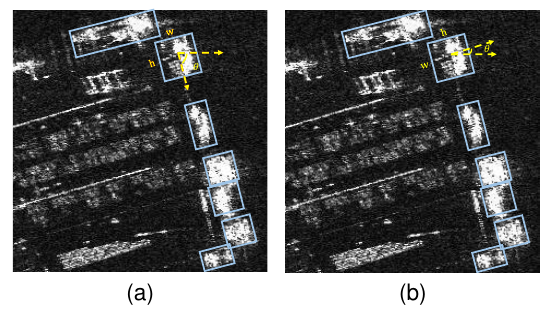

*来源：第 5 页 Fig. 4。重点比较黄色标记框：数值角度差很大，覆盖区域却接近。蓝框是其他舰船的框。*

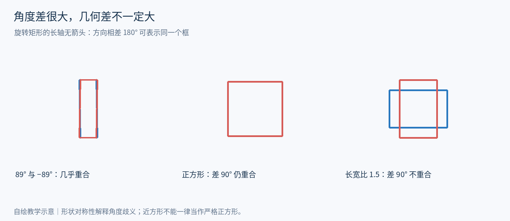

*读图：左图解释 ±90° 边界，中图解释严格方形对称性，右图说明近方形只是一种近似。*

### 3.3 ARW 角度损失

作者设计了 Aspect Ratio Weighting（ARW）损失：

$$
L_\theta=\left|\sin\!\left(\alpha(\theta-\hat\theta)\right)\right|\,\mathrm{SmoothL1}(\theta,\hat\theta)
$$

其中：

$$
\alpha=1,\qquad h/w>1.5
$$

$$
\alpha=2,\qquad h/w\le1.5
$$

长宽比由 Ground Truth 计算。

**它根据长宽比改变正弦权重的零点分布，在某些几何等价或近似等价角差处减小惩罚。**

> **数学核查：** 具有 180°/90° 周期的是绝对正弦权重。完整损失还乘有 Smooth L1，因此不能说完整 ARW 严格具有该周期。它也不等同于先计算最短周期角差再回归。实际计算三角函数前需将角度统一为弧度。

对于细长目标，使用 `α=1`，正弦权重具有 180° 周期。

对于近方形目标，使用 `α=2`，正弦权重具有 90° 周期。

例如：

真实角度为 `-70.6°`，预测角度为 `19.7°`，两者相差 `90.3°`。

由于目标接近正方形：

$$
\alpha=2
$$

因此：

$$
|\sin(2\times90.3^\circ)|\approx0.01047
$$

虽然原始角度差很大，但周期性权重很小，使最终角度损失显著减弱。

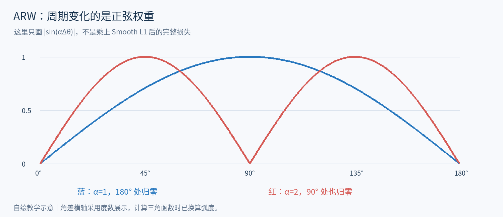

*读图：看 90° 处：红色权重为零、蓝色达到峰值。完整损失并不等于这两条权重曲线。*

### 3.4 ARW 的理解与局限

ARW 的出发点合理：避免几何上近似相同的旋转框产生过大的角度惩罚。

但其设计属于近似处理。

例如：

$$
h=30,\qquad w=20
$$

长宽比刚好为 1.5，因此使用 `α=2`。

当预测角度与真实角度相差 90° 时，ARW 角度损失为 0。

但如果两个框中心、尺寸相同，仅角度相差 90°，其 IoU 只有 0.5，并非完全重合。

这说明 **ARW 的零角度损失不等于真实几何误差为零**。

此外，长宽比阈值采用离散切换，1.49 与 1.51 的目标可能使用不同的角度周期，缺少连续过渡。

### 3.5 目标检测损失

检测分支总损失主要由三部分构成：

$$
L_{\mathrm{object}}=L_{\mathrm{reg}}+L_\theta+L_{\mathrm{cls}}
$$

其中：

- `L_reg`：中心位置和长短边回归，采用 Smooth L1。
- `L_θ`：旋转角度回归，采用 ARW。
- `L_cls`：目标分类，采用 Focal Loss。

因此，ARW 仅针对角度参数，不直接处理中心坐标或长宽回归。

---

## 四、DFF：去噪特征融合模块

### 4.1 设计动机

SAR 图像中的散斑噪声会干扰浅层特征提取，并进一步影响深层网络对目标语义的学习。

但去噪存在一个矛盾：

**在抑制背景噪声的同时，可能将弱小目标的有效散射特征一并削弱。**

因此，作者并没有直接使用去噪图像替代原始图像，而是保留原始特征，并与去噪特征进行融合。

这也是 DFF 的主要设计思想。

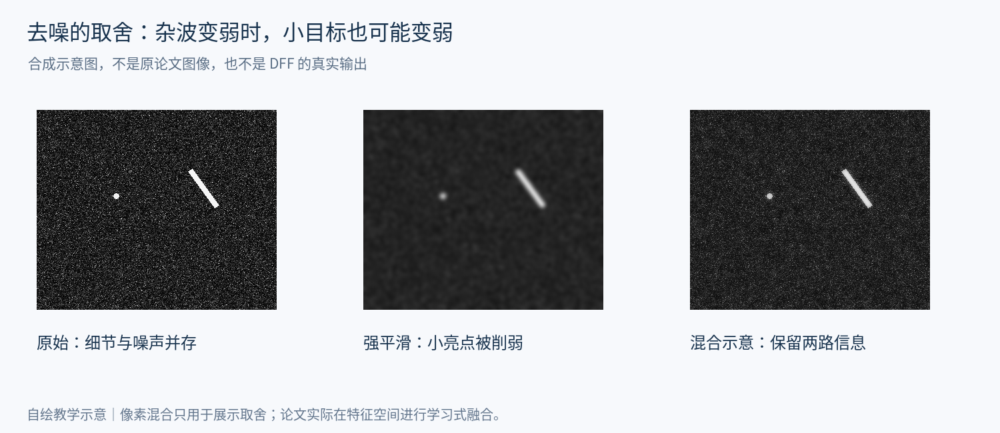

*读图：先找左图的小亮点，再看中图平滑后是否仍然清楚。右图只演示保留信息的直觉。*

### 4.2 DFF 的内部处理

DFF 包含下采样卷积、上采样转置卷积以及双特征融合注意力。

原始浅层特征 `F2` 被送入去噪路径，经过卷积和池化提取特征，再通过转置卷积恢复空间分辨率。

当特征图与 `F2` 具有相同的空间尺寸时，得到去噪特征：

`F2de`

该特征用于 DFA 融合。

原文第 5 页在 DFA 之后描述将融合特征反卷积至原图尺寸，并用 Sigmoid 获得去噪重建图像，再利用 MSE 监督。这里应结合 Fig. 2 阅读，不能仅凭简化流程断定重建头所有层的接线。

需要区分：

- `F2de`：用于检测网络的中间去噪特征。
- `Ŷ`：用于计算去噪重建损失的输出图像。

作者的目的不是简单生成一张更干净的 SAR 图像，而是利用去噪特征辅助后续检测特征学习。

---

### 4.3 去噪监督从哪里来？

原文第 7 页实验设置说明：真实 SAR 通常没有对应的无噪声图像，因此作者用同场景、不同极化的 SAR 图像配对训练，选取了 137327 对 HH/HV 图像。这里的监督目标不能直接称为“真实干净图像”。

**个人分析：** 不同极化的目标响应也会不同，因此该训练目标的有效性依赖配对数据和训练假设；MSE 重建误差变小不自动意味着检测定位更好。这也是需要保留原始特征通路的原因之一。

## 五、DFA：双特征融合注意力机制

对应论文 Fig. 5、公式（3）。

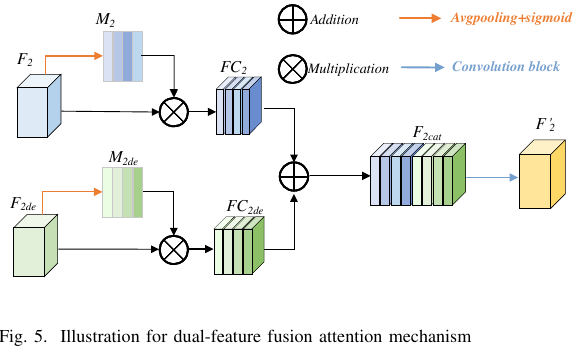

*来源：第 5 页 Fig. 5。两条支路分别生成自己的通道权重，再融合。注意图例写 Addition，而正文与公式（3）说明是 concatenation；本笔记按正文解释为拼接，复现时须核查代码。*

### 5.1 输入特征

DFA 接收两份特征：

$$
F_2\in\mathbb R^{H\times W\times C}
$$

$$
F_2^{\mathrm{de}}\in\mathbb R^{H\times W\times C}
$$

其中原始特征包含较丰富的细节，但可能受到噪声干扰；去噪特征有助于抑制噪声，却可能损失小目标信息。

作者希望利用两者之间的互补性。

### 5.2 具体处理流程

**第一步：全局平均池化。**

分别对两份特征执行 Global Average Pooling，将每个通道的空间响应压缩成一个数值。

$$
H\times W\times C\;\longrightarrow\;1\times1\times C
$$

**第二步：生成通道权重。**

经过 Sigmoid：

$$
M_2=\sigma(\mathrm{GAP}(F_2))
$$

$$
M_2^{\mathrm{de}}=\sigma(\mathrm{GAP}(F_2^{\mathrm{de}}))
$$

获得两组通道注意力权重。

**第三步：通道加权。**

$$
F_{C2}=M_2\odot F_2
$$

$$
F_{C2}^{\mathrm{de}}=M_2^{\mathrm{de}}\odot F_2^{\mathrm{de}}
$$

每个通道使用对应的权重，对该通道内所有空间位置进行加权。

**第四步：拼接与卷积融合。**

论文公式（3）可表示为：

$$
F_2'=\mathrm{Conv}_{1\times1}\!\left(\mathrm{Concat}(F_{C2},F_{C2}^{\mathrm{de}})\right)
$$

拼接后的特征经过 1×1 卷积，获得融合特征 `F2'`，再输入后续主干网络。

**用维度检查一次，就能看懂融合：**

| 操作 | 输出维度 | 实际含义 |
|---|---|---|
| 两路输入 | 各 H×W×C | 同位置、同通道数的两种表示 |
| GAP + Sigmoid | 各 1×1×C | 每个通道一个权重 |
| 广播相乘 | 各 H×W×C | 同一通道所有位置乘同一个数 |
| 按通道拼接 | H×W×2C | 两路信息都保留下来 |
| 1×1 卷积 | H×W×C | 学习各通道如何重新组合 |

例如某通道两个位置的原响应为 4 和 1，权重为 0.8，那么输出为 3.2 和 0.8。这能调节整张通道的贡献，却不能单独压低其中一个杂波位置。两路 Sigmoid 权重相互独立，不要求加起来等于 1。

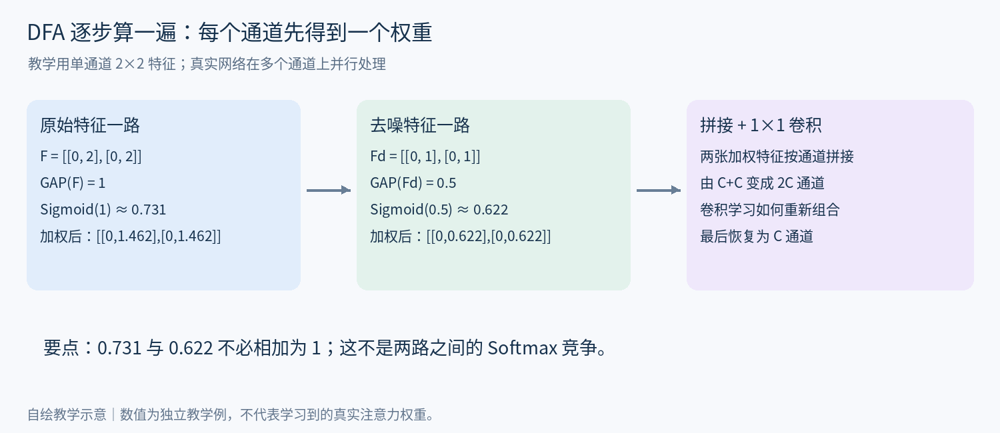

*读图：沿每一列从上往下计算，再从左往右看拼接。权重是作用于整张通道，而非单个空间位置。*

### 5.3 DFA 的实际作用

DFA 不是直接根据像素位置判断舰船与背景，而是分别调整原始特征和去噪特征的通道贡献，再学习两者的组合关系。

例如某个目标的弱散射响应在去噪过程中被削弱，如果原始特征仍然保留相应信息，那么后续融合卷积就有机会重新利用这些特征。

因此，DFA 可以为小目标信息保留提供条件。

但它无法保证所有小目标散射点都被保留。

### 5.4 DFA 的技术局限

DFA 的注意力主要作用于通道维度，而不是直接给每个空间位置分配独立权重。

Global Average Pooling 将每个通道的空间信息压缩成一个平均值，因此无法直接区分：

- 舰船自身的强散射点。
- 港口建筑产生的强散射点。
- 海浪或杂波形成的局部亮点。

这些区域如果产生相似的特征响应，也可能受到相似的通道加权。

所以，**DFA 本质上是特征融合机制，不是显式的 SAR 目标—杂波识别机制**。

---

## 六、Target Segmentation：旋转 Gaussian-Mask 辅助分割

这是论文标题中最核心的技术内容。

### 6.1 引入分割任务的原因

目标检测主要预测类别与边界框，但检测框内部不可避免地包含一定背景区域。

作者希望额外利用像素级任务学习目标区域，使网络不仅关注检测框整体，还能关注目标附近的空间分布。

因此，设计了基于旋转 Gaussian-Mask 的目标分割模块。

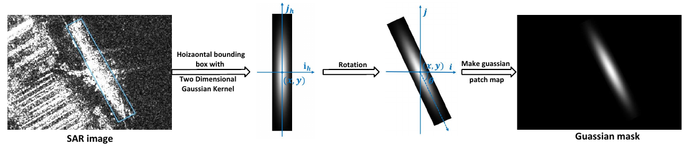

*来源：第 6 页 Fig. 6。由左向右读：舰船几何框 → 轴对齐高斯核 → 旋转 → 映射回图像。最终亮带表达几何先验，并非从 SAR 亮点直接拟合出的散射分布。*

### 6.2 Gaussian-Mask 的设计思想

普通二值掩码通常将目标区域标记为 1、背景标记为 0。

而 Gaussian-Mask 根据目标的中心、长宽和方向生成连续变化的空间权重。

其特征是：

- 几何中心权重最高。
- 权重随距离增加逐渐下降。
- 长轴方向与短轴方向具有不同的衰减速度。
- 根据目标旋转角度调整高斯分布的方向。

因此，它并不是普通圆形高斯分布，而是可以产生具有方向性的椭圆状响应。

### 6.3 公式（5）：旋转二维高斯分布

论文定义：

$$
g(i,j)=\exp\!\left[-\frac{\lambda_w(i_h-x)^2}{2w^2}-\frac{\lambda_h(j_h-y)^2}{2h^2}\right]
$$

其中：

- `(x,y)`：真实目标框中心。
- `h,w`：目标长短边。
- `θ`：旋转角度。
- `λw, λh`：控制对应方向的高斯分布宽窄。
- `(ih,jh)`：未旋转高斯核对应的坐标。

坐标旋转使用标准二维旋转矩阵：

$$
R(\theta)=\begin{bmatrix}\cos\theta&-\sin\theta\\\sin\theta&\cos\theta\end{bmatrix}
$$

通过坐标变换生成与目标方向对应的高斯权重图。

从数学上理解：

$$
\sigma_w=w/\sqrt{\lambda_w}
$$

$$
\sigma_h=h/\sqrt{\lambda_h}
$$

因此，舰船长宽及控制系数共同决定高斯椭圆的形状。

**坐标变换要绕框中心进行。** 为计算图像像素的权重，应先减中心，再逆旋转回局部坐标：

$$
\begin{bmatrix}u\\v\end{bmatrix}
=R(\theta)^\top
\begin{bmatrix}i-x\\j-y\end{bmatrix},\qquad
 g(i,j)=\exp\left(-\frac{\lambda_w u^2}{2w^2}-\frac{\lambda_h v^2}{2h^2}\right).
$$

这里 u、v 对应公式（5）中的局部两轴。本式保持原文“第一轴分母为 w²，第二轴为 h²”的写法；若实现中把长轴设为局部 x 轴，就必须同步交换尺寸约定。原文图示和角度定义的轴约定需要复现时进一步对齐。

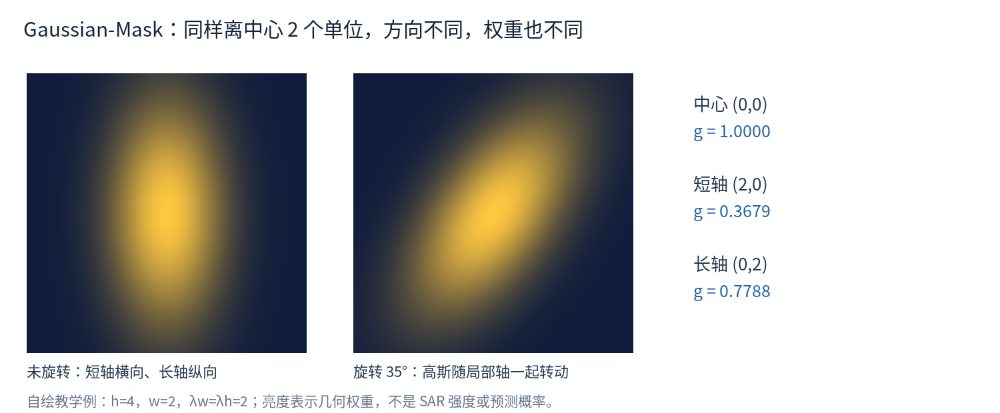

### 6.4 具体计算理解

假设：

$$
h=4,\qquad w=2
$$

$$
\lambda_w=\lambda_h=2
$$

目标中心为 `(0,0)`，暂时不考虑旋转。

则：

$$
g(u,v)=\exp(-u^2/4-v^2/16)
$$

在中心：

$$
g(0,0)=1
$$

沿短轴移动 2 个单位：

$$
g(2,0)=\exp(-1)\approx0.3679
$$

沿长轴移动 2 个单位：

$$
g(0,2)=\exp(-0.25)\approx0.7788
$$

可以看到，两个点到中心的距离相同，但由于方向不同，高斯权重不同。

这说明 Gaussian-Mask 不仅考虑距离中心有多远，也考虑像素处于目标长轴还是短轴方向。

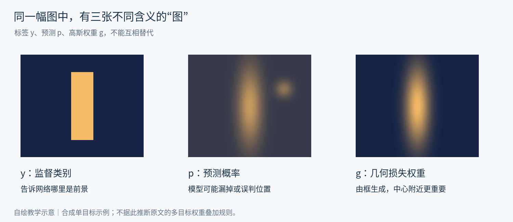

*读图：标签决定对错，预测来自模型，高斯图决定错误的权重。三者具有不同来源。*

### 6.5 公式（6）：高斯掩码如何参与分割损失

原论文采用 Gaussian-Mask 对像素级 Focal Loss 进行空间加权。

其核心结构为：

$$
L_{\mathrm{segment}}\propto\sum_{i,j}g_{ij}\,\mathrm{FocalLoss}_{ij}
$$

这里：

- `gij`：Gaussian-Mask 的空间权重。
- `pij`：网络预测像素属于舰船的概率。
- `yij`：真实像素类别。
- `γ`：Focal Loss 的聚焦系数。

因此，高斯掩码并不是直接替代网络输出的分割结果，而是控制不同空间位置对损失的贡献。

例如，两个位置产生相同的分类错误：

- 中心位置 `g=1`，保留完整损失。
- 外围位置 `g=0.1`，损失只占原来的 10%。

这意味着作者希望分割任务更重视目标中心及其几何主方向附近的区域。

**公式阅读注意：** 原文公式（6）中的对数损失未写通常用于损失最小化的负号，且预测概率的取值说明存在不严谨之处。按常规非负 Focal Loss 理解时，需要在对数项前添加负号；这是对公式的数学解释，不应误写成论文原式。

**把三个对象分开，就不会把“高斯分割”读混：**

| 符号 | 谁生成 | 表达什么 |
|---|---|---|
| yᵢⱼ | 监督标签 | 该位置属于前景还是背景 |
| pᵢⱼ | 网络预测 | 该位置属于前景的概率，应在 [0,1] |
| gᵢⱼ | 按标注框构造 | 该位置的分类损失占多大权重 |

按常规损失最小化写法，可将公式（6）理解为下式（**加入负号后的解释式，不是原文逐字抄写**）：

$$
p_t=\begin{cases}p_{ij},&y_{ij}=1\\1-p_{ij},&y_{ij}=0\end{cases},\qquad
L_{seg}=-\frac1{WH}\sum_{i,j}g_{ij}(1-p_t)^\gamma\log p_t.
$$

**教学例：** 取 γ=2。若前景像素被预测为 p=0.2，未加高斯权重的 Focal 项约为 1.030；中心 g=1 时贡献 1.030，外围 g=0.1 时贡献约 0.103。若已经预测为 p=0.9，该 Focal 项仅约 0.00105。

因此两种权重做不同的事：Focal 项关注难分像素，Gaussian-Mask 关注几何位置。对于多目标高斯如何合并、框外权重如何设定、二值标签如何得到，仅凭这段公式不能补出完整实现，不能擅自认定作者采用最大值叠加、求和或截断。

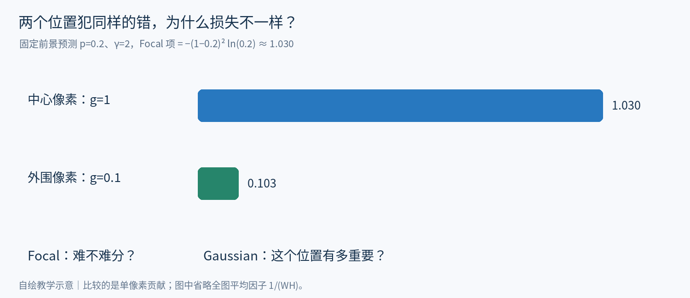

*读图：两点预测错误完全相同，仅高斯权重不同，贡献便相差十倍。*

### 6.6 Gaussian-Mask 的核心局限

Gaussian-Mask 主要依赖真实框的几何信息，不直接依据 SAR 图像的散射响应生成。

例如，舰船的舰首和舰尾可能产生较强散射，而几何中心响应较弱。

但 Gaussian-Mask 依旧将最大值放在真实框中心，不会自动把高斯峰值移动到实际强散射点。

因此：

**Gaussian-Mask 是几何空间先验，不是物理散射分布模型。**

此外，单个椭圆高斯核也不能完整描述复杂目标内部多个离散散射中心的分布。

还有一个潜在问题是：对远离目标中心的背景像素，高斯权重可能很小，导致这些区域的分类错误在分割损失中受到较弱惩罚。

所以该设计可以强调目标中心，但不保证能够充分抑制所有背景虚警。

---

## 七、WRBF：加权旋转框融合

对应论文 Fig. 7、Fig. 8、Algorithm 1、公式（7）和（8）。

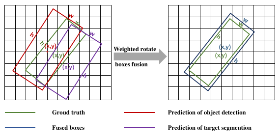

*来源：第 7 页 Fig. 8。绿色为真实框，仅用于解释；红色为检测框，紫色为分割得到的框，蓝色为融合框。真实框不参与推理时融合。*

### 7.1 设计动机

目标检测分支在多个方向上生成 Anchor，同一舰船可能对应多个高度重叠的候选框。

传统 NMS 根据置信度排序，并通过 IoU 删除冗余框。

但分类置信度较高，不意味着定位一定更加准确。

因此，作者采用 WRBF，希望保留多个候选框的有效定位信息，通过加权融合获得最终预测。

### 7.2 分割结果如何转换为检测框

检测分支可以直接输出 OBB。

而分割分支首先输出像素级概率图，需要经过目标区域提取、轮廓分析以及最小面积旋转外接矩形计算，才能形成旋转框。

因此：

`分割概率图 → 目标区域 → 轮廓 → 最小旋转外接框`

随后与检测分支的 OBB 一起参与 WRBF。

论文明确提出使用拓扑结构分析提取分割区域对应的旋转框，但没有完整说明二值化阈值、分割框置信度计算等实现细节。

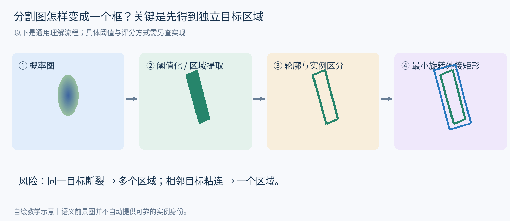

*读图：分割输出需要经过区域处理才能成为框；粘连和断裂会影响后续融合。*

### 7.3 WRBF 的处理过程

**第一步：** 汇总检测分支与分割分支产生的候选框。

**第二步：** 计算候选框之间的 IoU，根据阈值划分框簇。

**第三步：** 对同一框簇中的候选框进行置信度加权融合。

**第四步：** 得到新的中心、长宽、角度及融合置信度。

其中：

**IoU 用于判断候选框是否属于同一组；置信度用于决定组内各个候选框对融合结果的贡献。**

### 7.4 融合框置信度

论文公式（7）：

$$
C_f=\frac{\sum_{n=1}^{T}C_n}{T}
$$

其中 `T` 为当前框簇的候选框数量。

例如：

$$
C_1=0.9,\qquad C_2=0.6
$$

则：

$$
C_f=(0.9+0.6)/2=0.75
$$

这里采用算术平均，而不是置信度求和。

### 7.5 融合框位置与尺寸

论文公式（8）使用置信度加权平均：

$$
x_f=\frac{\sum_n C_nx_n}{\sum_n C_n}
$$

$$
y_f=\frac{\sum_n C_ny_n}{\sum_n C_n}
$$

长短边采用相同方法：

$$
h_f=\frac{\sum_n C_nh_n}{\sum_n C_n}
$$

$$
w_f=\frac{\sum_n C_nw_n}{\sum_n C_n}
$$

例如：

A 框中心为 `(100,80)`，置信度为 0.9。

B 框中心为 `(110,80)`，置信度为 0.6。

则融合中心为：

$$
x_f=(0.9\times100+0.6\times110)/1.5=104
$$

$$
y_f=80
$$

所以融合中心为 `(104,80)`，置信度为 `0.75`。

融合结果更接近置信度较高的 A 框。

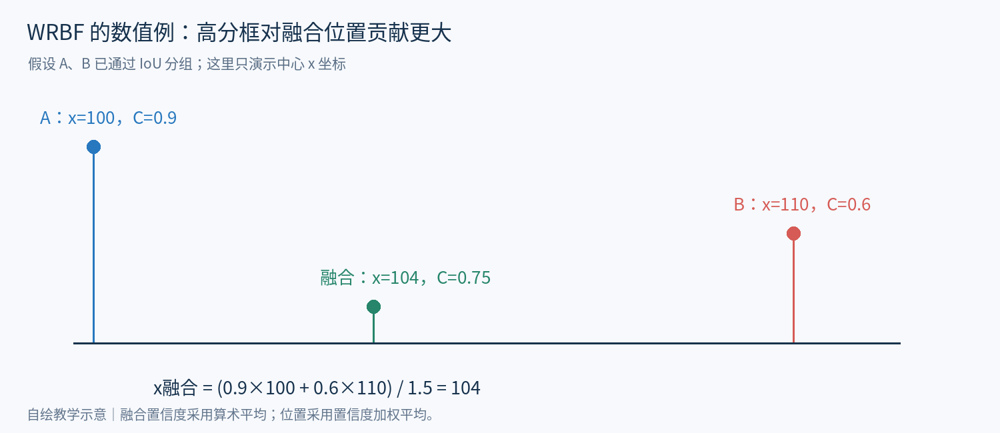

*读图：融合点落在 100 和 110 之间，并更靠近高置信度的 A。注意位置权重与融合置信度的计算不同。*

### 7.6 角度融合

作者没有直接对旋转角度数值取普通平均，而是分别对正弦和余弦分量进行加权：

$$
c_f=\frac{\sum_n C_n\cos\theta_n}{\sum_n C_n}
$$

$$
s_f=\frac{\sum_n C_n\sin\theta_n}{\sum_n C_n}
$$

论文没有单独给出由这两个分量恢复角度的最终公式。

如果使用 `atan2(sf,cf)` 恢复角度，需要额外注意旋转框的周期性。

对于具有 180° 周期的矩形长轴，直接融合 `sinθ`、`cosθ` 可能无法正确处理跨越 `-90°/90°` 边界的情况。

例如 `89°` 与 `-89°` 对应的长轴方向非常接近，但普通正弦、余弦加权可能得到接近 0° 的结果。

因此，公式（8）的角度融合存在潜在的周期处理问题。

这一点属于基于原文公式进行的数学分析，不能直接断言实际代码实现一定存在相同问题。

### 7.7 WRBF 与 NMS 的区别

| 对比 | NMS | WRBF |
|---|---|---|
| 核心目的 | 消除重复检测框 | 融合重复候选框 |
| 是否使用 IoU | 是 | 是 |
| 置信度作用 | 排序和保留 | 决定融合贡献 |
| 框坐标 | 保留选中的原始框 | 加权生成新框 |
| 可能问题 | 高分框未必定位最准 | 不准确的框可能拉偏融合结果 |

WRBF 的核心优势是能够利用多个预测框中的互补定位信息。

但它仍然依赖分类置信度进行加权，并没有直接根据每个框的真实定位误差分配权重。

因此，WRBF 不等同于定位质量最优融合。

---

## 八、整体损失与任务关系

论文公式（9）：

$$
L_{\mathrm{total}}=\lambda_1 L_{\mathrm{denoise}}+\lambda_2 L_{\mathrm{segment}}+\lambda_3 L_{\mathrm{object}}
$$

三个损失分别负责：

- 去噪图像重建。
- 像素级目标区域学习。
- 目标分类与旋转框回归。

需要注意，**多任务联合损失不等于所有分支在每一个训练阶段都同时更新**。

另外，WRBF 属于预测结果后处理，没有在公式（9）中对应独立的可微分训练损失。

因此，MLDet 的协作主要体现在共享特征、辅助监督、特征融合和预测结果融合四个方面，而不是所有模块构成一个完全可微分的统一优化过程。

---

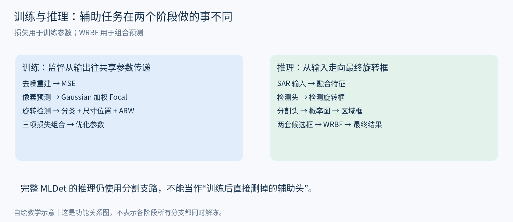

*读图：区分训练期损失与推理期预测处理，避免把 WRBF 误当作可微训练损失。*

## 九、对检测与分割关系的进一步理解

阅读这篇论文后，有一个值得单独记录的问题：

**如果分割已经能够准确找到目标区域，为什么还需要单独的检测分支？**

从理论上讲，如果获得准确的实例分割结果，并且能够区分不同目标实例，那么可以直接从掩码计算目标外接框。

但分割输出更精细，并不意味着分割任务一定更准确。

检测只需要确定类别和边界框，而分割还需要判断大量像素是否属于目标。

尤其对于 SAR 图像，目标内部可能存在暗区或不连续的强散射响应。一个目标检测框可以相当准确，但分割网络未必能够完整恢复目标轮廓。

因此：

**准确的实例分割通常能够提供可靠的检测框，但准确的检测不一定需要准确的像素级分割。**

### 9.1 分割辅助检测的三种方式

**第一种：训练期辅助监督。**

检测和分割共享特征，分割损失用于改善特征表达，推理时移除分割分支。

这种方法增加训练计算，但可以不增加推理计算。

**第二种：推理期分割框融合。**

分割分支在推理时继续运行，将预测掩码转换为检测框，再与原检测结果融合。

MLDet 的 WRBF 属于这一类。

这种方法通常同时增加训练和推理开销。

**第三种：分割或热力图指导候选框生成。**

利用前景概率、目标中心等信息，对候选框初始化或筛选进行引导。

这类方法更直接地影响 Proposal 的生成位置，但需要处理定位信息可靠性、多目标区分等问题。

### 9.2 分割辅助的本质

引入分割不是因为“分割一定比检测准确”，而是因为它可能提供更密集的空间监督信息。

但是否值得引入，取决于：

- 分割提供的信息是否确实是检测任务所缺少的。
- 分割监督是否可靠。
- 额外训练和推理成本是否合理。
- 是否能够用更简单的中心热力图等方法达到类似目的。

因此，分割辅助任务并非越复杂越好。

---

## 十、论文技术评价

以下为阅读分析，不属于作者直接给出的结论。

### 10.1 值得学习的地方

**（1）去噪与特征保留的平衡。**

DFF 的重要价值不是单纯强化去噪，而是认识到噪声抑制可能损害小目标特征，因此保留原始特征并进行融合。

**（2）利用辅助任务加强空间学习。**

Gaussian-Mask 为网络提供额外的目标位置与空间分布约束，使检测学习不完全依赖框回归。

**（3）利用多种预测结果进行定位。**

WRBF 没有直接丢弃全部低分候选框，而是尝试利用多个预测结果的互补信息。

**（4）从多个阶段处理检测问题。**

论文分别在特征、损失和后处理层面进行改进，体现了多任务辅助检测的整体思路。

### 10.2 主要局限

**（1）没有显式建模 SAR 目标的物理散射结构。**

DFF、DFA 和 Gaussian-Mask 主要依赖通用图像特征学习或几何信息，不能直接识别散射中心之间的空间关系。

**（2）通道注意力无法直接区分目标与背景亮点。**

DFA 可能增强目标相关通道，但对具有相似响应的杂波区域，也可能产生增强。

**（3）Gaussian-Mask 与实际散射分布并不完全一致。**

几何中心不一定是实际散射中心，单椭圆分布也难以表达复杂目标的多个离散散射点。

**（4）ARW 对近方形目标采用了近似周期处理。**

角度损失为零，不一定意味着预测框与真实框完全重合。

**（5）WRBF 没有显式利用定位质量。**

分类置信度较高的框未必具有更高的定位精度，错误候选框也可能对融合结果产生干扰。

---

## 十一、方法论启发：辅助任务应回应检测中的具体困难

### 11.1 先区分处理对象，再比较方法

MLDet 的去噪分支作用于 SAR 图像与特征；边界框扩散检测中的“去噪”作用于框参数。名称相同不代表操作对象、监督目标或优化过程相同。

### 11.2 几何先验与成像信息不能混为一谈

Gaussian-Mask 由标注框的中心、尺寸和方向构造。它提供几何空间权重，但不等同于从观测图像中恢复物理散射分布。迁移到其他目标形态或成像条件时，需要重新判断这种先验是否适用。

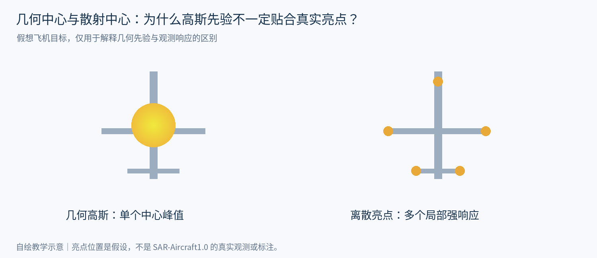

*自绘示意：框中心是几何位置，散射响应可能存在多个峰；假想结构不代表真实数据集的统计结论。*

### 11.3 将特征、监督与预测融合分开验证

DFF/DFA 改变特征，Gaussian-Mask 改变辅助监督，WRBF 改变预测后处理。评价多任务方法时，应分别验证每一层的收益与开销，再判断组合是否互补，避免将整体提升直接归因于某一个模块。

### 11.4 辅助任务的复杂度应与需求匹配

是否引入完整分割任务，取决于检测缺少的是哪种信息，以及可用标注能否提供可靠监督。更密集的输出并不自动意味着更准确或更经济；需要与更简单的辅助监督方式进行对照。

---

## 十二、阅读总结

这篇论文最值得学习的是多任务辅助检测的设计思路：

**利用去噪任务改善特征表达，通过旋转 Gaussian-Mask 提供目标空间监督，再结合旋转角度损失和多框融合提高检测过程对目标位置的利用程度。**

但整篇论文的主要技术仍然建立在通用特征学习、几何先验以及候选框后处理之上，没有直接对 SAR 目标内部的离散散射点结构进行显式建模。

对于当前 SAR 飞机检测研究，最值得借鉴的有两点：

**第一，进行任何特征增强时，都要考虑是否破坏原始的弱小目标信息。** 不能简单地认为去噪越强、注意力响应越高，检测效果就一定越好。

**第二，辅助任务应针对检测网络真正缺少的信息设计。** 如果主要问题是中心定位，就不一定需要完整分割；如果主要问题是散射结构表达，就应该优先改善特征提取机制。

**最终理解：MLDet 提供了“多任务协作改善检测”的思路。值得借鉴的是先明确检测环节中的困难，再选择对应的特征、监督或后处理设计，并分别检验必要性与适用边界。**

---

## 十三、复读时只问自己这六个问题

| 问题 | 能讲清楚的答案 |
|---|---|
| DFF 输出一张干净图供检测吗？ | 关键是中间特征融合；重建图像承担辅助监督。 |
| DFA 逐像素判断哪个亮点是船吗？ | 不直接这样做；它先按通道调节两路特征。 |
| 高斯亮带等于真实船体吗？ | 不等于，它由框的几何参数构造。 |
| ARW=0 意味着旋转框完全正确吗？ | 不意味着，近方形的 90° 角差就有反例。 |
| 分割为何不能完全代替检测？ | 像素预测可能断裂或粘连，实例划分也会出错。 |
| WRBF 一定比 NMS 定位准吗？ | 不保证，分组错误或高分偏框也会拉偏结果。 |

**验证思路：** 先定位错误发生的阶段，再选择一种对应设计。特征融合要检查弱小目标信息是否受损；辅助监督要检查标签可靠性与收益；预测融合要检查分组错误与定位偏差。每项改动同时比较精度、推理时间和训练成本。

### 图像与来源说明

- 论文版本：arXiv PDF，首页标记 arXiv:2411.13847v1，2024-11-21。页眉中的 2021 年模板信息不作为发表日期。
- 原文插图：Fig. 2、3、4、5、6、8，分别对应 PDF 第 4、4、5、5、6、7 页；仅裁去周围正文，未改变图中内容。
- 自绘教学图共 13 张：包括整体协作、高斯权重、水平框与旋转框、角度几何、ARW 权重曲线、去噪取舍、DFA 数值计算、标签/预测/权重对照、损失贡献、掩码转框、WRBF 数值、训练与推理、散射与几何先验。均为教学示意，不是原论文实验图，也不是模型实际输出。
- 所有性能判断仍需实验验证，本笔记未整理实验表格，不据此声称某一模块在新任务中有效。
