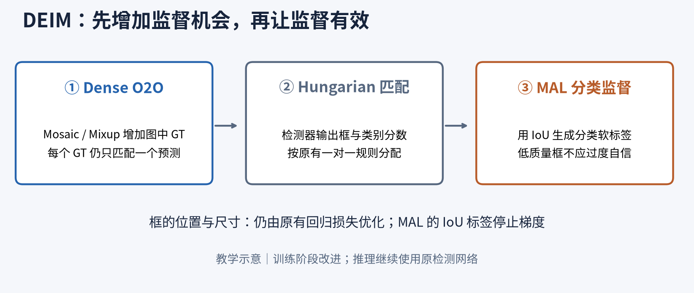
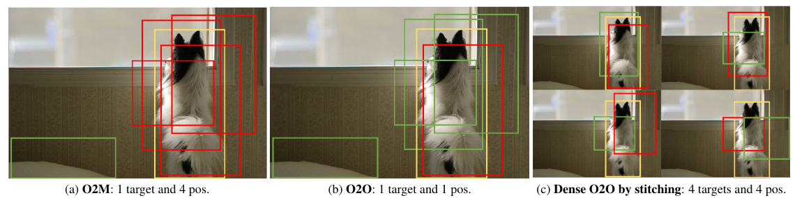
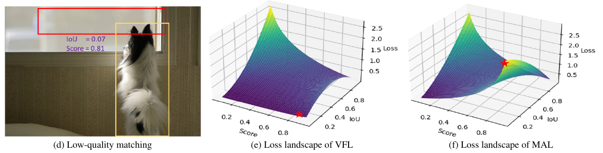
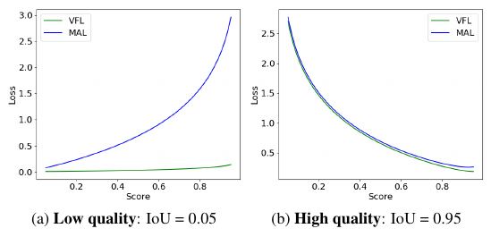
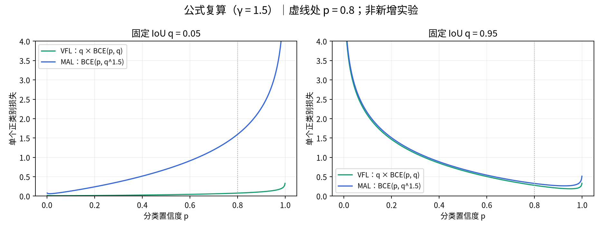

# DEIM｜让监督更多，也让低质量匹配得到有效训练

> **论文信息**：Shihua Huang 等，CVPR 2025，pp. 15162–15171

> **论文类型**：实时 DETR 的训练机制改进（匹配监督密度 + 分类损失）

> **论文原文**：[仓库 PDF](../originals/2026-11-01_DEIM.pdf) · [CVF 原文](https://openaccess.thecvf.com/content/CVPR2025/papers/Huang_DEIM_DETR_with_Improved_Matching_for_Fast_Convergence_CVPR_2025_paper.pdf)

> **官方代码**：[DEIM](https://github.com/Intellindust-AI-Lab/DEIM)

> **阅读定位**：原文事实与个人理解分开记录；实验只保留关键证据。

**笔记完成日期：** 2026-11-01。

**核查范围：** CVPR 正文 PDF（10 页）与官方 `DEIMCriterion` 的分类损失实现；未复现实验，未取得补充材料。

**标记约定：** 原图、表格数值来自论文；“理解”“教学示意”是辅助解释；SAR 迁移部分是个人研究设想。

## 先看这一页：DEIM 到底改了哪里？

把 DETR 想成一个同时给出许多“框 + 类别分数”的检测器。训练时，需要先决定每个真实目标由哪个预测负责，再计算负责者的分类和定位损失。DEIM 主要改进这条**训练监督链路**。



*自绘教学图：从左到右读。Dense O2O 改变输入中目标的数量；Hungarian 负责分配；MAL 作用于分配之后的分类监督。箭头表达监督流程，不是新增网络层。*

| 先遇到什么问题 | 作者怎么处理 | 阅读时抓住什么 |
|---|---|---|
| 一张图只有少量 GT，能分配的正样本有限 | 用 Mosaic / Mixup 增加每张输入图的 GT | 增加的是目标数 N，单个 GT 的匹配数仍是 1 |
| 有些已匹配框与目标重叠很少，却给出高分 | MAL 对这类分类错误提供更强信号 | 匹配身份、框质量、类别分数是三件事 |
| 强增强未必适合训练全过程 | 使用分阶段增强调度 | 后期关闭 Dense O2O 不会取消一对一匹配 |

**建议阅读路径：** 先看 §3 的拼图，再看 §4.1 的低质量框；理解后再读 §4.3–4.5 的公式。§6 用实验核查收益，§8 再讨论对 SAR 的启发。

### 四个词先认清

| 术语 | 在这篇笔记中的意思 | 容易混淆的地方 |
|---|---|---|
| GT | 数据标注给出的真实目标框及类别 | 不是模型生成的预测框 |
| Query | 检测器用于产生候选预测的槽位 | 不等于已经找到的目标 |
| 正样本 | 被训练匹配规则分配给 GT 的预测 | 不保证预测框已经准确 |
| IoU | 预测框与 GT 的交集面积 / 并集面积 | 衡量框的重叠，不是类别置信度 |

> **贯穿全文的小例子：** 图里只有一只狗，但网络输出很多框。一个框最终被分配给狗，只说明“由它负责学习这只狗”；即便这个框偏到狗头上方，它仍可能是已匹配的正样本。DEIM 既想增加这样的学习机会，也要避免偏框仍然自信地报高分。

## 1. 论文概述与研究动机

这篇论文的核心不是重新设计 DETR 的 Backbone、Encoder 或 Decoder，而是研究**为什么 DETR 的训练收敛仍然较慢，以及能不能在尽量不改变推理结构的情况下提高训练效率**。

作者将问题概括为两个方面：

1. **稀疏监督（Sparse Supervision）**：O2O 匹配规定每个 GT 只匹配一个正样本；相较于 O2M，每张图参与有效目标监督的预测数量较少。
2. **低质量匹配（Low-quality Matching）**：Query 与目标的空间位置未必对齐，即使通过匈牙利算法匹配成正样本，预测框也可能与 GT 重叠很少，却给出较高分类置信度。

我对这篇文章的总体理解是：**DEIM 分别从“正样本数量”和“低质量匹配的监督有效性”两个方向改进训练。** Dense O2O 负责增加一张训练图中的正样本数量，MAL 负责使分类监督能够更加充分地处理低 IoU 的匹配预测。这两者主要作用于训练过程，而不是增加一个推理时使用的检测模块。

## 2. 方法整体流程

```text
训练图像与 GT
    ↓
按训练阶段进行 Mosaic / Mixup 等数据增强
    ↓
增加单张训练图中的 GT 数量（Dense O2O）
    ↓
原有检测网络输出 Query 对应的预测框和类别分数
    ↓
Hungarian Matching：每个 GT 仍只匹配一个正样本
    ↓
按匹配结果计算分类损失 MAL + 原有的边界框回归损失
    ↓
反向传播、更新模型参数
    ↓
训练后期关闭 Dense O2O；推理时使用原有检测架构
```

需要注意：**Mosaic、Mixup 是实现 Dense O2O 的数据增强手段，本身不是新的匹配算法；MAL 也不是负责重新执行 Hungarian Matching。**

## 3. 核心方法一：Dense O2O（论文 §3.2、Fig.2、公式 1）



*来源：正文 PDF 第 3 页 / 页脚 15164，Fig.2(a–c)。黄色为 GT，红色为正样本预测，绿色为负样本预测。*

**按三步读图：**

1. **看左边：** 一只狗对应多个红框，是 O2M，同一个 GT 获得多份正样本监督。
2. **看中间：** 一只狗只对应一个红框，是 O2O。其余框即便靠近狗，也不自动成为正样本。
3. **看右边：** 拼图后出现四个目标实例，各自对应一个红框，是 Dense O2O。仍然是“一只狗由一个预测负责”。图中重复同一图像是原理示意，不表示实现只能复制同一图。

| 教学计数（不含去噪 / 辅助分支） | 每图 GT 数 N | 每个 GT 的正匹配数 | 总正匹配数 |
|---|---:|---:|---:|
| 普通 O2O | 1 | 1 | 1 |
| 示例 O2M | 1 | 4 | 4 |
| 示例 Dense O2O | 4 | 1 | 4 |

**四个正样本不等于同一种监督关系。** Dense O2O 还受固定 Query 数量与增强后有效标注数量约束，不能无限增加 GT。

### 3.1 O2O 和 O2M 的本质区别

论文用一个概括性的正样本监督公式表示：

$$
\mathcal L_{\mathrm{match}}=\sum_{i=1}^{N}\sum_{j=1}^{M_i}f(\hat y_{ij},y_i)
$$

这里将求和下标整理为从 1 开始。$N$ 表示一张图中的 GT 数量，$M_i$ 表示第 $i$ 个 GT 匹配到多少个正样本，$\hat y_{ij}$ 为对应预测，$f$ 为损失。这个式子只用于说明监督数量，不等于 DETR 完整训练损失。

- **O2O**：$M_i=1$，一个 GT 只分配一个正样本。
- **O2M**：通常 $M_i>1$，一个 GT 可以分配多个正样本。
- **Dense O2O**：依旧保持 $M_i=1$，但是利用数据增强增大每张图的 $N$。

举例：原图只有 1 个目标，O2O 得到 1 个正样本；若将四张含有目标的图拼成一张复合图，得到 4 个 GT，则仍按 O2O 规则得到 4 个正样本。这里增加的是**不同 GT 的数量**，不是“一个 GT 对应四个 Query”。

这也是我阅读 Fig.2(a–c) 后确认的关键区别：**Dense O2O 并没有变成 O2M；两者可以在整张图的正样本数量上接近，但匹配关系及监督来源并不等价。**

### 3.2 为什么这样设计

已有一些方法通过额外的 Query 组、Decoder 或辅助检测头引入更多正样本。DEIM 则尝试从训练数据侧实现监督密集化，避免为获得 O2M 式密集监督而额外引入推理结构。

不过我认为必须区分：**GT 数量增加 ≠ 新增了同等数量的独立信息**。Mosaic、Mixup 改变了图像尺度、背景和目标呈现方式；正样本总数增加，也不能保证匹配框的平均 IoU 同时提高。作者正是因此引入第二个模块 MAL。

## 4. 核心方法二：Matchability-Aware Loss（论文 §3.3、公式 3–4、Fig.4）



*来源：正文 PDF 第 3 页 / 页脚 15164，Fig.2(d–f)。先看左边：红框偏离黄色 GT，IoU 只有 0.07，分数却达 0.81；再看右边两张曲面的星号，MAL 在这个位置给出更大的损失。曲面只说明损失响应，不能据此声称框坐标已经被修好。*

### 4.1 先分清匹配身份与匹配质量

- $y=1$：Query 被匹配给某个 GT，是训练意义上的正样本。
- $q$：该预测框与其匹配 GT 的 IoU，表示定位质量。
- $p$：该预测对目标类别的置信度。

**“被分配为正样本”并不等于“IoU 很高”。** 论文 Fig.2(d) 给出 $q=0.07$、$p=0.81$ 的例子：框几乎没有覆盖目标，却预测得非常自信。Hungarian Matching 做的是满足一对一约束的全局匹配，并不保证每个被匹配的预测都有较高 IoU。

### 4.2 VFL 的问题

**先不用公式理解：** VFL 会让分类分数参照框质量，但又给低质量框的整项损失乘一个很小的权重。于是，一个“框很差但很自信”的预测，虽然错得明显，受到的总惩罚仍可能很小。MAL 去掉这层正样本权重，让这类错误更值得被纠正。

论文公式（3）的正样本分支可以写成：

$$
L^{+}_{\mathrm{VFL}}=-q\left[q\log p+(1-q)\log(1-p)\right]
=q\,\mathrm{BCE}(p,q)
$$

VFL 一方面以 IoU $q$ 为分类软标签，另一方面又用 $q$ 作为整个损失的权重。当 $q$ 很小时，损失会被同步压低，因此对于“低 IoU、高置信度”的已匹配预测，优化信号可能较弱。

负样本分支在原文中写为：

$$
L^-_{\mathrm{VFL}}=-\alpha p^\gamma\log(1-p)
$$

其中 $p^\gamma$ 使过度自信的背景预测受到更强惩罚，$\alpha$ 用于控制权重。

### 4.3 MAL 的实际计算机制

**勘误提醒**：论文印刷版公式（4）的正样本分支第二项为加号；但这与非负 BCE 的形式及 Fig.4 曲线不一致。官方代码使用 `binary_cross_entropy_with_logits`，故按**实际实现**理解为：

$$
L_{\mathrm{MAL}}=\begin{cases}
-q^\gamma\log(p)-(1-q^\gamma)\log(1-p),&y=1\\
-p^\gamma\log(1-p),&y=0
\end{cases}
$$

于是正样本分支等价于：

$$
\boxed{L^+_{\mathrm{MAL}}=\mathrm{BCE}(p,q^\gamma)}
$$

与 VFL 相比有两个变化：

1. **去掉正样本外层的 $q$ 权重**：低 IoU 匹配不再因为整体乘以 $q$ 而被明显削弱。
2. **将分类软标签由 $q$ 改为 $q^\gamma$**：当 $\gamma>1$、$0<q<1$ 时，$q^\gamma<q$，定位差的正样本不应该获得很高的分类置信度。

以 $p=0.8$、$q=0.05$、$\gamma=1.5$ 为例：

$$
q^\gamma=0.05^{1.5}\approx 0.01118
$$

$$
L^+_{\mathrm{VFL}}\approx0.0770,\qquad
L^+_{\mathrm{MAL}}\approx1.5939
$$

同一个低 IoU、高置信度预测，在 MAL 下获得明显更大的分类处罚；这正对应论文 Fig.4(a) 的曲线。对于 $q=0.95$ 的高质量匹配，二者曲线则较接近（Fig.4(b)）。



*来源：正文 PDF 第 5 页 / 页脚 15166，Fig.4。横轴是分类分数，纵轴是损失。左图固定低 IoU，蓝色 MAL 随分数升高明显上升；右图固定高 IoU，蓝绿曲线接近。不要把横轴误读成训练 Epoch。*



*自绘公式核查图：统一取 γ=1.5；展示完整 p 区间，非论文实验。固定 q 时，VFL 在 p=q 附近最小，MAL 在 p=q^γ 附近最小，所以 MAL 也不是“分数越低永远越好”。高 IoU 时目标仍很高，合理的高分会被鼓励。*

**把一个训练步走完（教学例子）：**

| 环节 | 已匹配、低 IoU 框会发生什么 |
|---|---|
| 分配责任 | Hungarian 已经将这个预测分配给狗 |
| 测量质量 | 当前框与 GT 的 IoU 为 0.05，分类分数为 0.8 |
| MAL 分类目标 | γ=1.5 时软标签约为 0.0112，当前分类分数明显过高 |
| 分类更新方向 | 降低这个预测对该类别的过度自信 |
| 框坐标更新 | 原有 L1 / GIoU 等回归损失继续提供定位监督 |

**这不是把狗标成“没有狗”。** 它是在目标类别通道上用质量软标签监督分数。该框若在后续训练中定位变好，重新计算的 IoU 及分类目标也会升高；具体训练轨迹仍受整个模型优化影响。

### 4.4 我对 MAL 梯度的理解

记分类 Logit 为 $z$，$p=\sigma(z)$，并将 IoU 作为停止梯度的监督目标，则：

$$
\frac{\partial L^+_{\mathrm{VFL}}}{\partial z}=q(p-q)
$$

$$
\frac{\partial L^+_{\mathrm{MAL}}}{\partial z}=p-q^\gamma
$$

对于 $p=0.8$、$q=0.05$，前者约为 0.0375，后者约为 0.7888。这解释了 MAL 为什么能够对过高的分类置信度给出更强的梯度信号。

我在这一步特别区分两件事：

- **MAL 直接优化的对象是分类分数的合理性**，鼓励置信度与定位质量相协调。
- **MAL 并不直接通过 IoU 监督信号来推动预测框坐标移动**；官方实现对 IoU 使用 `detach()`，几何回归仍主要由边界框损失完成。

另外，代码按“是否匹配”为正负身份，而不是简单按 IoU 是否大于 0 决定。因此一个**已匹配但 IoU 恰好为 0**的预测，在 MAL 中仍可按正样本分支计算 $\mathrm{BCE}(p,0)$。这与把所有 $q=0$ 一概当成普通未匹配负样本不同。

### 4.5 $\gamma$ 的作用

正样本中 $\gamma$ 控制 IoU 变成软标签的幅度；负样本中 $\gamma$ 控制高置信度背景的损失权重。$\gamma$ 不是越大越好，过大也可能压低中等质量匹配的分类目标。论文 Table 5 在所测试的 1.3、1.5、1.8、2.0 中，$\gamma=1.5$ 对应最高 AP，因此采用该值；它是实验选取的超参数，并非通用最优常数。

## 5. 训练策略：密集监督并非全程开启

正文 §4.1 明确给出：通常先用约 4 个 Epoch 做增强预热；训练中途关闭 Dense O2O；最后 2 个 Epoch 关闭数据增强。正文写到关闭 Dense O2O 的时机在训练约 50% 之后，具体调度指向补充材料，但当前阅读材料不含补充材料。

| 阶段示意 | 输入增强 | 理解 |
|---|---|---|
| 初期预热 | 暂不开启高级增强 | 先建立初步学习能力 |
| 中前期 | 启用 Dense O2O | 增加一张输入中的目标和正匹配 |
| 后期 | 关闭 Dense O2O，保留常规增强 | 不再持续依赖拼接 / 叠加输入 |
| 最后 2 Epoch | 关闭增强 | 完成最后训练 |

具体配置的精确增强调度边界仍需结合补充材料核查，不将单一配置的阶段划分推广到所有模型。

关闭 Dense O2O 不等于停止 Hungarian Matching，一对一分配仍然存在。“前期借密集监督加速学习，后期回到更接近常规输入的分布”是对调度的理解，不是作者独立证明的因果结论。

## 6. 关键实验结论（精简记录）

只保留能支撑方法结论的关键结果，不逐表罗列所有检测器。

### 6.1 核心消融（Table 6）

**先记清衡量对象：** AP 是精度指标，Epoch 是遍历训练集的轮数，GPU·h 是训练算力时间，ms 是单次推理延迟。训练收敛加快与推理加快需要分别评价。

| 模型 / 配置 | Epoch | AP | AP50 | AP75 |
|---|---:|---:|---:|---:|
| RT-DETRv2-R50 基线 | 72 | 53.4 | 71.6 | 57.4 |
| + Dense O2O | 36 | 53.6 | 71.9 | 58.2 |
| + Dense O2O + MAL | 36 | **53.9** | 71.7 | **58.6** |
| D-FINE-L 基线 | 72 | 54.0 | 71.6 | 58.4 |
| + Dense O2O | 36 | 54.2 | 72.1 | 58.9 |
| + Dense O2O + MAL | 36 | **54.6** | **72.2** | **59.5** |

我的判断：Dense O2O 能以更少 Epoch 达到或超过原始基线；在同为 36 Epoch 的比较中，加入 MAL 又提升了 AP 和 AP75。但 **RT-DETRv2-R50 的 AP50 从 71.9 下降到 71.7**，不能说所有指标都提高。

此外，Table 6 没有给出同 Epoch 的纯基线及单独使用 MAL 的完整消融，因此还不足以把所有收益完全分解为两个模块的独立贡献。

### 6.2 实际训练时间与推理代价（Table 1、Table 7）

- RT-DETRv2-R50：基线 **72 Epoch / 约 85 GPU·h / 53.4 AP**；DEIM **60 Epoch / 约 71 GPU·h / 54.3 AP**，这组实际总 GPU 时间下降约 **16.5%**，不是 50%。
- 单 Epoch 时间为 **1.181 对 1.183 GPU·h**，几乎未变。DEIM 的“快”主要是更快达到目标精度，**不是单步计算量减半**。
- D-FINE-L 与 DEIM-D-FINE-L 都约 **31M 参数、91 GFLOPs、8.07 ms**，AP 则由 **54.0 提升到 54.7**。其收益主要来自训练改进，并不额外增加推理模块。

### 6.3 Mosaic 与 Mixup（Table 4）

12 Epoch 时，仅 Mosaic（概率 0.5）由 49.6 提高到 50.4 AP；24 Epoch 时，Mosaic 与 Mixup 联合使用由 51.7 提高到 52.5 AP。但单用 Mixup 的24 Epoch结果为51.5，低于不启用两种增强的51.7。**增强方法的收益依赖组合与训练阶段，不能简单认为“增强越多越好”。**

## 7. 方法合理性与局限

**从原文可直接确认的方面：** DEIM 不改变 O2O 的每 GT 匹配一个正样本约束；增加训练图像中的GT数量后可能出现更多低质量匹配；MAL主要通过IoU软标签优化分类置信度；在论文测试的RT-DETRv2、D-FINE等模型中出现了收敛和精度收益。

**我的机制分析与需要进一步验证的疑问：**

1. **增加匹配数量不代表改善单框几何质量。** Dense O2O没有直接改变Query初始化、匈牙利匹配代价或边界框回归机制。它可能让监督更多，却不能保证每个GT都得到更高IoU的匹配。
2. **MAL改善分类—定位质量一致性，不等于直接解决框偏移。** AP75的提升既可能涉及更优的定位，也可能涉及高IoU预测排序与分数校准的改善，需要额外分析区分。
3. **低IoU但是真实的难目标，可能被赋予较低分类目标。** 这有助于压制过度自信的低质量框，但是否影响早期难目标学习和召回，需要在特定数据集上观察。
4. **训练图像的物理与统计性质被增强改变。** 特别是Mosaic的尺度缩小、Mixup的图像叠加是否适用于SAR散射结构，不能由COCO实验直接得出结论。
5. **消融证据不完全。** 缺少MAL-only与充分同训练时长对照，且训练调度、增强方式之间可能存在交互；不宜把全部性能提升归因到单一模块。

## 8. 方法论启发：先诊断监督瓶颈，再选择改进机制

### 8.1 将监督数量与监督有效性分开分析

Dense O2O 增加单张输入图中的目标数量，MAL 调整已有匹配的分类监督。二者回应不同问题：更多正匹配不保证单框定位更准，分类信号更强也不等同于直接移动框坐标。

### 8.2 迁移损失前先检查原有训练机制

质量感知分类的适用性依赖匹配规则、分类目标与几何回归之间的关系。迁移到其他检测器前，应核对现有匹配、候选组织和损失实现，先统计预测分数与 IoU 的关系、低 IoU 高分框比例、正样本质量分布、虚警与召回，再判断是否存在对应瓶颈。

### 8.3 数据增强需要考虑目标领域

Mosaic 的缩放与 Mixup 的叠加会改变目标呈现方式及背景统计。自然图像上的收益不能直接证明其适用于 SAR 成像；是否损害细节、召回或分数校准，需要独立实验。这些是适用性问题，不是已证实的缺陷。

### 8.4 将训练效率与推理效率分别评价

比较训练方法时，除了 Epoch，还应检查实际 GPU 时间、达到目标精度的预算及增强成本。评估时控制数据划分和训练条件，分别报告分类、定位、虚警和召回的变化，避免把单项 AP 增加解释成全部问题已解决。

## 9. 用四个问题检查自己是否理解

| 问题 | 应该能说出的答案 |
|---|---|
| Dense O2O 是一个目标分配多个 Query 吗？ | 不是。它增加输入图的 GT 数，每个 GT 仍只有一个正匹配。 |
| 已匹配为什么还能低 IoU？ | 匹配是受一对一约束的全局分配，分配责任不等于当前框已经准确。 |
| MAL 如何处理“低 IoU、高分”？ | 去掉正样本整体的 IoU 权重，以 q^γ 为软标签，加强对过高分类分数的惩罚。 |
| MAL 能直接把框拉到 GT 上吗？ | 这里 IoU 标签停止梯度，坐标仍依赖原有回归损失；后续共享特征优化可能产生间接影响。 |

## 10. 阅读总结

**一句话总结DEIM：** 不改变单目标一对一匹配的基本规则，通过增加训练图像中的GT数量获得更密集的监督，再利用MAL避免低IoU正样本的分类监督被过度削弱，从而改善实时DETR的收敛效率。

我认为最值得学习的不是Mosaic或某个具体公式，而是作者把问题拆成了两个可验证的环节：**监督数量是否够，以及已有监督是否真正有效。** 对后续SAR目标检测研究而言，需要首先判断主要瓶颈究竟发生在特征质量、候选框空间覆盖、正样本匹配，还是分类置信度校准，再考虑适合的改进机制。

---

**原文定位**：§3.1 / Eq.(1)（O2O与O2M）；Fig.2、§3.2（Dense O2O）；§3.3 / Eq.(3)–(4)、Fig.4（VFL与MAL）；§4.1（调度原则；补充材料 Fig.5 未取得）；Table 4–7（关键消融与训练成本）。

## 11. 图片与核查来源

- 原论文：CVPR PDF；页码同时给出 PDF 页序与论文页脚编号，便于本地查找。
- 官方损失实现：[engine/deim/deim_criterion.py](https://github.com/Intellindust-AI-Lab/DEIM/blob/main/engine/deim/deim_criterion.py)，核查日期 2026-11-01。`loss_labels_mal` 使用 IoU `detach()`、`target_score.pow(self.gamma)` 与 `binary_cross_entropy_with_logits`；正负分支权重由匹配类别掩码决定。当前代码另支持可选 `mal_alpha`，本文公式对应默认未设置该项的形式。
- Fig.2 上、下半部分及 Fig.4 为原图裁取，没有改动原始数据；总览图为教学示意，复算曲线依据本文列出的正样本公式生成，不代表额外实验。

**阅读边界：** 本文讲述论文提出及测试时的结果，不将 2025 年的“最优”表述当作当前榜单结论。跨领域迁移部分用于分析适用条件，不代表已完成新任务上的验证。
