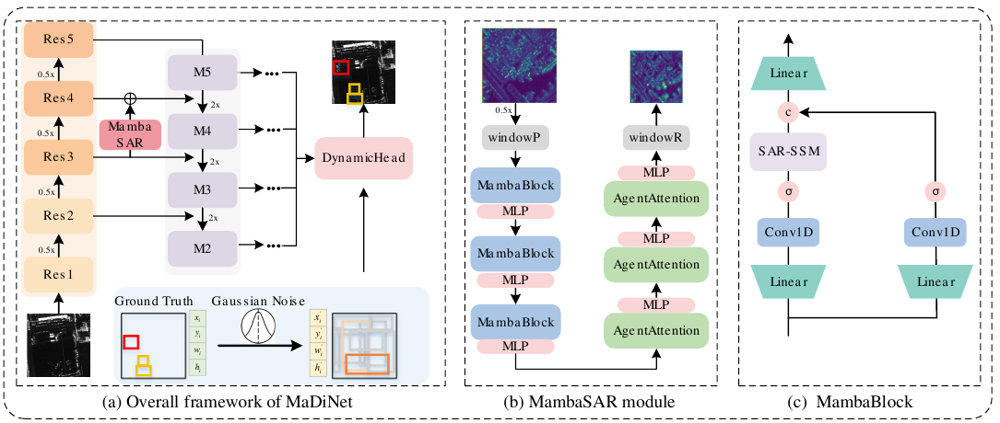
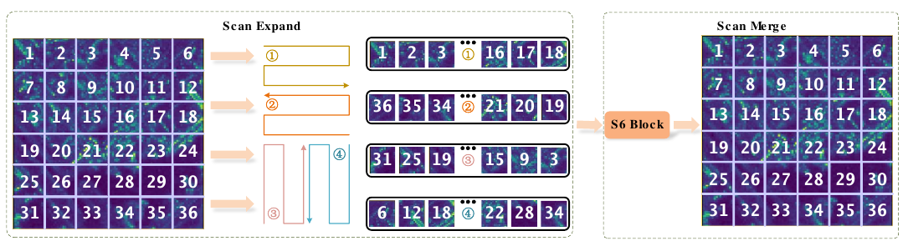
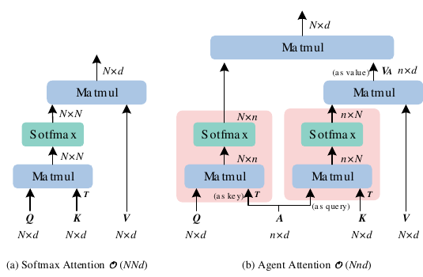

# MaDiNet｜先改善 SAR 空间表示，再进行检测框去噪

**论文名称：** MaDiNet: Mamba Diffusion Network for SAR Target Detection

**中文译名：** 面向 SAR 目标检测的 Mamba 扩散网络

**作者：** Jie Zhou、Chao Xiao、Bowen Peng、Tianpeng Liu、Zhen Liu、Yongxiang Liu、Li Liu

**核对版本：** arXiv:2411.07500v1，2024-11-12。

**笔记整理日期：** 2026-11-01。

**阅读范围：** 以问题定义、方法设计为主，用 Table 6–8 核查设计解释；未核查代码或复现实验。

**原文 / 代码：** [仓库 PDF](../originals/2026-11-01_MaDiNet.pdf) · [arXiv](https://arxiv.org/abs/2411.07500v1) · [官方代码](https://github.com/JoyeZLearning/MaDiNet)

> **标记约定：** “原文”表示作者给出的结构、动机或结果；“理解”表示教学解释；“个人分析／研究设想”表示由此延伸的判断，不能当作论文已经验证的结论。文中页码采用论文页脚编号，PDF 实际页序需加 1。

## 先看这一页：作者在检测链路的哪里动手？

SAR 飞机可能表现为多个分离的强散射区域，周围建筑也可能很亮。检测器既要判断“哪些响应属于同一目标”，又要把框的位置与尺寸估计正确。

MaDiNet 将问题分到两个层次：

| 层次 | 处理对象 | 方法 | 作用理解 |
|---|---|---|---|
| 特征表示 | SAR 图像的中间特征 | CNN、MambaSAR、可变形卷积、FPN | 为检测头提供更有区分力的局部与上下文信息 |
| 检测预测 | 带噪检测框参数 | DiffusionDet 式条件去噪 | 根据图像特征逐步预测目标框及类别 |

**主要增量是 SAR 特征表示的改进；框扩散范式主要承接 DiffusionDet 与作者此前的 DiffDet4SAR。** 这不等于已经核实两者代码完全相同。

全文沿一条主线阅读：**SAR 有什么困难 → 哪个检测环节受影响 → 采用什么设计 → 实验支持到什么程度。**

## 一、问题从哪里来：离散散射、稀疏目标与复杂背景

### 1.1 离散散射让“目标整体”不再直观

原文 Introduction 指出，SAR 中的飞机、舰船常表现为离散后向散射点的集合，缺少光学图像中连续的轮廓与纹理。局部亮点不一定能代表整个目标，局部预测也可能出现漏检或将同一目标拆成多个实例。

**理解：** 网络需要结合多个位置的响应及周围环境，才能更可靠地判断目标范围。但“建立长距离依赖”不等于显式识别出每个散射中心及其归属。

### 1.2 稀疏且尺度多变，使固定候选框配置面临适配问题

作者据此引入随机框到目标框的生成式检测思路，减少对手工设计 anchor 位置、尺度与长宽比的依赖。

**证据边界：** 这是作者选择框扩散范式的动机；不能由此推断所有 anchor-based 方法都无法处理 SAR，也不能认定随机框天然保证更准确的中心定位。

### 1.3 更大的感受范围同时带来机会与风险

周围结构和金属设施可能具有与目标相似的散射响应。扩大上下文有助于判断目标与环境关系，也可能把更多背景干扰纳入表示。

因此作者选择 CNN 与 Mamba、Attention 混合，而不是只追求更大感受野。**这篇论文值得学习的矛盾是：如何利用全局信息，同时保留局部细节并控制背景干扰。**

## 二、整体框架：图像条件路径与框去噪路径协作



*来源：论文第 5 页 Fig. 5，裁取原图。左图看 Res3 到 Res4 的旁路，中图从左上沿箭头读到右上，右图看两路特征在 c 处拼接。图中 σ 按正文解释为 SiLU。*

```text
图像条件路径：SAR 图像 → CNN 特征提取
                         ├─ 原 CNN 路径 ─────────┐
                         └─ Res3 → MambaSAR ─────┤
                                                ↓ 相加得到增强 Res4
                                     后续骨干及 FPN → 多尺度特征
                                                            ↓
框预测路径：训练用带噪 GT 框／推理用随机框 → 条件检测头 → 类别与目标框
                                                            ↑
                                                          时间步 t
```

这是一张概念流程图，省略了具体检测头内部结构。**Dynamic Head 参与条件去噪预测，不能把它理解为先输出检测结果、再交给一个独立“扩散模块”处理。** 推理中的迭代使用图像特征作为条件，通常无需为每个去噪步重新提取整张图像的骨干特征。

论文保留 CNN 主干，在中间层通过旁路补充 MambaSAR 表示；另在中高层引入可变形卷积，再用 FPN 形成多尺度特征。FPN 与框扩散均是整体系统的重要组成，主要新设计集中于骨干特征增强。

## 三、框扩散：加噪的是框参数

### 3.1 训练时输入什么，预测什么？

原文第 4 页将一个水平框表示为：

$$
b_i=(c_{x,i},c_{y,i},w_i,h_i),\qquad z_0=b\in\mathbb R^{N\times4}.
$$

前向加噪为原文式（1）：

$$
q(z_t\mid z_0)=\mathcal N\!\left(z_t;\sqrt{\bar\alpha_t}z_0,(1-\bar\alpha_t)I\right).
$$

等价的采样解释为：

$$
z_t=\sqrt{\bar\alpha_t}z_0+\sqrt{1-\bar\alpha_t}\,\epsilon,
\qquad\epsilon\sim\mathcal N(0,I).
$$

网络结合图像条件、时间步和带噪框预测干净框，并预测类别：

$$
\hat z_0=f_\theta(z_t,t,x).
$$

**理解：** 随噪声增加，框坐标包含的真实位置信息变少，网络更需要图像条件来完成定位；这是直觉解释，不是本文对各时间步信息需求的实验结论。

### 3.2 推理为什么能从随机框开始？

训练让网络学习在不同噪声水平下恢复目标框；推理从噪声先验采样框参数，利用图像条件逐步更新为检测框。

应区分三个概念：

- 加噪对象是框参数，本文没有用扩散模型对 SAR 图像做去斑。
- 随机框仍是候选框，只是初始化方式不同，不能说模型“完全没有 proposal”。
- 噪声参数空间不等于直接对任意像素坐标加噪。具体归一化、尺度变换、补齐框数与采样调度，需要核查实现，本文不据式（1）自行补全。

### 3.3 式（2）不能代替完整训练实现

原文式（2）以平方误差概述恢复目标：

$$
\mathcal L_{\mathrm{train}}=\tfrac12\|f_\theta(z_t,t)-z_0\|^2.
$$

原文此式省略了图像条件，而正文又说明预测类别。**仅凭该式不能断言检测器只使用 L2 损失**，也无法确定分类、框匹配和其他回归损失的完整实现。这一处作为复现前的待核查项保留。

## 四、MambaSAR：为何增强 Res4，而不替换整个骨干？

### 4.1 两路互补与中间层融合

原文 Table 7、Fig. 13(e) 的最终结构为：

$$
\mathrm{Res4}_{\mathrm{enh}}
=\mathrm{ori\_Res4}+\mathrm{MambaSAR}(\mathrm{Res3}).
$$

这里的 MambaSAR 包含下采样，使旁路输出能与 Res4 融合。因此上式不是说 Res3 与 Res4 原本具有相同空间尺寸和通道数。

**作者解释：** 前面的 CNN 先处理局部信息，中间层 MambaSAR 再建模较大范围关系，并保留原 CNN 表示。若直接处理最高层，可能损害已经形成的高层语义；不合适的响应还可能通过 FPN 传播到多个尺度。

**个人分析：** 中间层在空间细节与语义之间提供一种折中；残差相加提供保留原表示的路径，但不保证新分支一定不会带来干扰。“浅层全是杂波、最高层必然被破坏”都过于绝对。

### 4.2 内部顺序是三个 MambaBlock，再三个 Agent Attention

结合 Fig. 5(b) 和第 5 页正文，模块包括窗口处理、三层 MambaBlock 与三层 Agent Attention；每层还带有 MLP。原文式（3）的主要结构可以用统一索引重写为：

$$
\hat x_\ell=x_{\ell-1}+\mathcal B_\ell(\mathrm{LN}(x_{\ell-1})),
$$

$$
x_\ell=\hat x_\ell+\mathrm{MLP}(\mathrm{LN}(\hat x_\ell)),
$$

其中前 3 层的 $\mathcal B_\ell$ 为 MambaBlock，后 3 层为 AttentionBlock。这是消除原文索引混用后的结构说明，不是逐字抄写原式。

图中 windowP / windowR 对应窗口处理与恢复。**正文没有充分展开窗口大小、跨窗口交互等细节，因此“全局建模”应理解为模块的设计目标，不宜在未核查实现时宣称每个 token 都直接访问整幅原图。**

## 五、MambaBlock：序列建模与卷积分支如何互补？

### 5.1 为什么改变原始 Mamba 的卷积？

作者将 causal convolution 改为普通卷积，减少单向因果约束。图像空间不天然具有语言序列的前后因果关系，这是调整的动机。

需要强调：原文式（4）明确写 Conv 为 **1D convolution**。可以说它补充局部 token 信息，但不能未经核查将其改写为二维 3×3 空间卷积。

### 5.2 两条分支做什么？

按原文式（4）及 Fig. 5(c)，可将流程整理为：

$$
x_1=\mathrm{SARScan}\!\left(\mathrm{SiLU}(\mathrm{Conv1D}(W_1x))\right),
$$

$$
x_2=\mathrm{SiLU}(\mathrm{Conv1D}(W_2x)),
$$

$$
y=W_o\,\mathrm{Concat}(x_1,x_2).
$$

第一路经过 SAR-SSM，建模扫描序列中的较长距离关系；第二路不经过 SAR-SSM，用于补充局部信息；最后拼接并线性融合。它们学习到什么，最终仍由检测训练决定，不能把其中一路直接视为“真实目标散射图”。

### 5.3 用维度核查公式，而不是盲目照抄

原文两路 Linear 都将 $C$ 映射到 $C/2$。若后续保持通道数，拼接后应为 $C$；但式（4）末行将输出 Linear 写作 $(C/2,C)$，存在表面上的维度不一致。

**按图意的解释：** 两路各 $C/2$，拼接成 $C$，再用兼容 $C$ 输入的线性层融合。上面的 $W_o$ 故意不照抄有疑问的维度；实际实现是否如此仍须代码核查。这是公式疑问，不能据此直接认定模型代码有错。

## 六、SAR-SSM：扫描顺序为何重要？



*来源：论文第 6 页 Fig. 6。每个数字表示特征图位置。先沿不同路径生成序列，再经 S6 处理，最后恢复对应二维位置并合并。*

### 6.1 先解决二维特征如何进入序列模型

SAR-SSM 包含：

**Scan Expand → S6 → Scan Merge。**

二维特征被按四条路径展开成序列，选择性状态空间模型沿序列传播信息，再恢复二维位置并融合不同方向的信息。正文称其方向为左到右、上到下、下到上、右到左，Fig. 6 展示相应的折返遍历。

**理解：** 单一路径会让某些二维相邻点在序列中相隔较远，并引入方向依赖。多路径为不同空间关系提供多种传播顺序，但不能自动消除全部方向偏置。

### 6.2 SSM 如何传递远处信息？

用一个教学递推式理解：

$$
h_k=\bar A_kh_{k-1}+\bar B_ku_k,\qquad y_k=C_kh_k.
$$

$u_k$ 为当前 token，$h_k$ 为累积状态。此前位置的信息可通过状态影响后续位置，选择性机制使传播与当前输入相关。**这是理解 SSM 的简化表达，本文未给出该模块完整参数化，不能将其当作 MaDiNet 的复现代码规范。**

### 6.3 多方向扫描没有提供哪些能力？

- 它改变的是同一特征图的遍历顺序，没有获取新的 SAR 入射角或方位角观测。
- 它没有显式输出散射中心、目标拓扑或散射点实例归属。
- 它有助于建立跨位置关系，但不保证只传播目标信息，背景也可能参与。

因此，较准确的概括是：**借助多方向序列化和选择性状态传播，改善空间上下文表示。**

## 七、Agent Attention：先汇总，再广播



*来源：论文第 7 页 Fig. 7。右图先由少量 A 汇总 K、V，再把汇总结果传回 Q。A 在两次计算中分别充当 query 和 key。*

### 7.1 为什么在 Mamba 后继续加入注意力？

**作者动机：** 状态压缩可能损失细粒度 token 关系，希望通过后续注意力加强区域间交互，提高目标与复杂背景的可分性。

**理解边界：** 这是结构设计解释，不是说所有 Mamba 必然丢失相同信息，也不表示 Attention 能恢复此前已经彻底消失的观测细节。

### 7.2 两次注意力分别计算什么？

设普通 token 数为 $N$，Agent 数为 $n$，每头特征维度为 $d$。为便于理解，省略多头拆分和额外实现细节：

$$
V_A=\mathrm{Softmax}\!\left(\frac{AK^\top}{\sqrt d}\right)V,
$$

$$
Y=\mathrm{Softmax}\!\left(\frac{QA^\top}{\sqrt d}\right)V_A.
$$

第一次，Agent 从全部 value 中聚合信息；第二次，每个 query 从 Agent 汇总结果中读取信息。对应原文式（6）：

$$
\mathrm{AgentAtten}(Q,A,K,V)
=\mathrm{Atten}(Q,A,\mathrm{Atten}(A,K,V)).
$$

原文式（5）的分母写为 $\sqrt{d_h}$，紧接着把 $d_h$ 解释为注意力头数，符号说明存在疑问。上式按常见的每头特征维度缩放进行教学解释，并未声称这是作者代码的实际写法。

### 7.3 计算量为什么减少？

普通注意力构造 $N\times N$ 关系，主要交互计算量为 $O(N^2d)$；Agent Attention 构造 $n\times N$ 与 $N\times n$ 关系，主要为 $O(Nnd)$。例如 $N=1024,n=16$，关系矩阵元素由 $1024^2$ 变为约 $2\times1024\times16$。

这是关系矩阵规模的教学比较，不是完整模型的实测加速比。**只有当 $n$ 相对 $N$ 固定或增长受限时，才能说该部分对 $N$ 近似线性。**

## 八、可变形卷积与 FPN：支持模块承担什么？

### 8.1 可变形卷积改变采样位置

原文第 5 页说明，在中高维特征层使用可变形卷积，以适应目标尺度变化及不连续、不规则结构。用简化教学式表示：

$$
y(p)=\sum_k w_k\,x(p+p_k+\Delta p_k).
$$

$\Delta p_k$ 为学习到的偏移；非整数位置通常需插值。本文这段描述不足以确定所用 DCN 版本、具体替换层或调制机制，不应自行补写。

**个人分析：** 偏移学习受到最终任务损失驱动，不是显式“寻找最亮散射点”。它可能更适合目标结构，也可能利用背景线索。是否改善中心定位或降低虚警，需要单独消融，不能只凭可变形采样的直觉下结论。

### 8.2 FPN 让增强信息参与多尺度预测

增强 Res4 进入后续骨干与 FPN。自顶向下及横向融合使中高层信息参与其他尺度的表示，但不同尺度还有各自的局部输入，不能将所有层看作增强 Res4 的简单复制。

**方法启发：** 融合网络既可能传播有效证据，也可能传播错误响应。研究 FPN 时，应检查跨尺度融合究竟改善了目标信息，还是同时扩大了背景干扰；本文没有给出对此的直接因果测量。

## 九、只保留能检验设计逻辑的实验

以下结果均按原文报告，提升量用“百分点”表示，不作为复现实验结果。

### 9.1 MambaSAR 的增益应与正确基线比较

Table 6 的 Ours⋆ 表示移除 MambaSAR，而非原始 Res50-FPN。

| 数据集 | Ours⋆：无 MambaSAR，mAP50 | Ours：完整模型，mAP50 | 差值 |
|---|---:|---:|---:|
| SSDD | 97.8 | 99.0 | +1.2 |
| SAR-AIRcraft1.0 | 88.9 | 90.5 | +1.6 |
| SAR-ShipDataset | 96.2 | 97.5 | +1.3 |

因此不能把完整模型相对 Res50-FPN 的全部提升归因于 MambaSAR。

不能将对比结果概括为“纯 Mamba 不适合 SAR”：Table 6 中 MambaVision 在三个数据集分别为 95.3、86.8、96.1；其相对不同基线的优劣并不一致。原文将其描述为 pure Mamba，但这张表本身不足以支撑对“纯 Mamba”架构类别的普遍结论。**可靠结论是：在作者比较的配置中，所提出的混合骨干结果更好。**

### 9.2 插入位置与融合方式均重要

Table 7 在 SAR-AIRcraft1.0 上报告：

| 配置 | mAP50 |
|---|---:|
| Res50-FPN | 88.4 |
| Res3 = MambaSAR(Res2) | 88.5 |
| Res4 = MambaSAR(Res3) | 89.8 |
| Res5 = MambaSAR(Res4) | 87.5 |
| Res5 = ori_Res5 + MambaSAR(Res4) | 87.8 |
| Res4 = ori_Res4 + MambaSAR(Res3) | **90.5** |

中间层残差融合在所比较配置中最好；它支持“插入位置需要验证”，不证明所有 SAR 数据和骨干都应固定使用 Res4。

### 9.3 组合更好，但收益存在指标差异

Table 8 的部分结果如下。3 层 Attention 在前指普通 Attention；表中没有提供 Agent Attention 在前的对应完整对照。

| 配置 | AP | AP50 | AP75 | APs | APm | APl |
|---|---:|---:|---:|---:|---:|---:|
| 无 Mamba／Attention | 62.3 | 88.9 | 69.0 | 50.0 | 60.8 | 55.5 |
| 3 层 MambaBlock | 62.6 | 89.6 | **71.0** | 40.0 | 60.6 | 57.4 |
| 3 层普通 Attention → 3 层 MambaBlock | 61.9 | 89.1 | 70.0 | 50.0 | **67.7** | 56.9 |
| 3 层 MambaBlock → 3 层普通 Attention | 62.6 | 90.0 | 70.5 | 40.0 | 61.8 | 57.5 |
| 3 层 MambaBlock → 3 层 Agent Attention | **63.9** | **90.5** | 70.2 | 40.0 | 62.1 | **57.7** |

注意加粗仅比较本表列出的配置。

可以确认：最终组合的 AP、AP50 最好，相对无模块基线分别提高 1.6 个百分点；APs 下降 10.0 个百分点，AP75 也没有达到所有配置的最高值。

**不能确认：** 下降一定由窗口、下采样或小目标信息丢失造成。表中没有提供重复试验方差或足够的尺度分组统计，无法仅凭一个数判断机制与稳定性。

### 9.4 可视化支持什么？

作者 Fig. 14 用特征响应展示模块加入后的变化，可用于支持“目标更突出、部分背景响应减弱”的定性解释。

但热图不能独立证明模块只处理某类信息，也不能替代定位误差分析、虚警统计或反事实消融。**“Agent Attention 有助于背景区分”比“Agent Attention 确实主要负责背景抑制”更符合证据强度。**

## 十、方法评价：设计对应了困难，机制仍多为隐式学习

### 10.1 值得学习的设计方法

| 观察到的困难 | 对应设计 | 仍需追问 |
|---|---|---|
| 分散响应难以形成整体 | 多方向 SAR-SSM | 传播的是目标关系还是背景共现？ |
| 序列状态可能遗漏局部信息 | 不经 SSM 的卷积分支 | 分支互补是否有独立消融？ |
| 全局表示仍需区域交互 | 后接 Agent Attention | 与普通注意力的收益及成本如何权衡？ |
| 不规则形态难适配固定采样 | 可变形卷积 | 采样是否更有目标意义？ |
| 增强层需要参与多尺度检测 | FPN 融合 | 增益如何分布到各尺度？ |

核心方法论是：**把复杂检测困难分解到表示、空间交互、采样和预测等具体环节，再验证组合方式与放置位置。**

### 10.2 论文尚未直接解决的问题

- 没有显式建立散射中心拓扑或 target/clutter 两类证据模型。
- 没有充分分析不同扩散时间步需要何种 SAR 条件信息。
- 没有将总体 AP 增益直接分解为中心误差、尺寸误差、类别错误和虚警的改善。
- 文中未给出足以独立量化各扫描方向、对称卷积分支与 DCN 贡献的完整对照，不能仅依据整体结果为每个部件分配收益。

这些是研究边界，并不意味着相关设计无效。

## 十一、方法论启发：先定位问题，再选择表示与交互方式

### 11.1 将表示质量与预测过程分开分析

特征质量、候选框覆盖、RoI 提取、时间步条件和回归策略都可能影响定位。论文对特征表示的改善，并不证明表示问题在所有任务上都应优先解决；选择改进环节前，需要先分析中心偏差、尺度偏差、召回率与背景虚警。

### 11.2 插入位置也是方法设计的一部分

同一模块放在不同层级、采用不同融合方式，结果可能不同。应将放置位置与模块机制一起验证，而不能仅凭“全局建模”或“多尺度融合”的名称判断收益。保留原分支提供信息通路，也不保证融合不会引入背景干扰。

### 11.3 混合结构需要可比较的独立对照

比较新结构与基线时，需要对齐数据、训练预算和推理设置；分别检查各模块与组合的结果、计算成本及不同尺度指标。整体 AP 提升并不足以证明每个子模块都改善了同一种误差。

### 11.4 数学解释与机制证据分别核查

公式的维度、复杂度和算子关系可以解释设计如何工作，但“传播了目标关系”“抑制了杂波”等机制判断仍需针对性证据。面对书面公式与图示的歧义，应将待核查项保留下来，不直接推断代码有错。

## 十二、复读时检查这七个问题

| 问题 | 应能讲清楚的答案 |
|---|---|
| 扩散是在清理 SAR 图像吗？ | 加噪与恢复的是检测框参数。 |
| MambaSAR 替换了 CNN 吗？ | 保留 CNN，并在 Res3 到 Res4 之间引入增强旁路。 |
| 所谓多方向是多个物理观测角度吗？ | 是同一特征图上的不同遍历路径。 |
| 两条 MambaBlock 分支怎样融合？ | 一路经过 SAR-SSM，一路保留卷积 token 信息，拼接后线性融合。 |
| Agent Attention 省掉了什么？ | 用经 Agent 的两次交互替代直接构造全部 N×N 关系。 |
| 最优组合对所有尺度、指标都最好吗？ | 否；Table 8 的 APs 下降，AP75 也非最高。 |
| 它证明应优先改 FPN 吗？ | 没有；FPN 是研究启发，优先级应由当前误差诊断决定。 |

**最核心的理解：MaDiNet 以框扩散完成检测预测，以混合特征模块改善 SAR 条件表示。可迁移的是围绕具体困难选择模块、验证插入位置与组合方式，并保留指标退化和机制不确定性。**

### 来源与待核查记录

- 原文第 1–2 页：问题定义；第 4–7 页：方法与公式；第 10、11、13 页：Table 6、7、8。
- 原文插图：Fig. 5、6、7，分别来自 PDF 实际第 6、7、8 页，仅裁切周围正文。
- 待代码核查：框参数归一化与完整检测损失；MambaSAR 窗口操作；式（4）的投影维度；注意力缩放符号；Agent 的构造；DCN 版本与具体插入位置；扫描合并方式。
