# EDDNet 图解笔记｜小目标容易被背景淹没，能否先改变卷积的采样位置？

> 中文题目：面向红外小目标检测的方向感知偏移增强与动态可变形卷积

> 阅读主题：动态卷积、可变形采样、方向感知偏移、杂波抑制、SAR 散射结构保留

**笔记完成日期：** 2026-11-02。未核查源码、未复现实验。

> **阅读约定：** 原文图表保留编号；“教学图解／数值例子”用于解释机制，并非模型实际输出；“研究设想”仅表示迁移到 SAR 的待验证方案。页码均指 PDF 的实际页序。

**原论文：** [仓库 PDF](../originals/2026-11-02_EDDNet.pdf) · [DOI](https://doi.org/10.1109/TGRS.2026.3688853)

## 先看这一页：这篇论文到底改了什么？

**它想解决的不是“目标为什么不够亮”，而是“提取目标特征时，为什么读入了太多背景”。** 具体做法是在 U-Net 式分割网络的编码器里调整卷积采样，再用深层特征细化辅助解码。

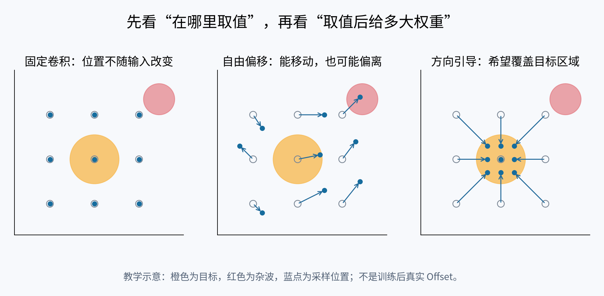

**读图顺序：** 先看橙色目标与蓝色采样点的关系，再看右上角红色杂波。左图的采样点位置固定；中图说明“可以移动”不等于“移动正确”；右图画的是作者希望学到的效果。**右图没有证明实际网络一定如此采样。**

| 阅读时先问 | 本文对应设计 | 一句话理解 |
|---|---|---|
| 目标尺度变了，用哪一种局部范围？ | EDDConv 的多尺度分支与动态路由 | 同时准备几种范围，再根据输入调节贡献 |
| 卷积点应该往哪里移动？ | EDConv 中的 DAOE 与偏移预测 | 给偏移学习补充水平、垂直位置线索 |
| 某个位置采错了，如何降低影响？ | Modulation 调制系数 | 降低该位置对结果的贡献 |
| 深层特征如何交给解码器？ | SR | 重组通道、融合不同尺度的语义信息 |

**建议分两遍读：** 第一遍看本页、第二～三节，以及每个模块的“先看直觉”和配图；第二遍再核查第四节公式、第五节证据与第七节方法论启发。公式的作用是回答机制问题，不需要先背符号。

## 一、论文基本信息

- **英文题目**：Direction-Aware Offset Enhancement and Dynamic Deformable Convolution for Infrared Small-Target Detection
- **作者**：Baofeng Ji, Dewei Wang, Jianpeng Bai, Guoqiang Zheng, Tongshuai Xin, Huitao Fan
- **期刊**：IEEE Transactions on Geoscience and Remote Sensing（TGRS），Vol. 64，2026，Article No. 5620310
- **DOI**：10.1109/TGRS.2026.3688853
- **任务**：红外小目标检测（IRSTD），具体采用**二值分割**范式，而非多类别边界框检测
- **提出方法**：Enhanced Dynamic Deformable Network（EDDNet）
- **源码地址（论文声明）**：[作者声明的代码地址](https://github.com/wdw0537/EDDNet)（未核查发布状态）
- **核心图表**：Fig.2（设计动机）、Fig.3（整体网络和 EDDConv/EDConv）、Fig.4（DAOE）、Fig.5（SR）、Table II（关键消融）

**一句话总结**：本文不是把可变形卷积用于常见的旋转或尺度形变适配，而是利用方向感知信息引导卷积采样位置，使采样点尽可能集中于红外小目标，减少传统固定卷积提取特征时混入的背景信息；同时采用多尺度动态路由和深层语义细化来改善分割结果。

## 二、研究问题、已有方法不足与设计动机

红外小目标通常只有少量像素、纹理不明显、目标与背景区分困难。对于比常规卷积采样范围还小的目标，固定 $3\times3$ 卷积会同时读取目标附近的大量背景位置，造成目标响应被背景特征混合。作者认为，这不仅是后续注意力权重如何分配的问题，还应从**卷积实际在哪里采样**入手。

但直接改成普通可变形卷积（DCN）并不够：DCN 允许每个采样点学习二维 Offset，却不能保证偏移方向正确。极小目标提供的有效定位信息有限，偏移可能无序或朝强杂波移动。由此引出本文的三层设计逻辑：

1. **EDDConv**：通过不同感受野的特征分支和动态路由适应目标尺寸变化。
2. **DAOE**：从水平、垂直方向提取位置相关信息，辅助 Offset 和 Modulation 的学习。
3. **SR**：在编码器和解码器交界处进一步细化深层特征。

需要先明确：作者所说的采样点向目标中心“收缩”，是设计动机及期望学习到的行为；论文给出的公式并没有硬性规定全部采样点必须向中心移动。

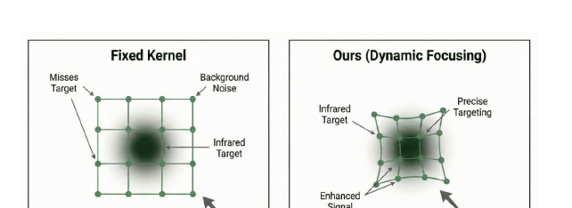

*来源：原文第 2 页 Fig. 2。该图是动机示意图，不是实际预测的偏移场。*

**把问题想成一次局部取样。** 假设一个 3×3 邻域只有中心 1 个位置属于目标，其他 8 个位置都是背景。常规卷积都会读取这 9 个位置，但它们的实际贡献还取决于卷积权重与特征值，因此不能简单说“背景一定占输出的 8/9”。作者想进一步改变读入的位置，让更多采样落在有用区域。

**为什么不直接把卷积核缩成 1×1？** 小目标仍需要上下文来区分真实目标、孤立噪点与背景边缘；只看单点可能丢掉判别信息。本文同时保留多尺度分支、跳跃连接与深层语义处理，体现的是局部聚焦与上下文利用之间的权衡。

## 三、整体框架：EDDNet（对应 Fig.3）

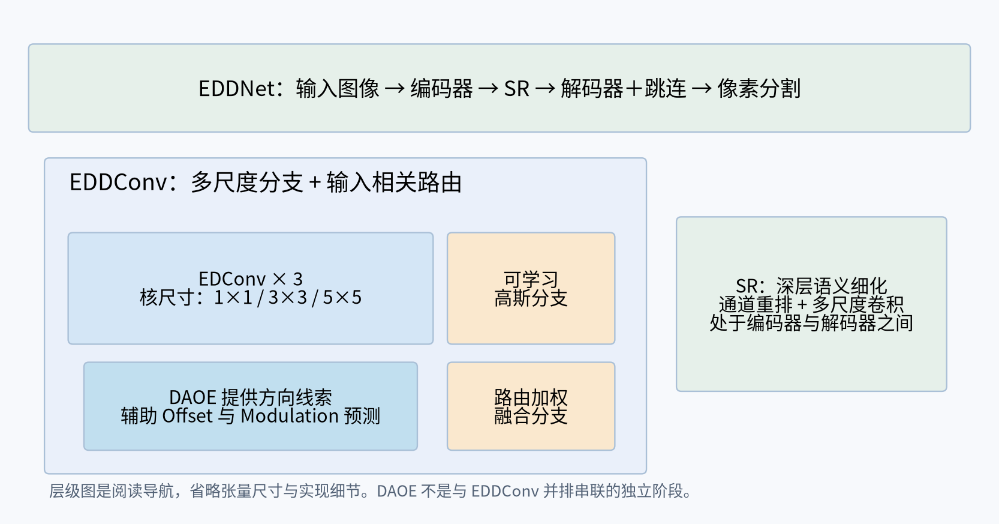

**先记住层级，再读原图：** 网络叫 EDDNet；编码器中的动态模块叫 EDDConv；内部的增强可变形卷积叫 EDConv；DAOE 为其采样相关预测提供方向线索。SR 位于编码器与解码器的连接处。

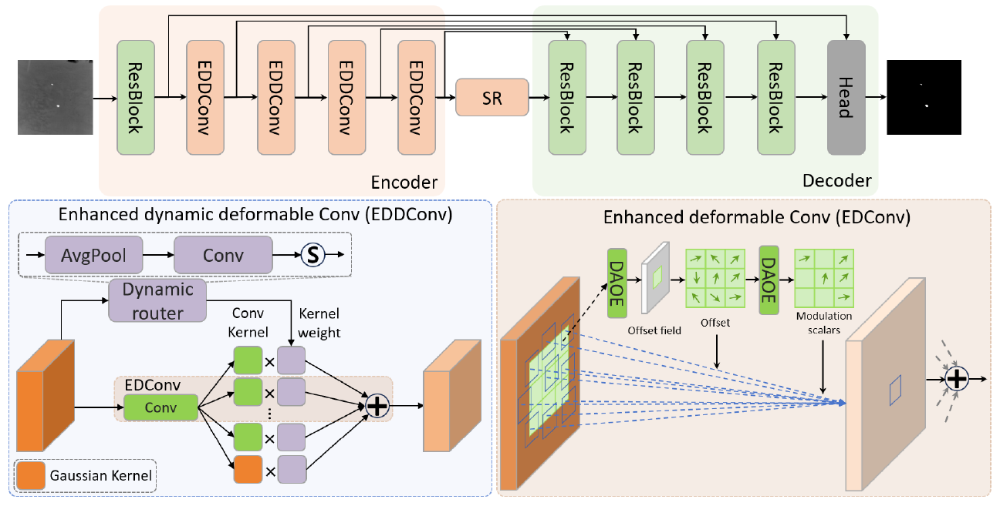

**原图分三块读：**

1. **上方整条网络：** 左边输入图像，经过 ResBlock 和四级 EDDConv；中间 SR；右边逐步解码，Head 输出目标掩膜。长连线将编码阶段的特征送到解码阶段。
2. **左下 EDDConv：** 关注多条并行分支及 Dynamic router。这里回答“不同局部范围怎样一起用”。
3. **右下 EDConv：** 分别观察 Offset field 与 Modulation scalars。前者改变坐标，后者改变贡献；DAOE 为两类预测提供增强信息。

*来源：原文第 3 页 Fig. 3，重新从 PDF 高清裁取。输入到输出的主路径与模块展开图应分开阅读。*

该网络以 U-Net 风格的编码器—解码器为基础。Encoder 使用多层 EDDConv 逐级提取特征；Decoder 接收跳跃连接并恢复空间分辨率；末端输出目标像素分割结果。**这不是把 DAOE 接到普通目标检测 Head 上的架构**，也没有直接的类别预测与检测框回归分支。

Fig.3 里的关系应当读作：**EDDConv 是动态多分支模块；其中的 EDConv 才是包含可变形采样的卷积；DAOE 又是 EDConv 中用于增强偏移相关特征的组成部分。** 三者不能混称为三个串联的独立模块。

## 四、核心模块与数学机制

### 4.1 EDDConv：多尺度动态路由（Section III-B；式 1—2）

**先看直觉：同一块输入，准备几种观察范围。** 1×1 分支强调局部位置，3×3 与 5×5 分支提供不同范围的信息；可学习高斯分支补充点状响应先验。路由分支根据输入生成权重，调节这些分支的贡献。这是机制层面的解释，不能据此断言每个训练后分支具有完全固定的语义分工。

| 两个容易混淆的“动态” | 改变什么 | 不代表什么 |
|---|---|---|
| 动态路由 | 各尺度分支的贡献 | 每次只启用一个卷积核 |
| 可变形采样 | 每个采样点的坐标 | 自动选择正确的目标位置 |

**带着一个问题看下面两式：路由权重从哪里来，又作用到哪里？** 式（1）生成权重，式（2）把权重作用到分支特征。

作者设置 $1\times1$、$3\times3$、$5\times5$ 三条增强可变形卷积分支，同时引入可学习高斯卷积分支，为点状红外目标提供另一种局部特征先验。输入特征 $F_x$ 经动态路由生成权重：

$$
W_d=\mathrm{Sigmoid}(\mathrm{Conv2d}(\mathrm{MaxPool}(F_x))).\tag{1}
$$

四条分支输出按原文记为：

$$
\begin{aligned}
F_{x1},F_{x3},F_{x5}&=\mathrm{EDConv}_{k}(F_x),\quad k\in\{1,3,5\},\\
F_g&=\mathrm{Conv}_{gas}(F_x),\\
F_d&=\mathrm{cat}(F_{x1},F_{x3},F_{x5},F_g)\ast W_d.
\end{aligned}\tag{2}
$$

其中 $\ast$ 按文中语义表示对连接后的分支特征进行路由加权；各分支的输出维度对齐、融合投影等实现细节未在公式中充分展开。

**我的理解**：动态路由并不是对每个输入“只选一个核”，也不是真的任意生成全新核尺寸，而是**多个预定义尺度分支并行提取，再依输入特征动态调节贡献**。式（1）使用 Sigmoid，而不是强制权重和为 1 的 Softmax。高斯分支可能有利于点状响应，但同样有增强背景亮点的风险，并不会天然识别真实目标。

### 4.2 可变形卷积：Offset 和 Modulation 的分工（Section III-C；式 3—4）

**先看一个点，不急着看整个卷积核。** 某采样点原本位于中心的右上方，Offset 把它移到另一个位置；该位置可能落在目标，也可能落在杂波。Modulation 再调节这个采样值参与输出的程度。最后，多个采样点的贡献加起来，才形成一个输出。

> **坐标 → 取值 → 调制与卷积加权 → 求和。** 这就是式（4）的阅读顺序。Offset 回答“去哪儿”，Modulation 回答“这个点贡献多少”，卷积权重负责可学习的特征组合。

普通 $3\times3$ 卷积的相对采样点集合为：

$$
S=\{(-1,-1),(-1,0),\ldots,(1,1)\}.\tag{3}
$$

作者使用带调制系数的可变形采样公式：

$$
\boxed{y(p_0)=\sum_{p_n\in S}M(p_n)\,w(p_n)\,x\bigl(p_0+p_n+\Delta p_n\bigr)}.\tag{4}
$$

- $p_0$：当前输出位置对应的卷积中心；$p_n$：规则采样点的相对坐标。
- $\Delta p_n$：学习到的二维偏移，决定**去哪里取特征**。
- $w(p_n)$：常规卷积核权重，决定**如何线性组合特征**。
- $M(p_n)$：调制系数，决定**某个采样位置贡献的大小**。
- $x(\cdot)$：在偏移后的位置取值，非整数位置通常需双线性插值。

以单个标准 $3\times3$ 采样组为例，共有 9 个点，对应每个空间位置 18 个二维偏移分量和 9 个调制值；常见张量形状分别是 $[B,18,H_o,W_o]$ 和 $[B,9,H_o,W_o]$。**这是一般调制 DCN 的维度推导，非论文公布的完整 DAOE 实现规格**（不同 deformable group 配置会改变通道数）。

**数值理解**：如果某个错误采样位置读到杂波特征 $15$、卷积权重为 $1/9$，不加抑制时贡献约 $1.667$；若 $M=0.1$，贡献约 $0.167$。这说明 Modulation 可以压低错误采样的影响，但**不会更改其错误坐标**；如果调制预测同样错误，仍可能产生虚警或漏检。

双线性采样也不会“创造”新的目标信息。例如采样位置 $(1.5,1.5)$，周围四个整数像素取值为 $1,1,1,10$，则插值值为 $(1+1+1+10)/4=3.25$。采样点集中能增大目标响应占比，却仍可能混入邻近背景。

### 4.3 DAOE：方向池化如何引导偏移（Section III-C；Fig.4；式 5）

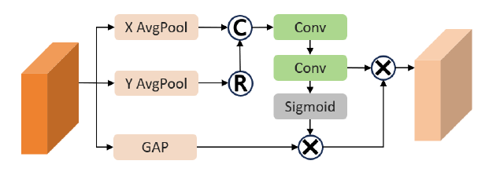

*来源：原文第 4 页 Fig. 4。先看 X/Y 两条池化路径，再看拼接、卷积与 Sigmoid 门控，最后留意下方 GAP 支路。图中没有完整展开最终偏移张量的生成过程。*

**先看直觉：把二维定位问题拆成两条方向线索。** 沿一条轴聚合，可以保留另一条轴的位置索引。它比把整张特征图压成一个全局数值保留更多位置信息；但两组投影仍不足以唯一恢复完整二维结构。

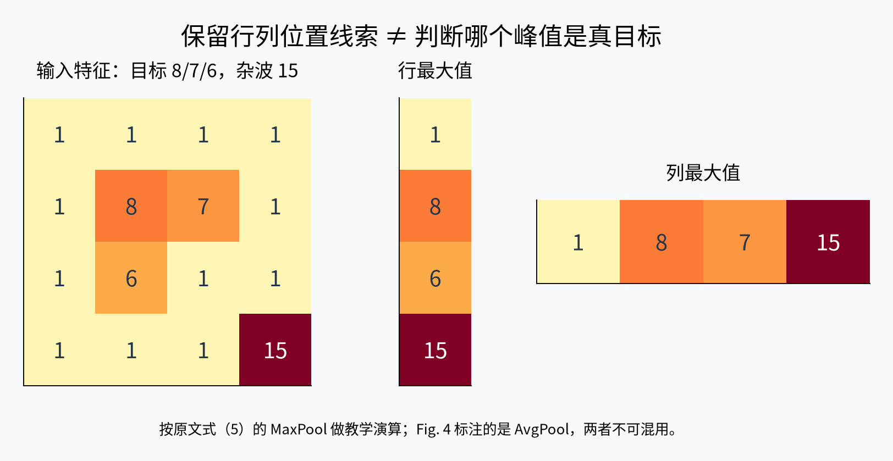

**读图时先找 8、7、6，再找 15。** 中间是逐行最大值，右边是逐列最大值。真实目标的响应进入了投影，但更强的背景响应也进入了投影。这说明 DAOE 提供的是定位线索，目标身份仍需要网络学习判断。

论文公式（5）给出的核心计算为：

$$
\begin{aligned}
F_{gap}&=\mathrm{MaxPool}(F_x),\\
F_{gapxy}&=\mathrm{cat}\left(\mathrm{MaxPool}_x(F_x),\mathrm{reshape}(\mathrm{MaxPool}_y(F_x))\right),\\
F_{convxy}&=\mathrm{Conv2d}(F_{gapxy}),\\
F_{out}&=F_{convxy}\odot\mathrm{Sigmoid}\left(\mathrm{Conv2d}(F_{convxy})\right).
\end{aligned}\tag{5}
$$

**计算逻辑**：沿 X 方向聚合，保留行的位置索引；沿 Y 方向聚合，保留列的位置索引；将两个方向信息拼接，经卷积与门控生成方向增强特征，为后续 Offset / Modulation 预测提供位置相关线索。

对 $F_x\in\mathbb R^{B\times C\times H\times W}$，一种可行的维度实现为：

$$
\begin{aligned}
P_x&\in\mathbb R^{B\times C\times H\times1},\\
P_y&\in\mathbb R^{B\times C\times1\times W},\\
\mathrm{cat}(P_x,\mathrm{transpose}(P_y))&\in\mathbb R^{B\times C\times(H+W)\times1}.
\end{aligned}
$$

这只能解释“方向特征拼接”，不能直接变成 $[B,18,H_o,W_o]$ 的 Offset。**论文没有完整写出 $F_{out}\to\Delta P$ 的映射、各卷积参数、空间展开及具体预测头**，不能擅自把通用 Coordinate Attention 的实现视作作者的原始代码。

一个与 SAR 强杂波相关的矩阵反例：

$$
F=\begin{bmatrix}
1&1&1&1\\
1&8&7&1\\
1&6&1&1\\
1&1&1&15
\end{bmatrix}.
$$

假设 $8,7,6$ 是目标相关响应，$15$ 是背景杂波。采用方向 MaxPool：

$$
P_x=[1,8,6,15]^T,\qquad P_y=[1,8,7,15].
$$

两条方向投影里的最大响应都来自背景杂波。因此，**方向池化保留了峰值的坐标线索，但没有自动赋予峰值“目标身份”**。后续可学习层可能改善这一问题，却不能仅凭式（5）保证会排除强杂波。

此外，两组一维投影可能丢失二维配对关系。例如两个峰值均为 9，分别位于 $(1,2),(3,1)$，或改为 $(1,1),(3,2)$，对应的行、列最大值投影可以完全一致。对多散射中心目标，不能把“行列峰值交点”直接当作真实完整的目标结构。

**关键文图不一致**：Fig.4 的 X/Y 分支标记 **AvgPool**，并有 GAP 分支；式（5）却写 **MaxPool**，且未明确写出 GAP 如何参与最终输出。Fig.3 的动态路由示意也标 AvgPool，而式（1）写 MaxPool。复现时必须核查作者实际源码，不能把论文图示和公式当作完全一致的计算图。

### 4.4 SR：深层语义细化（Section III-D；Fig.5）

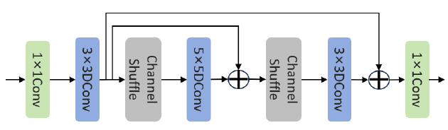

*来源：原文第 5 页 Fig. 5。建议先沿主路径看卷积与 Channel Shuffle，再看绕过中间操作的残差连线。*

**先看直觉：前面已经挑选和提取了特征，这里再整理特征之间的关系。** 通道重排改变通道排列，促进后续操作接触不同组合；不同尺度卷积整合不同局部范围；残差连接保留输入信息并加入学习到的更新。它们共同处理深层表示，不是重新读取原图中的全部细节。

SR 被放在 Encoder 与 Decoder 的转换位置，以通道重排（Channel Shuffle）、不同尺度卷积和残差连接细化深层特征。Fig.5 给出的主要操作包含 $1\times1$、$3\times3$、$5\times5$ 卷积及两次通道重排与残差汇合。正文还提及不同感受野的深度卷积，但图中未完整标出所有参数。

**我的理解**：DAOE 的主要关注点是“采样位置是否合适”，SR 关注的是“已经提取的深层特征能否更好融合和表达”。SR 不直接修正一个已经采错位置的 Offset，也不负责恢复原本从未采集过的完整散射结构。

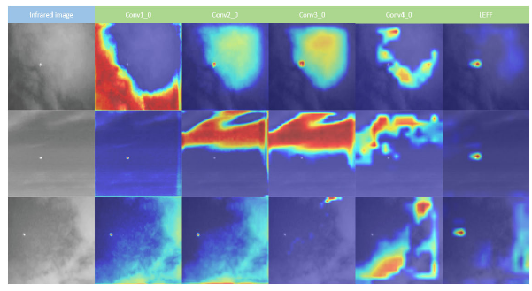

*来源：原文第 8 页 Fig. 12。每行是一个场景，列从原图到不同深度的特征响应及 SR。*

**看图任务：** 对照左侧原图，观察背景边缘是否一直保持强响应，再看 SR 列是否更集中。作者用它支持深层细化有效；但热力图不是采样坐标图，而且选取的案例不能代表整个测试集。

## 五、训练、推理和必要的结果证据

### 5.1 先明确训练对象：输出目标像素，而不是检测框

论文实现为 PyTorch，采用 Xavier 初始化、Adagrad 优化器、SoftIoU Loss、初始学习率 0.05，并从头训练。NUAA-SIRST、NUDT-SIRST 的输入被调整为 $256\times256$，IRSTD-1K 调整为 $512\times512$；相应划分见原文 Section IV-A。推理时采用编码器—解码器和分割头输出结果，不能把它误读为 DiffusionDet 式扩散候选框检测流程。

### 5.2 先看预测结果：漏了什么，多出了什么？

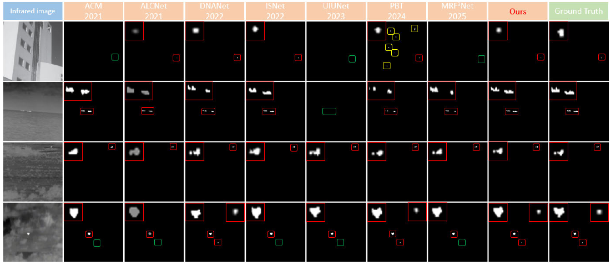

*来源：原文第 6 页 Fig. 6。红框标注正确检测，绿框标注漏检，黄框标注虚警。这些框是可视化标记，不表示模型输出了检测框。*

**建议先只看三列：原图 → Ours → Ground Truth。** 确认目标在哪，再比较输出是否漏掉小区域、是否多出背景亮点。之后再横向看其他方法。这样比直接盯着整张密集对比图更容易理解。

**不要把“预测更干净”直接当作全部结论。** 如果连弱目标一起消掉，图像也会更干净；所以要同时看漏检和虚警，并结合数值结果。

### 5.3 再看消融：哪一步带来提升，代价是什么？

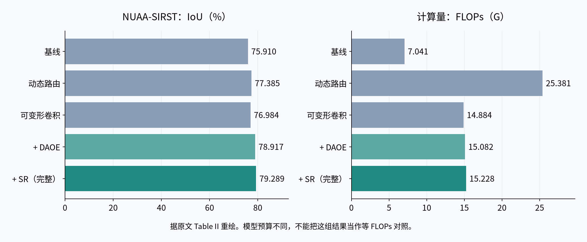

**读左图看性能，读右图看代价。** DAOE 前后 IoU 差为 1.933 个百分点；SR 再提升 0.372 个百分点。完整模型相对基线提升 3.379 个百分点，FLOPs 约为基线的 2.16 倍。以上均据表内数字计算，不表示同预算下的净收益，也不直接等于实际延迟变化。

**只保留与机制判断直接相关的消融（NUAA-SIRST，Table II）**：

| 变体 | IoU (%) | nIoU (%) | FLOPs |
|---|---:|---:|---:|
| ResNet18 Baseline | 75.910 | 73.961 | 7.041G |
| Dynamic Router | 77.385 | 75.063 | 25.381G |
| Deformable Conv | 76.984 | 74.674 | 14.884G |
| + DAOE | 78.917 | 76.549 | 15.082G |
| + SR（完整 EDDNet） | **79.289** | **76.910** | 15.228G |

就论文给出的模型变体而言，未经方向增强的可变形卷积表现低于动态路由变体，而引入 DAOE 后 IoU 从 76.984% 上升到 78.917%，再加 SR 达到 79.289%。这**支持 DAOE 在该实验设置中的有效性**，但不等于作者用直接证据证明了所有采样点均向真实目标收缩。

**比较时的保留意见**：上述变体的 Params/FLOPs 变化并不单调（例如 Dynamic Router 为 25.381G，而后续 Deformable Conv 变体为 14.884G），因此不能简单当成完全相同计算预算下逐个“只添加一项”的受控对照。完整模型的 15.228G 也高于 ResNet18 基线的 7.041G，不能直接宣称轻量化。

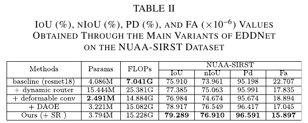

*来源：原文第 8 页 Table II。重绘图用于快速比较，原表用于核对模型变体与指标。论文将这些变体按模块递进介绍，但计算量并不单调，具体替换方式仍需代码确认。*

### 5.4 把结论限制在实验真正支持的范围内

原文 Table I 还报告了 NUDT-SIRST、IRSTD-1K 与 WideIRSTD-Full 的结果。摘要和数据集介绍主要列三个数据集，但总表与结果段落包含 WideIRSTD-Full；不能据摘要把整篇实验概括为只有三个数据集。

| 数据集 | EDDNet IoU（%） | EDDNet nIoU（%） | 阅读重点 |
|---|---:|---:|---|
| NUAA-SIRST | 79.289 | 76.910 | 也是本文关键模块消融的数据集 |
| NUDT-SIRST | 94.762 | 91.919 | 不同数据集的绝对分数不能直接横比难度 |
| IRSTD-1K | 68.564 | 66.507 | nIoU 低于 PBT 的 67.841，不是所有指标最优 |
| WideIRSTD-Full | 46.533 | 33.426 | 原文结果段报告 Pd 为 57.360%，仍有明显提升空间 |

*数据来源：原文第 5～6 页结果段与 Table I。本文没有在这些数据上验证 SAR 检测能力。*

**IoU 与 nIoU 为什么可能给出不同排序？** 原文式（6）先累计所有样本的交并区域再求比值；式（7）先逐样本求 IoU 再平均。前者更受较大并集样本影响，后者让每个样本占相同的平均权重。两者不能替代检测框 AP，也不能仅凭一个指标判断所有目标尺度都受益。

**指标复现风险**：原文式（9）把 $F_a$ 写成 $FP/(TP+FP)$，这相当于 $1-\mathrm{Precision}$；但 Table I/II 报告的 $F_a$ 单位为 $\times10^{-6}$，两者口径明显需要进一步核对。论文分割 IoU/nIoU 也不能直接等同于 SAR 多类别检测的 AP50、AP75。

## 六、论文创新的实际边界与不足

1. **有价值的创新是“偏移如何被引导”，不是首次使用 DCN**：本文明确强调 Offset 自由学习的风险，并尝试用方向位置线索限制其偏离目标；这是比简单换卷积更明确的研究动机。
2. **对“向目标聚集”缺少充分直接的验证**：特征热力图能够说明某层响应更集中，却不能代替 Offset 矢量图、采样点覆盖统计及目标/背景命中比例。
3. **强杂波可能劫持响应线索**：MaxPool 对极端峰值敏感；AvgPool 又可能稀释极小目标。方向池化本身无法区分目标与杂波，调制系数也只能调节错误采样贡献。
4. **多峰结构可能受损**：采样点集中到最强位置，未必保留多个分离散射中心之间的几何关系。这是 SAR 迁移风险，而非本文在红外实验中已经证明的缺陷。
5. **计算开销与实现透明性不足**：动态 Offset/多分支带来额外代价；论文图示与公式对池化方式不一致，关键预测映射未展开。作者也承认复杂强杂波下仍存在虚警，且推理速度有所下降。

## 七、方法论启发：采样自由度需要什么证据与约束？

### 7.1 调整位置与调节贡献是两个问题

Offset 决定采样坐标，Modulation 调节该位置的贡献。抑制一个错误采样值并不意味着修正了坐标，应分别检查采样位置与加权结果。

### 7.2 定位线索不自动具有目标语义

方向池化保留位置索引，但强背景响应也会进入统计。评价方向增强时，需要观察采样点、目标覆盖与背景命中情况，而不能仅以热力图更亮判断偏移更准确。

### 7.3 跨任务迁移先检查目标形态与输出范式

红外点状目标与多峰空间结构不一定适用相同采样偏好；二值分割指标也不能直接替代多类别检测指标。迁移前应明确任务所需的有效信息与采样范围，分别验证结构保留和背景干扰。

### 7.4 单项设计、组合收益与开销分别验证

对照实验应控制数据划分和训练预算，分别检查动态路由、偏移引导与语义细化，并报告实测延迟。组合性能提升不等于每个部件都独立有效，也不能直接证明作者期望的采样机制已实现。

## 八、阅读总结

我认为这篇论文最值得借鉴的并不是“用可变形卷积替代普通卷积”这一表面形式，而是作者明确指出：**Offset 自由度本身也可能成为小目标特征提取的风险，因此需要给采样行为引入位置先验与约束。**

可迁移的方法是：围绕目标形态与背景干扰选择采样机制，用直接的采样证据和可比较消融检验它，而不是只凭最终特征响应推断机制。

## 九、读完后用五个问题检查理解

1. **EDDConv 和 DAOE 是同一级模块吗？** 不是。EDDConv 组织多尺度分支；DAOE 位于增强可变形采样的内部机制中。
2. **Offset 和 Modulation 能互相替代吗？** 不能。一个调整采样坐标，一个调节采样贡献。
3. **为什么方向池化有帮助，却仍可能失败？** 它保留位置线索，但强杂波也会进入投影，且一维投影可能丢失二维配对关系。
4. **实验已经证明采样点全部向真实目标移动了吗？** 没有。消融支持模块收益，热力图支持响应变化，仍缺少直接的偏移统计证据。
5. **迁移到 SAR 最该保留什么？** 不应只追求中心变亮，而应验证多个有效散射区域及其空间关系是否保留。

---

**配图索引与来源。** 原文图共 7 张：Fig. 2、3、4、5、6、12 与 Table II，均裁自论文 PDF；教学图共 4 张：采样对比、模块层级、方向池化与消融重绘。教学图用于机制解释或数据比较，不是模型实际输出。
