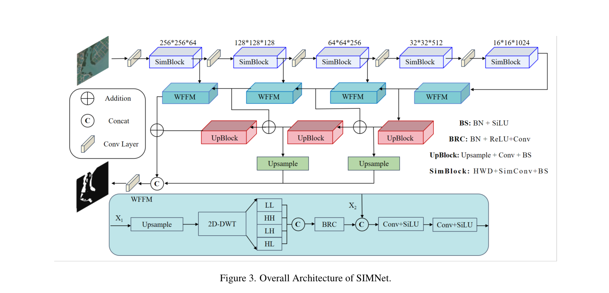
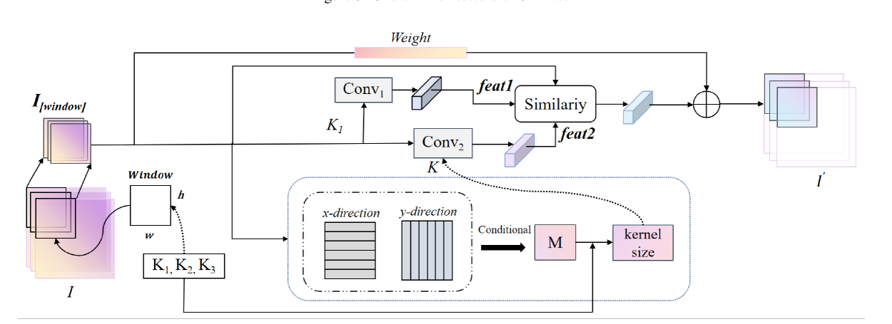

# SimConv / SIMNet：动态感受野与小波融合阅读笔记

> **原文标题**：Remote Sensing Forestry Similarity Convolution

> **笔记完成日期**：2026-11-02

> **论文类型**：IEEE/CVF WACV 会议论文（CVF Open Access）

> **作者**：Shikuan Wang、Yuangong Chen、Jianzhou Gong 等

> **研究任务**：光学遥感森林与土地覆盖语义分割

> **核心方法**：Similarity Convolution（SimConv）、SIMNet、Wavelet Feature Fusion Module（WFFM）

> **源码（原文提供）**：[WangShiK/SimConv](https://github.com/WangShiK/SimConv)

> **阅读定位**：重点学习动态感受野选择、相似性约束、小波多尺度融合，以及它们对 SAR 离散散射结构建模的启发。

**原论文：** [仓库 PDF](../originals/2026-11-02_SimConv.pdf)

## 阅读导航

主线为：研究问题 → SIMNet 全貌 → SimConv 的两次选择 → 小波融合 → 实验证据 → 复现疑点 → SAR 迁移分析。数学手算用于核查机制，不替代方法本身。

- **原文方法与结果**：第 1—5 节，原文有歧义处明确标注。
- **批判性分析**：第 6 节；反例和手算属于笔记解释。
- **方法论启发**：第 7—8 节，分析局部相似性与有效结构之间的区别，不预设跨领域迁移有效。
- **查阅定位与复现清单**：附录 A、B。

## 1. 研究问题与核心思想

传统卷积的空间核尺寸通常在设计时固定。面对光学遥感图像中的大面积森林、细小植被斑块、复杂边界等不同尺度结构，固定感受野未必总能同时兼顾局部细节和大范围上下文。作者认为，卷积还需要利用局部特征之间的空间关系，决定当前区域适合多大的感受野。

文章采用两项改进：

- **SimConv**：先分析局部窗口沿两个空间方向的相邻特征变化，再从候选卷积核中选择尺寸；随后比较固定卷积分支与自适应分支的特征一致性，决定最终保留哪组特征。
- **WFFM**：将深层特征上采样并作二维离散小波变换（2D-DWT），把 LL、LH、HL、HH 四种子带表示与浅层特征融合，以兼顾高层语义和空间细节。

两者被组织进编码器—解码器网络 **SIMNet**。我的理解是：**SimConv 解决“当前区域看多大”，WFFM 解决“不同层级、不同频率的特征如何融合”。** 前者不改变采样点的自由位置，不能与 Deformable Conv 混为一谈；后者也不是单纯的小波去噪。

## 2. SIMNet 整体架构

**图 3（原论文）**：上部是 SIMNet 编码器—解码器；下部是 WFFM 结构。

图 3 所示配置下，编码器依次产生五级特征（这些尺寸不是任意输入分辨率下的固定尺寸）：

| 层级 | 空间尺寸 | 通道数 |
|---|---|---:|
| Stage 1 | 256×256 | 64 |
| Stage 2 | 128×128 | 128 |
| Stage 3 | 64×64 | 256 |
| Stage 4 | 32×32 | 512 |
| Stage 5 | 16×16 | 1024 |

图中的 **SimBlock** 由 HWD、SimConv 和 BS（BN + SiLU）组成；**HWD** 为 Haar Wavelet Downsampling，负责下采样并将局部空间变化重组到小波子带。解码器利用 WFFM、UpBlock 及跨层连接逐级恢复分割特征，其中 UpBlock 标注为 Upsample + Conv + BS。

这不是目标检测网络：SIMNet 最终输出像素级分割结果，并不预测 DiffusionDet 使用的候选框。

## 3. SimConv：动态卷积核选择与相似性筛选

**图 4（原论文）**：局部窗口分析、候选核选择、固定/自适应双卷积分支、相似性筛选以及 Weight 加性分支。

### 3.1 确定窗口：感受野与观察区域不是同一回事

论文预先设定候选核 $K_1,K_2,K_3$，并用其边长的最小公倍数设置局部观察窗口：

$$
h,w=\mathrm{LCM}(K_1,K_2,K_3),\qquad I_w=I_{[h,w]}.
\tag{2--3}
$$

例如候选尺寸为 1、3、9，窗口尺寸为 9×9。局部窗口用于**分析特征空间关系**，真正用于提取卷积特征的核则由后续规则选择，因此两者不能混为一谈。

这一设计也有工程疑问：若候选尺寸为 3、5、7，则最小公倍数为 105，观察窗口可能过大。论文没有充分说明不同候选尺寸下 LCM 窗口的具体高效实现。图中 $K_1$ 是参考卷积核；$K_2/K_3$ 的大核、小核身份以正文关于分支行为的解释为准，不应机械地按 Table 9 列表顺序对应。

### 3.2 沿 x/y 方向建立局部关系

作者沿两个相邻空间方向计算特征差分：

$$
R_x(x,y)=I_w(x+1,y)-I_w(x,y),
$$
$$
R_y(x,y)=I_w(x,y+1)-I_w(x,y).
\tag{5--6}
$$

设定 $R_\theta=0.1$，将“满足相关性条件”的相邻位置对标记为 1，否则标记为 0，得到布尔矩阵 $M$。再计算：

$$
P=\frac{M[1]}{M[1]+M[0]}.
$$

这里 $M[1]$ 与 $M[0]$ 分别是布尔统计中 1 和 0 的个数。按作者文字阐述：

$$
K=\begin{cases}
K_2, &P>M_\theta,\\
K_3, &P\le M_\theta,
\end{cases}\quad M_\theta=0.4.
\tag{7}
$$

**核心意图**：相似位置占比较高时用较大卷积核，扩大上下文；占比较低时用较小卷积核，避免混合差异明显的区域。

**原文与实现要区分**：公式（5）（6）写的是**有符号差分**，却没有明确说明比较阈值前是否取绝对值。按变化幅度理解应比较 $|R|$，但若严格采用有符号的 $R<0.1$，较大的负差分也会被当成相似。论文还没有完整交代多个通道以及 x/y 两组布尔矩阵的融合统计方式，复现时应以公开源码进一步核实。

**SAR 相关的数值反例**：考虑单通道局部矩阵

$$
I=\begin{bmatrix}
0&0&0&0\\
0&1&0&0\\
0&0&1&0\\
0&0&0&0
\end{bmatrix}.
$$

如果采用绝对差分阈值，并把两个方向总计 24 个相邻位置对合并统计，则差异为 0 的有 16 对：

$$
P=16/24\approx0.667>0.4.
$$

模型按设计意图会选择大核。**这并非因为它识别出了两个散射点属于同一架飞机，而是因为大量相邻暗背景位置之间的差异很小。** 所以“空间局部相似”不能直接等同于“目标语义/几何结构相关”。

### 3.3 固定参考特征与动态特征

选择核尺寸后存在两条卷积分支：

$$
feat_1=\mathrm{Conv}_{K_1}(I_w),\qquad
feat_2=\mathrm{Conv}_{K}(I_w).
$$

$feat_1$ 来自固定**尺寸**的参考卷积，$feat_2$ 来自动态选择的卷积核。这里“固定”不等于卷积权重冻结，两条分支的权重仍可学习。

作者先给出标准余弦相似度：

$$
\mathrm{cos}(a,b)=\frac{a^\top b}{\|a\|_2\|b\|_2}.
\tag{8}
$$

按公式（8）及其后续文字的一致性理解，定义两条特征分别与输入窗口的相似度评价：

$$
E_1=\mathrm{cos}(feat_1,I_w),\qquad
E_2=\mathrm{cos}(feat_2,I_w),\qquad
D=|E_1-E_2|.
$$

注意 **$D$ 不是 $feat_1$ 与 $feat_2$ 的余弦距离**，而是它们各自相对于输入窗口的**相似度评分之差**。两个特征即使彼此差异很大，也可能得到相同的 $E$ 评分。

**公式（9）的原文疑点**：论文印刷版第二个根号下为 $\sum I_{w,i}$，未写 $\sum I_{w,i}^{2}$。如果严格按印刷公式计算，结果不一定落在余弦相似度的 [-1,1] 范围内，负特征时甚至可能出现实数域问题。这与公式（8）不一致；本笔记的数值例子均按**标准余弦相似度**理解，而不是将修正推测当作已确认的源码实现。

### 3.4 阈值筛选与 Weight 分支

作者设定 $E_\theta=0.15$，最终输出规则为：

$$
I'_w=Weight+
\begin{cases}
feat_1, &D>E_\theta,\\
feat_2, &D<E_\theta,\\
\dfrac{feat_1+feat_2}{2}, &\text{其他情况}.
\end{cases}
\tag{10}
$$

其中

$$
Weight=\mathrm{Conv}_{1\times1}(\mathrm{Reshape}(I_w)).
\tag{4}
$$

**必须注意**：$Weight$ 在分段选择式**之外**，三种情况都要加上它；这里采用的是加法，不是 $Weight\odot feat$ 那种乘性注意力。其 Reshape 的具体维度与通道对齐方式，论文并未交代充分。

简化手算：设 $I_w=[3,4]$、$feat_1=[4,3]$、$feat_2=[3,4]$，则

$$
E_1=24/25=0.96,\quad E_2=25/25=1,\quad D=0.04<0.15.
$$

因此选择 $feat_2$。如果换成 $feat_2=[5,0]$，则 $E_2=0.6$、$D=0.36>0.15$，转而选 $feat_1$。

我认为此处的设计更接近**以参考特征为基准的一致性约束**，并不是“挑选质量最高的特征”。如果动态分支更好地恢复了飞机散射结构，但与参考分支差异较大，也可能被拒绝。余弦相似度还对正比例幅值缩放不敏感，可能无法区分被显著放大的背景强杂波。

## 4. HWD 与 WFFM：小波结构化下采样及深浅层融合

### 4.1 HWD 与普通池化的区别

Haar 小波将 2×2 局部特征转为四个系数。以正交归一化 Haar 变换为例，对

$$
X=\begin{bmatrix}a&b\\c&d\end{bmatrix}
$$

采用“LH 对水平差异敏感”的命名约定：

$$
\begin{aligned}
LL&=(a+b+c+d)/2,\\
LH&=(a-b+c-d)/2,\\
HL&=(a+b-c-d)/2,\\
HH&=(a-b-c+d)/2.
\end{aligned}
$$

例如 $X=\begin{bmatrix}2&2\\2&6\end{bmatrix}$，结果为 $(LL,LH,HL,HH)=(6,-2,-2,2)$。只保留平均池化会得到 3，最大池化得到 6；而完整 Haar 子带能表示该块的整体响应与方向变化，在保留全部子带时可逆。

但 **DWT 可逆不意味着 HWD 整块网络完全无损**：后续卷积、非线性及通道压缩都可能损失信息。不同库对 LH/HL 的轴定义可能相反，重要的是具体滤波方向。

### 4.2 WFFM 对应 Figure 3 与公式（11）（12）

WFFM 在解码端对深层特征 $X_1$ 进行：

$$
(LL,HH,LH,HL)=\mathrm{2D\!\text{-}DWT}(\mathrm{Up}_{4\times}(X_1)),
\tag{11}
$$

$$
X'_1=\mathrm{Concat}(LL,HH,LH,HL).
\tag{12}
$$

再经 BRC（BN + ReLU + Conv）调整特征，与浅层 $X_2$ 拼接，接两层 Conv + SiLU 融合。

例如深层输入 $B\times1024\times16\times16$：上采样 4 倍变为 $B\times1024\times64\times64$；DWT 将高宽各减半，四个子带各为 $B\times1024\times32\times32$；沿通道拼接为 $B\times4096\times32\times32$，与空间尺寸为 32×32 的浅层特征对齐。BRC 之后的实际输出通道数由网络配置决定，不能仅凭图示臆定。

为什么采用“上采样 4 倍 + DWT”而非简单 2 倍上采样？净空间尺度同样扩大两倍，但前者显式产生四种频率子带供后续融合。**它是在已经上采样的特征上做分解，并不会凭空恢复丢失的真实高频细节。**

对 SAR 而言，高频子带可能承载强散射点、边缘和纹理，也可能包含斑点噪声与杂波。不能把“高频 = 目标、低频 = 背景”或“保留高频 = 自动去噪”当作事实。

## 5. 训练、推理与必要的效果证据

**训练**：论文在单张 RTX 4090 上采用 PyTorch、AdamW、Focal + Dice Loss，从头训练，不使用预训练权重；初始学习率 $5\times10^{-5}$，余弦退火。Mangrove 训练 50 epochs（batch 4），LoveDA 100 epochs（batch 4），WHDLD 100 epochs（batch 8）。输入通常调整到 512 或 256 分辨率。文章任务是语义分割，采用 OA、F1、mIoU 评价，而不是检测 AP。

**推理**：输入图像依次经过编码器的 SimBlock、WFFM/UpBlock 解码融合和输出层，产生像素级分类预测。SimConv 的局部路由与特征阈值选择属于网络前向计算的一部分；文中并未报告将这些分支在推理时移除或转换为单一固定卷积。

仅保留支撑方法判断的结果：

| 对比或消融 | 原文关键数值 | 能说明什么 |
|---|---|---|
| 完整模型三数据集 | Mangrove mIoU 89.80、LoveDA 63.55、WHDLD 62.87 | 在各自表格列出的对照模型中取得最高 mIoU |
| WHDLD 256，移除 SimConv | mIoU 62.87 → 62.10 | SimConv 对该配置的 mIoU 有 +0.77 个百分点贡献 |
| WHDLD 256，移除 WFFM | mIoU 62.87 → 61.37 | WFFM 对该配置的 mIoU 有 +1.50 个百分点贡献 |
| 单卷积方法对比 | SimConv 62.87；ODConv 62.18 mIoU | SimConv 在所测条件下领先 0.69 个百分点 |
| 单卷积 FLOPs / 参数 | SimConv 0.0456 G / 0.0011 M；ODConv 0.0440 G / 0.0007 M | 精度提升伴随额外成本；不能当成整网延迟 |
| 阈值 | $R_\theta=0.1,M_\theta=0.4,E_\theta=0.15$ | 仅在作者测试的候选设置下效果最好 |
| 候选核组合 | Hybrid：mIoU 62.87、Params 73.78 M | 优于表中其他组合，但需明确各层配置才可解释来源；73.78 M 是 Table 9 模型参数量口径 |

两个值得保留的反例：LoveDA 512 中去掉 SimConv 后 F1 从 77.50 升至 77.80，说明并非每个指标都提升；Table 7 把 $R_\theta$ 和 $M_\theta$ 同时改变，不能单独识别哪个阈值贡献了改进。

另外，Table 6 未包含 SimConv 与 WFFM **同时移除**的完整空白基线，因此不能据此严格计算两模块的协同效应；Table 9 中 Hybrid 与其他组合的总参数量差异较大，也不构成完全等预算的纯核尺寸比较。

## 6. 技术局限与复现时必须核实的地方

1. **相邻差分不是真正的语义相似度**。暗背景可能具有很高的局部相似比例，离散有效散射点之间却可能缺乏相邻连续性。
2. **硬阈值的离散路由可能不稳定**。核尺寸切换、特征分支切换依赖阈值；原文未充分交代阈值边界和未选分支的训练/梯度处理。
3. **参考特征不是真值**。$D$ 大时退回 $feat_1$ 只是与参考分支保持一致，不能证明 $feat_1$ 更有利于目标检测。
4. **余弦相似度对幅值缩放不敏感**。对 SAR 强散射与强杂波，单独使用角度一致性可能不足。
5. **公式描述存在实现歧义**：有符号差分是否取绝对值；x/y 方向及通道的布尔统计聚合；式（9）的输入模长是否漏平方；LCM 窗口的高效构造；图 3/正文子带顺序与 Hybrid 每层组合均需对照源码。
6. **工程效率证据不完整**。Table 4 是单卷积 FLOPs/Params，不是整网 FPS、真实显存或 GPU 延迟。性能提升也缺乏多随机种子显著性验证。
7. **缺乏机制层可视化**。论文没有充分展示背景和目标区域的大/小核选择频率、$D$ 的分布或不同分支的接受比例。结果支持最终性能，但还不足以说明具体如何抑制错误特征。

## 7. 方法论启发：代理指标是否对应真正需要的信息？

### 7.1 区分局部平滑与任务相关性

相邻位置差异较小，只能说明局部变化有限，不能自动证明这些位置属于同一目标。分析动态感受野时，需要检查目标区域、边界及背景区域的核选择比例，判断路由依据是否与任务需求一致。

### 7.2 参考分支提供比较基准，但不是真值

与参考特征一致不等于更准确。评价分支筛选时，应同时观察两路结果、筛选频率与任务指标，避免将相似度更高直接解释为语义质量更好。

### 7.3 表示变换与信息保留分别验证

小波分解组织了不同频率的表示，但后续通道压缩、非线性与融合仍可能丢失细节。子带的数学可逆性不能替代整块网络的任务效果验证。

### 7.4 收益与成本需要同一口径的对照

分别比较核选择、分支筛选与小波融合，控制训练条件和模型预算，并报告真实延迟与显存。单算子的 FLOPs 或总体指标提升不足以解释全部机制。

## 8. 读后总结

我认为这篇论文最值得学习的不是某组特定卷积核尺寸和阈值，而是**把局部结构判断前置到卷积特征提取之前**。SimConv 通过“局部关系统计 → 动态感受野 → 参考特征一致性筛选”建立了一个可研究的设计框架；HWD/WFFM 则尝试用小波子带保留并融合多尺度空间细节。作者在多个光学遥感分割数据集上给出了正面实验结果，但其局部相似性代理指标、余弦筛选规则和硬阈值实现都存在值得质疑的地方。

更值得继续追问的是：局部结构代理指标是否对应任务所需的信息，以及动态感受野和特征筛选是否在可比预算下带来稳定收益。

---

**阅读依据**：论文 Figure 3、Figure 4；公式（2）—（12）；Table 1—9。

**标注约定**：原文网络、公式与表格结果保留出处；数值手算与跨领域讨论属于解释或分析，不代表额外实验。

## 附录 A. 原文定位索引

以下“PDF 页”从文件第一页开始计数；印刷页码见页面底部。

| 内容 | PDF 页 / 印刷页 | 对应位置 |
|---|---|---|
| SIMNet 与 WFFM 架构 | 3 / 7567 | Figure 3、§3.1 |
| SimConv 流程图 | 3 / 7567 | Figure 4、§3.2 |
| 局部窗口、差分、核选择、相似性筛选 | 4 / 7568 | 式（2）—（10） |
| WFFM、数据集、训练设置 | 5 / 7569 | 式（11）（12）、§4.1—4.2 |
| Mangrove 结果 | 5 / 7569 | Table 1 |
| LoveDA、WHDLD 结果 | 6 / 7570 | Table 2—3 |
| 卷积对照与计算量 | 7 / 7571 | Table 4 |
| 融合对照、模块消融、阈值与候选核 | 8 / 7572 | Table 5—9 |

**核对补充**：Table 6 中 LoveDA 输入 256 时完整模型 mIoU 为 63.86，高于输入 512 时的 63.55；主对比表 Table 2 报告的是 63.55。引用结果时应同时交代输入设置，不能混用。Table 9 中列出的组合是 1,3,9、1,7,9、3,3,5、3,5,7 和 Hybrid；正文另提到 1,5,9，与表中条目不一致，复现时需核实。

## 附录 B. 复现前待核实清单

- [ ] 有符号差分是否取绝对值，特征是否归一化，阈值是否受输入幅值影响。
- [ ] x/y 两方向与各通道的统计如何合并；窗口步长、边界填充如何设置。
- [ ] K2 / K3 的大小核映射，以及 Hybrid 各层的实际配置。
- [ ] 式（9）的分母、展平维度、零范数稳定项，以及卷积输出与输入的维度对齐。
- [ ] Weight 分支 Reshape 的含义及其加法对齐方式。
- [ ] 硬路由时哪些候选分支实际参与计算、哪些参数获得梯度。
- [ ] WFFM 上采样方式、子带排列、BRC 的通道配置。
- [ ] 数据划分、随机种子、重复实验方差，以及整网速度和显存。

以上实现细节仍待源码核查。
