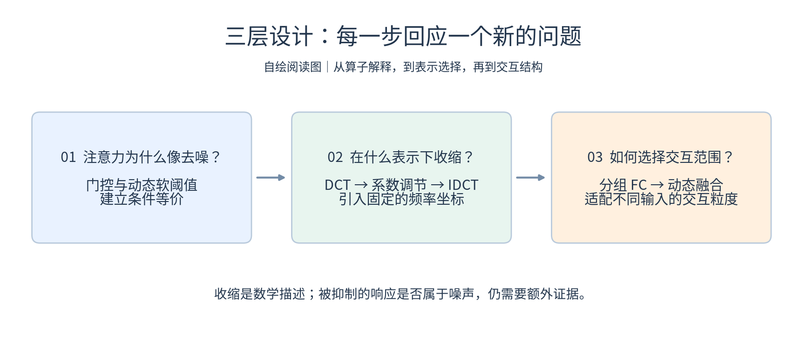
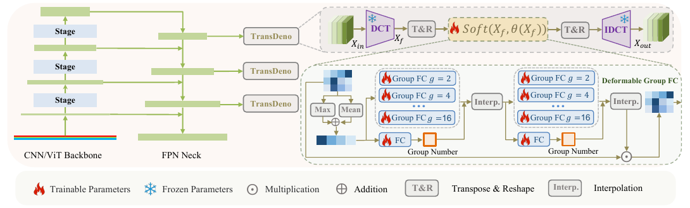
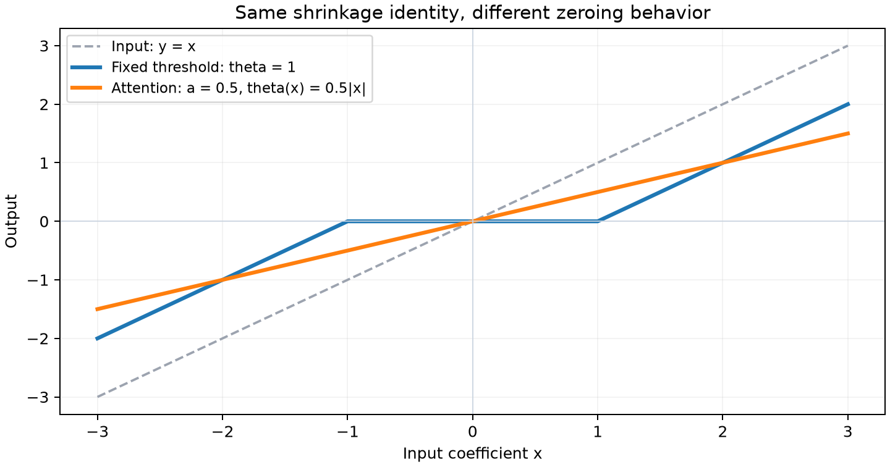
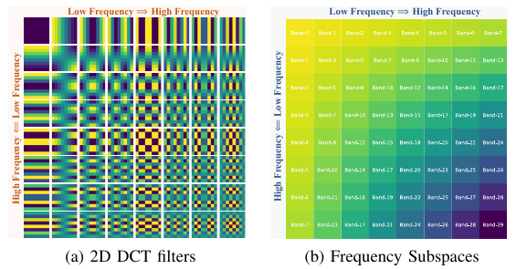
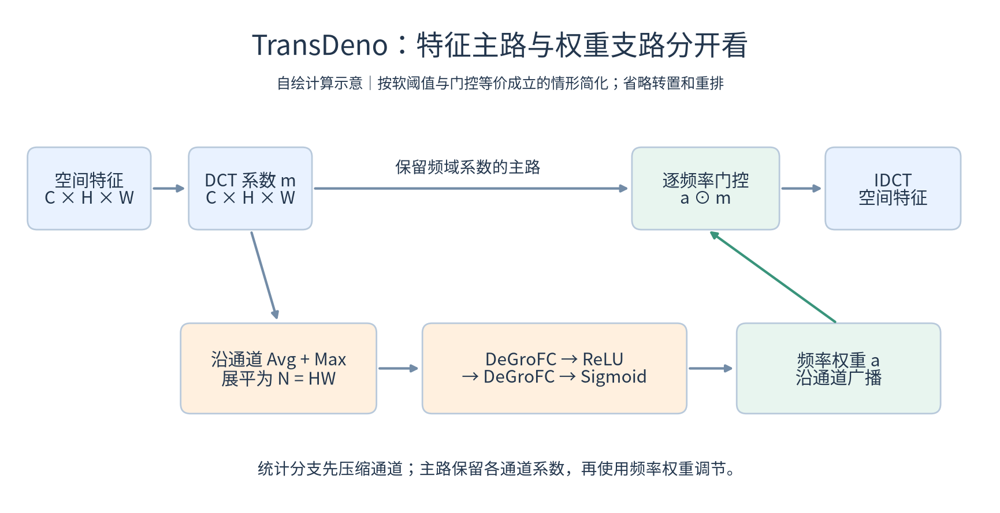
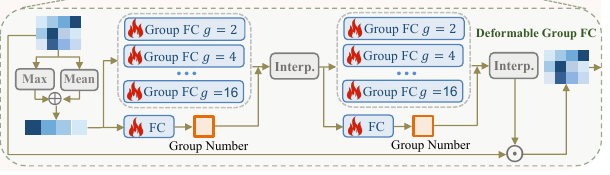
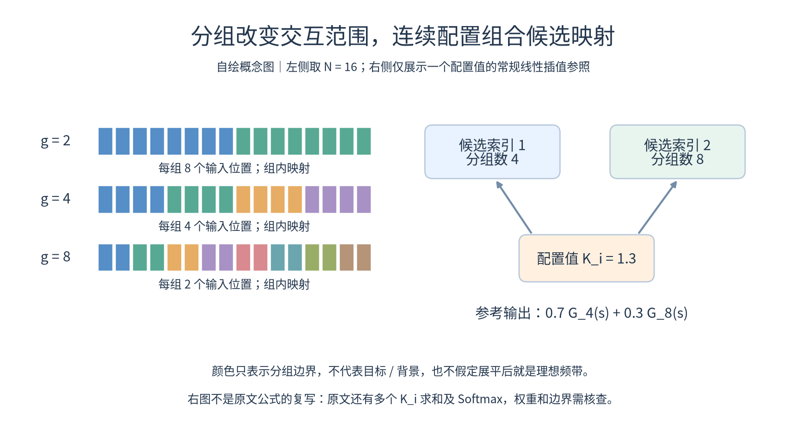

# DenoDet｜从软阈值去噪到动态频域注意力

> **阅读重点：作者如何把传统去噪思想转化为网络模块？**
>
> 三个层次：**用软阈值重新解释注意力 → 在频域组织注意力 → 让频率交互粒度随输入变化。**
>
> 当前判断：最有启发的是从已有算子的数学等价关系出发，借用信号处理中的表示方式设计注意力；最需辨析的是，代数上的“收缩”等价是否足以支持“去噪”的机制解释。

## 阅读信息

| 项目 | 记录 |
|---|---|
| 论文 | DenoDet: Attention as Deformable Multi-Subspace Feature Denoising for Target Detection in SAR Images |
| 作者 | Yimian Dai、Minrui Zou、Yuxuan Li、Xiang Li、Kang Ni、Jian Yang |
| 阅读版本 | arXiv:2406.02833v2，2024-08-10，共 18 页 |
| 原文 / 代码 | [仓库 PDF](../../originals/2024/DenoDet.pdf) · [arXiv](https://arxiv.org/abs/2406.02833v2) · [GrokSAR](https://github.com/GrokCV/GrokSAR) |
| 阅读重点 | §III，PDF 第 5—7 页：软阈值解释、TransDeno 与 DeGroFC |
| 进度 | 方法正文与关键公式已对照；官方代码尚未核查 |

## 1. 先看全貌：三个创新点是什么关系？

*自绘图 A｜先建立收缩解释，再选择频率表示，最后让交互粒度自适应。三个设计分别回答不同的问题。*

**先读这条主线，再看原图：** 软阈值解释为设计提供数学入口；DCT 决定操作所在的表示；DeGroFC 决定权重预测时的交互方式。

*原文 Fig. 3，PDF 第 6 页。左侧是检测网络中的插入位置，右上是特征处理主路，右下是生成注意力的分支。*

**读图顺序：**

1. **左侧：** Backbone 与 FPN 产生多尺度特征，TransDeno 放在 Neck 与检测头之间；它改造的是中间特征。
2. **右上：** DCT → 转置与重排 → 软阈值处理 → 逆重排 → IDCT。DCT/IDCT 是固定变换，学习主要发生在系数如何被调节。
3. **右下：** Max 与 Mean 生成频谱统计，两个 DeGroFC 逐级生成注意力；每级都有分组 FC 候选和配置预测支路。

| 层次 | 要回答的问题 | 论文的回答 |
|---|---|---|
| 算子解释 | 注意力为什么可以和去噪联系？ | 受约束的乘法门控可改写为动态软阈值 |
| 表示选择 | 在什么坐标下调节特征？ | 用 DCT 把空间变化映射到频率位置 |
| 交互结构 | 哪些频率成分共同参与权重预测？ | 分组 FC 限制交互，再用 DeGroFC 自适应融合不同粒度 |

**个人理解：** DenoDet 是检测框架，TransDeno 是核心模块，DeGroFC 是模块中生成权重的算子。它们是逐层包含的关系。

## 2. 创新点一：把注意力改写成动态软阈值

### 作者为什么从软阈值切入？

SAR 去噪面临“抑制干扰可能同时损失细节”的矛盾。作者没有先恢复干净图像，而是把去噪思想移到检测特征中：让任务训练决定哪些响应应收缩。

这个转向的关键是发现：**注意力的乘法门控与软阈值可以在一定条件下写成同一种输出。**（§III-A，公式 (1)—(5)，第 5 页）

### 关键推导：不是一句类比，而是一个条件等价

传统软阈值为：

$$
\operatorname{soft}(x,\theta)=\operatorname{sign}(x)\max(0,|x|-\theta).
$$

乘法注意力为 $y=a(x)x$。当 $0\le a(x)\le1$ 时，定义：

$$
\theta(x)=(1-a(x))|x|.
$$

于是：

$$
\begin{aligned}
\operatorname{soft}(x,\theta(x))
&=\operatorname{sign}(x)\max(0,a(x)|x|)\\
&=a(x)x.
\end{aligned}
$$

这里 x 是某个系数，a(x) 可以由整张特征图的上下文生成。逐元素的输出，并不要求逐元素独立地预测权重。

### 图解：等价于软阈值，不等于固定阈值的行为

*蓝线：固定阈值会把一段小幅输入直接置零。橙线：为便于比较，将注意力固定为 0.5，所有非零输入都缩小一半。实际网络的权重还会随上下文变化。*

例如 $x=-2$、$a=0.25$，则 $\theta=1.5$，输出为 $-0.5=ax$。注意力权重为 0 时完全抑制，为 1 时保持不变。

### 这一步的创新价值在哪里？

**个人理解：** 价值主要是打开设计空间。既然注意力可解释为收缩，就可以借用变换域去噪中的“先变换、再收缩、再重建”流程，而不局限于在空间特征上直接生成门控。

**需要保留的质疑：**

- 这是代数等价，没有证明被压低的系数就是噪声。
- 当 $a>0$ 时，非零输入通常仍非零；它不自动具有固定正阈值的硬性置零区间。
- Sigmoid 权重在有限输入下位于 `(0,1)`，主要表示连续衰减。相对突出有效响应可以通过少衰减实现，不代表直接将其幅值放大到原值以上。

**可迁移的方法论：** 先找熟悉神经算子与经典方法的数学联系，再借用经典方法的结构先验；同时把“表达等价”和“任务机制成立”分开验证。

## 3. 创新点二：TransDeno 把收缩放到频域

### 为什么一定要改变表示？

空间域中的一个位置描述局部响应；DCT 中的一个位置描述整张特征图对某种余弦变化模式的响应。作者希望借助这种固定的频率语义，学习不同频率之间的依赖关系。

*原文 Fig. 4，PDF 第 6 页。左侧是不同频率的二维余弦基，右侧示意频率子空间。它是表示方式的示意，并非证明目标与噪声已被分开。*

**怎样读这张图？** 左上对应低频，整体变化较缓；沿横向或纵向增加频率，变化更密。右下同时包含较高的横、纵频率。不能把每个格子当成一块原图区域：它们代表的是空间变化模式。

### 先分清两条路径：什么被处理，什么生成权重？

*自绘图 B｜上方保留并处理频域特征，下方通过通道统计生成频率权重；绿色箭头表示权重回到主路。此图按门控与软阈值等价成立的情况简化，不代表原文公式 (9) 已无歧义。*

**读图要点：** 池化发生在权重支路，主路没有因此丢弃通道。权重虽由压缩后的统计产生，最终仍用于调节各通道的频域系数。

### 用统一符号拆开计算

为避免原文中变换、重排符号混淆，以下用 𝒲 表示 DCT、ℛ 表示重排、D₁、D₂ 表示两级 DeGroFC。令 $N=HW$，忽略 batch 维：

$$
\begin{aligned}
M&\in\mathbb R^{C\times H\times W},\\
m&=\mathcal W(M)\in\mathbb R^{C\times H\times W},\\
s&=\operatorname{vec}\big(\operatorname{Avg}_c(m)+\operatorname{Max}_c(m)\big)
\in\mathbb R^N,\\
a&=\sigma\big(D_2(\operatorname{ReLU}(D_1(s)))\big).
\end{aligned}
$$

由公式 (8) 的通道池化和图 3 可理解：权重分支先压缩通道信息，再为频率位置生成权重。概念上 a 是长度为 N 的频率门控，在通道维广播；层间隐藏维度需查看实现。

按公式 (5) 的软阈值定义，自洽的主路写成：

$$
\widetilde m=\mathcal R(m),\qquad
\theta=(1-a)\odot|\widetilde m|,\qquad
M'=\mathcal W^{-1}\!\left(\mathcal R^{-1}\!\left[\operatorname{soft}(\widetilde m,\theta)\right]\right).
$$

在等价条件满足时，也可理解为 $M'=\mathcal W^{-1}(a\odot m)$，其中广播与重排按相应维度进行。

**注意：** 上式用绝对值使阈值与公式 (5) 一致，是用于理解的自洽表达；原文公式 (9) 的写法存在差异，见下文。

### 为什么使用 FC，以及为什么分组？

空间位置的语义会随目标平移变化，频率位置却有固定的基函数含义。作者因此认为，固定位置的 FC 更适合学习频率分布模式。

但如果所有频率都任意交互，可能混入不必要的依赖。Group FC 把交互限制在各组内部，提供一种结构先验。

**一个容易忽略的点：** DCT 本身不会创造或删除信息。若正逆变换匹配，中间不改系数，应近似恢复输入。模块的作用来自“在特定表示下学习系数调节”。

### 对“多子空间”的个人理解

- “子空间”主要通过频率特征分组及组内映射实现，不能直接理解为已分离出的目标、背景和噪声三个语义空间。
- 重排只改变数据组织，不自动保证每组对应理想频带。组内究竟包含哪些频率，要看展平顺序、分组轴和实现。
- DCT 基具有全局空间支撑，因此频率调节可能改变空间响应；其作用仍应从变换域系数调节来理解。

**可迁移的方法论：** 先选择让任务规律更容易表达的坐标系，再设计该坐标系中的交互结构。表示变换的价值在于为学习引入合适的组织方式。

## 4. 创新点三：DeGroFC 让交互粒度随输入变化

### 固定 Group FC 留下了什么问题？

少数组意味着每组交互范围大，多数组意味着更细的局部交互。不同场景可能需要不同范围，用一个固定分组数难以兼顾。

*原文 Fig. 3 局部，PDF 第 6 页。每一级既包含多个 Group FC 候选，也包含预测分组配置的 FC 支路，再通过插值组合输出。*

### 它如何实现“动态”？

论文 §III-C（第 7 页）设置四个候选分组数：

$$
[g_0,g_1,g_2,g_3]=[2,4,8,16].
$$

对长度为 N 的向量，如果采用等长分组，则每组输入长度为 $N/g_j$；实际如何保证整除和适配尺寸需查实现。

作者用一个 $N\to k$ 的 FC 预测 k 个配置值 $K_i$，其中 $k=4$，文中理想范围为 $[0,k-1]$。对每个 $K_i$，取相邻索引对应的分组 FC 输出，再融合。

公式 (12)—(14) 描述了 k 个 $K_i$ 及对 i 的求和，因此需要区分单个配置的相邻候选融合与多个配置的聚合。配置值如何限制到有效范围，正文没有给出完整表达。

### 先看分组，再理解连续配置

*自绘图 C｜左边以 16 个输入位置说明不同分组数如何限制交互范围；右边用单个配置值示意相邻候选的常规插值。颜色不是语义标签，右侧也没有复写原文完整融合公式。*

**读图要点：** “选择分组配置”与“给每个频率分配权重”是两个层次。前者改变生成权重的映射如何组织，后者才直接调节主路系数。

### 用一个例子理解连续配置

假设某个 $K_i=1.3$，它位于候选索引 1 和 2 之间，对应的实际分组数是 **4 和 8**。

以常规线性插值作理解参照，应为：

$$
z_i=0.7G_{4}(s)+0.3G_{8}(s).
$$

这只是解释连续配置的参考式，**不是原文公式 (14) 的逐字重写**。原文的偏移命名、权重方向和 Softmax 另有问题，下一节具体分析。

### “可变形”到底变了什么？

| 算子 | 输入相关地改变什么？ |
|---|---|
| 可变形卷积 | 空间采样位置 |
| DeGroFC | 候选分组映射的组合，进而改变交互粒度 |

它没有创建“5.2 个分组”，也没有直接改变空间采样坐标。推理时参数仍然固定，动态的是由输入产生的配置和融合结果。

### 两级结构有什么意义？

原文用两级 DeGroFC，配合 ReLU 与最终 Sigmoid。作者将其解释为先粗调、再细化注意力。

**个人理解：** 它是具有输入相关分组结构的 MLP。两级允许第一轮交互产生的表示继续参与下一轮权重生成；“粗到细”是作者的机制解释，不能仅凭串联结构就确定成立。

**可迁移的方法论：** 当离散结构难以直接学习时，可以预设候选算子，再通过连续配置和融合实现输入自适应。代价是必须明确索引映射、边界、归一化与容量变化。

## 5. 数学质疑：哪些地方值得追到代码？

### 疑点一：公式 (9) 缺少绝对值，会改变负系数的行为

第 5 页公式 (5) 使用 $\theta=(1-a)\lvert x\rvert$；第 6 页公式 (9) 的阈值末项写为 m̃，没有绝对值。

这不是纯粹的排版偏好。DCT 系数允许为负。令 $x=-2$、$a=0.25$：

| 阈值写法 | 阈值 | 按公式 (1) 计算的输出 |
|---|---:|---:|
| $(1-a)\lvert x\rvert$ | 1.5 | −0.5 |
| $(1-a)x$ | −1.5 | −3.5 |

后一种会放大负系数，无法保持前面的收缩等价。

**当前结论：** 论文两处书面表达不一致，并可构造反例。尚不能判断代码是否照公式 (9) 执行；需要检查实现是直接乘法门控、取绝对值后软阈值，还是其他处理。

### 疑点二：插值权重的方向与整数位置

原文公式 (13) 定义：

$$
O_i^p=K_i-\lfloor K_i\rfloor,\qquad
O_i^q=\lceil K_i\rceil-K_i.
$$

公式 (14) 则将 $O_i^p$ 乘在下邻居、$O_i^q$ 乘在上邻居，并对 i 求和。直接看未经过 Softmax 的式子：

- 当 $K_i=1.3$ 时，下邻居权重为 0.3，上邻居为 0.7，与通常的线性插值方向相反。
- 当 $K_i$ 为整数时，两偏移同时为 0，该项原样计算会变成零。
- 文字说偏移会经过 Softmax，但公式没有写入。如果对这两个零做二元 Softmax，会得到各 0.5；由于两个邻居此时相同，行为又会不同。

**当前结论：** 书面表达没有完整定义融合过程，不能把它直接当作无歧义的标准插值。需核查 Softmax 的轴、上下邻居的权重对应和整数附近的连续性。

此外，$G_{\lfloor K_i\rfloor}$ 中的索引 0、1、2、3 应如何映射到实际分组数 2、4、8、16，也需要实现说明，不能直接把索引当成分组数。

### 疑点三：DCT 与 IDCT 是否真是互逆？

公式 (6) 和 (11) 均展示余弦求和，但未明确配套的归一化系数。按书面式直接计算，不能普遍保证原文公式 (2) 所要求的 $\mathcal W^{-1}\mathcal W=I$。

**当前结论：** 正逆变换的尺度约定需要补全。检查时应对随机张量做正逆变换往返误差测试，并核对库函数的 DCT 类型和归一化选项；代码可能已正确处理。

### 另一类问题：公式成立，是否就解决了目标问题？

即使上述实现都自洽，仍需要回答：

- 通道平均值与最大值是否足以区分弱目标响应和强杂波？
- 分组为何对应有用的频率交互，而不是人为限制？
- 自适应融合的收益是否来自输入依赖，还是来自更多分支和参数？

这些属于设计有效性与机制归因问题，不能只靠修正公式解决。

## 6. 我真正想从这篇论文带走什么？

### 方法设计的推进过程

**观察矛盾：** 去噪与保留目标细节存在冲突。

**重新定义操作对象：** 从原图去噪转到任务特征的选择。

**建立数学桥梁：** 把乘法注意力写成动态软阈值，为借用传统去噪结构提供入口。

**改变表示：** 引入具有固定频率语义的 DCT 坐标。

**加入结构先验：** 通过分组限制频率交互。

**再处理先验的僵硬性：** 用输入驱动的配置融合不同分组粒度。

这条路径比单纯记住模块名称更值得复用：**每增加一层设计，都应指出前一层尚未解决的具体困难。**

### 这篇论文带来的方法论启发

| 启发 | 在本文中的体现 | 阅读时应继续追问什么？ |
|---|---|---|
| 用数学联系打开设计空间 | 从乘法注意力与软阈值的条件等价出发，引入变换域去噪流程 | 等价成立需要哪些条件？它是否解释了实际机制？ |
| 表示方式与交互结构需要一起设计 | DCT 提供频率坐标，分组 FC 约束频率间的信息交互 | 这种分组是否符合表示中的规律？是否存在过强约束？ |
| 将固定结构改为输入相关的选择 | DeGroFC 融合不同分组粒度的候选映射 | 动态选择的必要性是什么？简单的固定融合是否足够？ |
| 对每一层设计说明必要性 | 从特征收缩到频域处理，再到动态分组，逐层回应新的困难 | 每一层是否解决了上一层的具体不足？ |
| 区分数学解释与机制证据 | 收缩等价提供设计依据，但不能直接证明噪声分离 | 作者的解释中，哪些是已推导的，哪些仍是待验证的假设？ |

**阅读收获：** 这篇论文展示了如何从经典信号处理方法中提取结构先验，再把它转化为可学习的网络模块。值得借鉴的是问题重述、数学联系、表示选择与结构自适应之间的设计逻辑，同时需要保持对公式条件和机制解释的审查。

## 7. 回看索引与下一步

| 回看内容 | 原文位置 |
|---|---|
| 注意力到软阈值的推导 | §III-A，第 5 页，公式 (1)—(5) |
| TransDeno 总体结构 | Fig. 3，第 6 页；§III-B，第 5—7 页 |
| DCT 表示与频率子空间 | Fig. 4，第 6 页，公式 (6)—(11) |
| 动态配置与分组融合 | §III-C，第 7 页，公式 (12)—(14) |

- [ ] 核查官方实现中阈值、负系数与乘法门控的对应关系。
- [ ] 核查 $K_i$ 的范围约束、候选映射、Softmax 和整数边界。
- [ ] 核查频率展平顺序、分组轴、不同 FPN 尺寸适配和正逆变换归一化。
